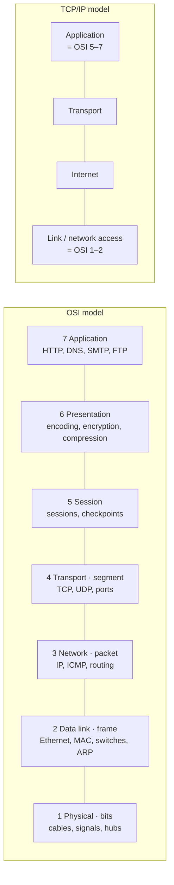
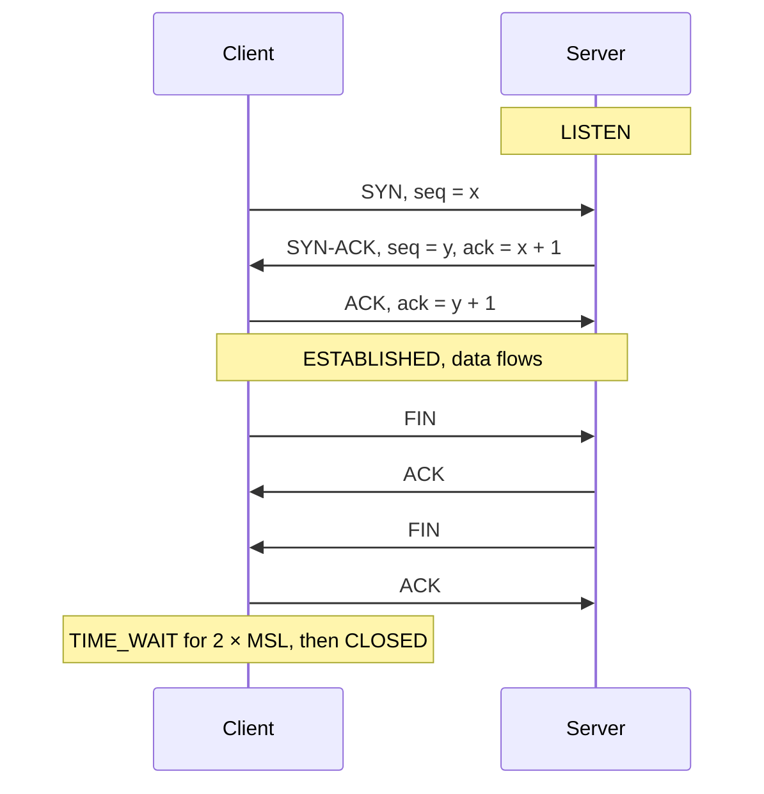
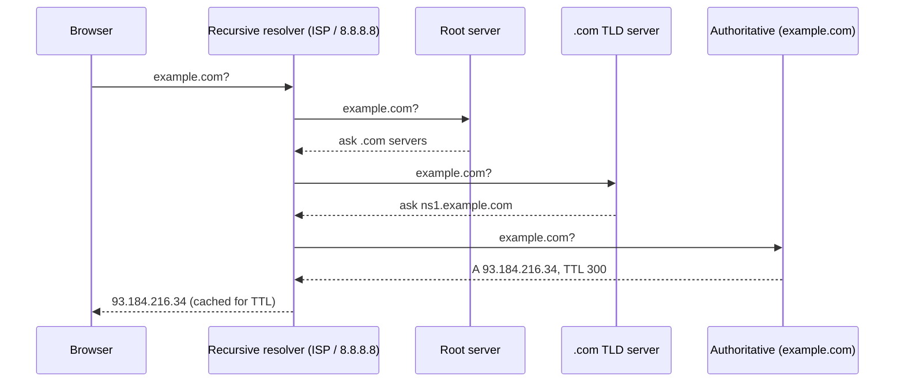
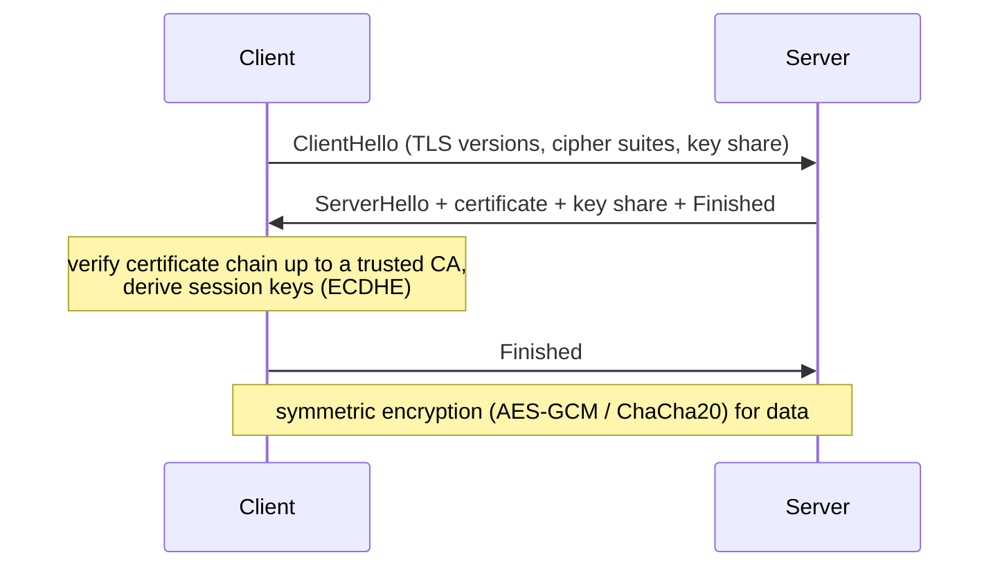
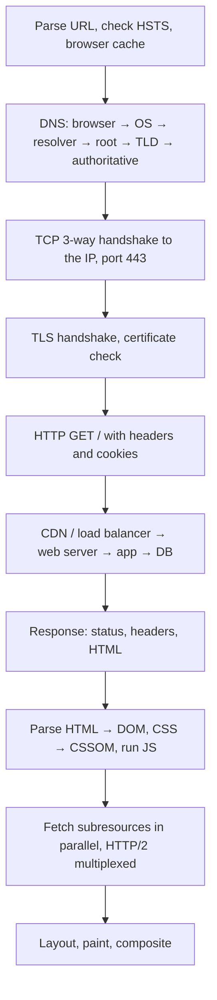

<!-- tab: Notes -->

## Layers: OSI vs TCP/IP



Devices by layer: **hub** (L1, repeats bits), **switch** (L2, forwards frames by MAC), **router** (L3, forwards packets by IP), **L4/L7 load balancers** and **gateways/proxies** (L7). Encapsulation: each layer adds its header going down; the receiver strips them going up.

## TCP vs UDP

| | TCP | UDP |
|---|---|---|
| Connection | Connection-oriented (handshake) | Connectionless |
| Reliability | Acks, retransmission, ordering, checksums | Checksum only; may lose, duplicate or reorder |
| Flow / congestion control | Yes (window, slow start) | No |
| Header | 20–60 bytes | 8 bytes |
| Use | Web, email, file transfer, SSH | DNS, video calls, gaming, streaming, QUIC (HTTP/3 runs on UDP) |

### Three-way handshake and teardown



Why three steps: both sides must learn and acknowledge each other's initial sequence number. Why `TIME_WAIT`: so a lost final ACK can be resent and old duplicate segments die out before the port is reused.

### Reliability and control
- **Sequence numbers and ACKs** (cumulative), retransmission on timeout or **3 duplicate ACKs** (fast retransmit).
- **Flow control**: the receiver advertises a **window** (rwnd) so a fast sender doesn't overflow it.
- **Congestion control**: congestion window (cwnd). **Slow start** doubles cwnd each RTT until a threshold, then **congestion avoidance** grows it by 1 MSS per RTT (AIMD); on loss, cut it (Reno halves; Tahoe resets to 1). Sending rate ≈ min(rwnd, cwnd) / RTT.
- **Nagle's algorithm** batches small writes; disable with `TCP_NODELAY` for latency-sensitive apps.
- Sliding window protocols: **Stop-and-wait**, **Go-Back-N** (resend everything after a loss), **Selective Repeat** (resend only lost frames).

## IP addressing and subnetting

IPv4 is 32 bits; IPv6 is 128 bits. **CIDR** `/n` = n network bits. Private ranges: `10.0.0.0/8`, `172.16.0.0/12`, `192.168.0.0/16`. Loopback `127.0.0.1`. **NAT** maps many private addresses to one public one.

```widget subnet
```

Usable hosts = 2^(32 − n) − 2 (network and broadcast addresses excluded). `/24` → 254 hosts, `/26` → 62, `/30` → 2 (point-to-point links).

Old classful ranges (still asked in MCQs): A `1–126` (/8), B `128–191` (/16), C `192–223` (/24), D `224–239` multicast, E `240–255` reserved.

### Key protocols around IP
- **ARP**: IP → MAC on a local network (broadcast "who has 192.168.1.5?").
- **DHCP**: assigns IP addresses (Discover → Offer → Request → Ack, "DORA"), UDP ports 67/68.
- **ICMP**: errors and diagnostics (`ping`, `traceroute` uses TTL expiry).
- **Routing**: distance vector (RIP, Bellman-Ford, hop count), link state (OSPF, Dijkstra), path vector between ISPs (BGP).

## DNS



Record types: **A** (IPv4), **AAAA** (IPv6), **CNAME** (alias), **MX** (mail), **NS** (name servers), **TXT** (verification, SPF), **PTR** (reverse). DNS uses **UDP port 53** for queries (TCP for large responses and zone transfers). Caching happens in the browser, OS, resolver.

## HTTP

| Version | Key change |
|---|---|
| HTTP/1.0 | New TCP connection per request |
| HTTP/1.1 | Persistent connections (keep-alive), pipelining (rarely used), Host header; **head-of-line blocking** per connection |
| HTTP/2 | Binary framing, **multiplexed streams** on one TCP connection, header compression (HPACK), server push (deprecated) |
| HTTP/3 | Runs on **QUIC over UDP**: no TCP head-of-line blocking, faster handshake (0-RTT/1-RTT), connection migration |

Methods: GET (safe, idempotent), HEAD, POST (not idempotent), PUT (idempotent replace), PATCH, DELETE (idempotent), OPTIONS (CORS preflight).

Status codes: 1xx info, **2xx** success (200, 201 Created, 204 No Content), **3xx** redirect (301, 302, 304 Not Modified), **4xx** client (400, 401, 403, 404, 409, 429), **5xx** server (500, 502 Bad Gateway, 503, 504 Gateway Timeout).

Cookies vs sessions vs tokens: cookies store data in the browser and are sent automatically; server sessions store state server-side keyed by a cookie; JWTs carry signed claims and are stateless.

**CORS**: browsers block cross-origin reads unless the server sends `Access-Control-Allow-Origin`; non-simple requests trigger an `OPTIONS` preflight.

## HTTPS and TLS



TLS 1.3 needs **1 round trip** (0-RTT on resumption). Asymmetric crypto (ECDHE, RSA/ECDSA signatures) authenticates and agrees on keys; **symmetric** crypto encrypts the bulk data because it's much faster. **Forward secrecy**: ephemeral keys mean a stolen server key can't decrypt past sessions.

## What happens when you type a URL and press Enter



> [!SAY]
> Walk this top to bottom and name one detail per step (cache layers in DNS, why TLS needs a certificate, what the load balancer does). Interviewers stop you at the depth they want.

## Ports to remember

| Port | Service | Port | Service |
|---|---|---|---|
| 20/21 | FTP data/control | 110 | POP3 |
| 22 | SSH | 143 | IMAP |
| 23 | Telnet | 443 | HTTPS |
| 25 | SMTP | 3306 | MySQL |
| 53 | DNS | 5432 | PostgreSQL |
| 67/68 | DHCP | 6379 | Redis |
| 80 | HTTP | 27017 | MongoDB |

## Sockets
Server: `socket() → bind() → listen() → accept() → recv/send → close()`. Client: `socket() → connect() → send/recv → close()`. A TCP connection is identified by the 4-tuple (source IP, source port, destination IP, destination port).

<!-- tab: Interview Q&A -->

### Q: Why does DNS use UDP?
Queries and answers are small and one round trip; UDP avoids the TCP handshake. It falls back to TCP when responses exceed the UDP size limit and for zone transfers.

### Q: How does TCP guarantee reliable, ordered delivery?
Sequence numbers order bytes, acknowledgements confirm receipt, timeouts and duplicate ACKs trigger retransmission, checksums detect corruption, and the receiver buffers out-of-order segments until gaps fill.

### Q: Difference between flow control and congestion control?
Flow control protects the **receiver** (advertised window). Congestion control protects the **network** (congestion window, slow start, AIMD), inferring congestion from loss or delay.

### Q: What is head-of-line blocking, and how do HTTP/2 and HTTP/3 address it?
In HTTP/1.1 a slow response blocks later ones on the same connection. HTTP/2 multiplexes streams, fixing it at the HTTP layer, but one lost TCP packet still stalls all streams. HTTP/3 uses QUIC over UDP where streams are independent, so a loss only stalls its own stream.

### Q: Switch vs router vs hub?
Hub repeats bits to every port (one collision domain). Switch learns MAC addresses and forwards frames only to the right port (L2). Router connects different networks and forwards packets by IP using routing tables (L3).

### Q: What's the difference between HTTP and HTTPS?
HTTPS is HTTP over TLS: the server proves its identity with a certificate, and traffic is encrypted and integrity-protected. Port 443 instead of 80.

### Q: What is a 502 vs 504?
Both come from a proxy or gateway. 502 Bad Gateway: the upstream returned an invalid response (or refused the connection). 504 Gateway Timeout: the upstream didn't respond in time.

### Q: Explain ARP spoofing in one line.
An attacker answers ARP requests with its own MAC for another host's IP, so traffic flows through the attacker (man in the middle).

<!-- tab: MCQs -->

```quiz
Q: Which layer of OSI is responsible for routing?
- Data link
* Network
- Transport
- Session
> IP addresses and routers live at layer 3.

Q: A switch operates mainly at…
- Physical layer
* Data link layer
- Network layer
- Transport layer
> It forwards frames using MAC addresses.

Q: Number of usable hosts in a /27 subnet?
- 32
* 30
- 62
- 14
> 2^5 − 2 = 30.

Q: Which protocol maps an IP address to a MAC address?
- RARP only
- DNS
* ARP
- DHCP
> Address Resolution Protocol.

Q: TCP's three-way handshake sequence is…
- SYN, ACK, FIN
* SYN, SYN-ACK, ACK
- SYN, ACK, SYN-ACK
- ACK, SYN, SYN-ACK
> Both sides exchange and acknowledge initial sequence numbers.

Q: Default port for HTTPS?
- 80
- 8080
* 443
- 22
> 80 is HTTP.

Q: DNS queries normally use…
* UDP port 53
- TCP port 80
- UDP port 67
- TCP port 25
> TCP 53 is used for large responses and zone transfers.

Q: Which is NOT a feature of UDP?
- Connectionless
- Low overhead
* Guaranteed ordered delivery
- Supports broadcast
> Ordering and reliability are TCP features.

Q: In TCP slow start, cwnd grows…
* Exponentially per RTT until ssthresh
- Linearly from the start
- Only after loss
- Randomly
> Then congestion avoidance grows it linearly.

Q: Which HTTP method is idempotent?
- POST
* PUT
- PATCH (always)
- None
> Repeating a PUT leaves the same state; PATCH may or may not be.

Q: HTTP/3 runs on…
- TCP with TLS 1.2
* QUIC over UDP
- SCTP
- Raw IP
> QUIC gives independent streams and faster handshakes.

Q: 192.168.1.100 belongs to…
- A public class A range
* A private class C range
- Multicast
- Loopback
> 192.168.0.0/16 is private.

Q: Which routing protocol uses Dijkstra's algorithm?
- RIP
* OSPF
- BGP
- ARP
> OSPF is link state; RIP is distance vector.

Q: Status code for "resource created"?
- 200
* 201
- 204
- 302
> 201 Created, often with a Location header.

Q: DHCP's message sequence is…
- Request, Offer, Discover, Ack
* Discover, Offer, Request, Ack
- Offer, Discover, Ack, Request
- Discover, Request, Offer, Ack
> DORA.

Q: TIME_WAIT is entered by…
* The side that sends the first FIN (active closer)
- The server always
- Both sides always
- Neither; it's for SYN
> It waits 2×MSL to handle a lost final ACK and stray segments.

Q: Go-Back-N on a single lost frame retransmits…
- Only that frame
* That frame and all frames sent after it
- Nothing
- The whole window from the start of the session
> Selective Repeat would resend only the lost frame.

Q: Which device separates broadcast domains?
- Hub
- Switch
* Router
- Repeater
> Routers don't forward layer-2 broadcasts.
```
