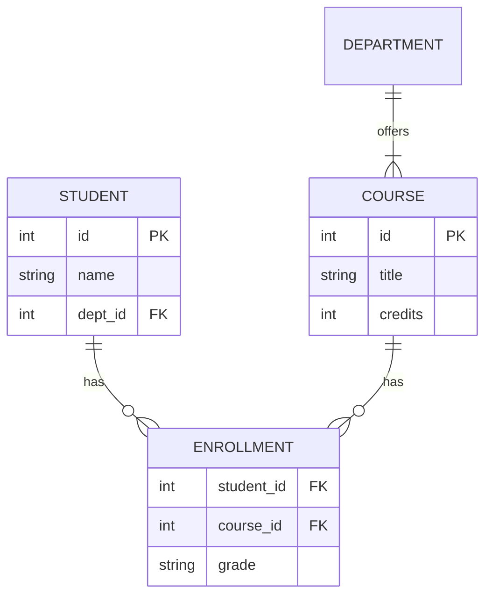
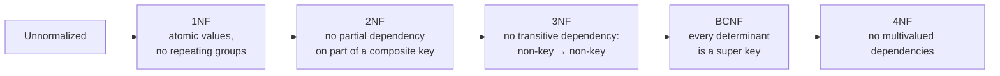
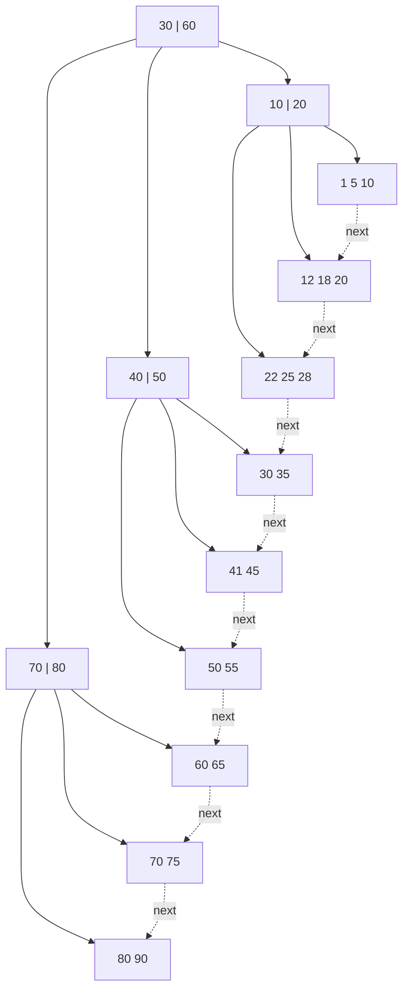

<!-- tab: Modelling & normalization -->

## Keys
- **Super key**: any set of attributes that uniquely identifies a row.
- **Candidate key**: minimal super key. **Primary key**: the chosen candidate key (not null). **Alternate keys**: the other candidates.
- **Foreign key**: references a primary key in another table (referential integrity).
- **Composite key**: key with more than one column. **Surrogate key**: synthetic ID.

## ER model → tables



Mapping rules: entity → table; 1:N → foreign key on the N side; M:N → a junction table with both keys; weak entity → composite key including the owner's key; multivalued attribute → separate table.

## Functional dependencies and normal forms

X → Y: rows that agree on X agree on Y. **Closure** X⁺ = everything X determines; X is a key if X⁺ = all attributes.



Worked example: `Enrollment(student_id, course_id, student_name, course_title, instructor, instructor_phone)` with key (student_id, course_id).
- `student_id → student_name` is **partial** (2NF violation) → move to `Student`.
- `course_id → course_title, instructor` is partial → move to `Course`.
- `instructor → instructor_phone` is **transitive** (3NF violation) → move to `Instructor`.

3NF vs BCNF: 3NF allows X → A if A is a prime attribute (part of some key); BCNF doesn't. 3NF decomposition is always **lossless and dependency-preserving**; BCNF is lossless but may lose dependencies.

**Anomalies** that normalization removes: insertion (can't add a course without a student), update (change a phone in many rows), deletion (deleting the last student loses the course).

**Denormalization** deliberately duplicates data for read performance (reporting, NoSQL); you pay in write complexity.

<!-- tab: SQL -->

## Query order

Written: `SELECT … FROM … JOIN … WHERE … GROUP BY … HAVING … ORDER BY … LIMIT`
Executed: **FROM/JOIN → WHERE → GROUP BY → HAVING → SELECT → DISTINCT → ORDER BY → LIMIT**. That's why a `SELECT` alias can't be used in `WHERE` but can in `ORDER BY`.

## Joins

| Join | Returns |
|---|---|
| INNER | Rows matching in both |
| LEFT (OUTER) | All left rows; NULLs where no right match |
| RIGHT | All right rows |
| FULL OUTER | All rows from both |
| CROSS | Cartesian product (m × n rows) |
| SELF | A table joined with itself (employee–manager) |

## Patterns interviewers love

```sql
-- 2nd highest salary (NULL if none)
SELECT MAX(salary) FROM employees WHERE salary < (SELECT MAX(salary) FROM employees);

-- Nth highest with a window function (ties share a rank)
SELECT DISTINCT salary FROM (
  SELECT salary, DENSE_RANK() OVER (ORDER BY salary DESC) AS r FROM employees
) t WHERE r = 3;

-- Highest paid per department
SELECT dept_id, name, salary FROM (
  SELECT *, RANK() OVER (PARTITION BY dept_id ORDER BY salary DESC) AS r FROM employees
) t WHERE r = 1;

-- Employees earning more than their manager (self join)
SELECT e.name FROM employees e JOIN employees m ON e.manager_id = m.id WHERE e.salary > m.salary;

-- Duplicate emails
SELECT email, COUNT(*) FROM users GROUP BY email HAVING COUNT(*) > 1;

-- Customers who never ordered
SELECT c.name FROM customers c LEFT JOIN orders o ON o.customer_id = c.id WHERE o.id IS NULL;

-- Running total
SELECT order_date, amount, SUM(amount) OVER (ORDER BY order_date) AS running FROM orders;
```

`ROW_NUMBER` (1,2,3,4) vs `RANK` (1,2,2,4) vs `DENSE_RANK` (1,2,2,3).

`WHERE` filters rows before grouping; `HAVING` filters groups. `COUNT(*)` counts rows; `COUNT(col)` skips NULLs. `NULL = NULL` is unknown — use `IS NULL`. `UNION` removes duplicates; `UNION ALL` doesn't (faster). `DELETE` (row by row, can rollback, WHERE), `TRUNCATE` (all rows, fast, resets), `DROP` (removes the table).

Command families: **DDL** (CREATE, ALTER, DROP, TRUNCATE), **DML** (SELECT, INSERT, UPDATE, DELETE), **DCL** (GRANT, REVOKE), **TCL** (COMMIT, ROLLBACK, SAVEPOINT).

<!-- tab: Transactions & indexing -->

## ACID
- **Atomicity**: all or nothing (undo log).
- **Consistency**: constraints hold before and after.
- **Isolation**: concurrent transactions behave as if serial (to the chosen level).
- **Durability**: committed data survives crashes (write-ahead log, fsync).

## Isolation levels and anomalies

| Level | Dirty read | Non-repeatable read | Phantom read |
|---|---|---|---|
| Read uncommitted | possible | possible | possible |
| Read committed (Postgres default) | — | possible | possible |
| Repeatable read (MySQL InnoDB default) | — | — | possible (InnoDB mostly prevents with gap locks) |
| Serializable | — | — | — |

- **Dirty read**: reading another transaction's uncommitted change.
- **Non-repeatable read**: same row read twice gives different values.
- **Phantom**: same query returns new rows.
- **Lost update**: two read-modify-writes overwrite each other — fix with `SELECT … FOR UPDATE`, atomic `UPDATE x = x + 1`, or optimistic version checks.

## Concurrency control
- **Two-phase locking (2PL)**: growing phase (acquire), shrinking phase (release); guarantees conflict serializability. **Strict 2PL** holds write locks until commit (avoids cascading aborts).
- Shared (read) vs exclusive (write) locks.
- **MVCC**: readers see a snapshot; writers create new versions — readers don't block writers (Postgres, InnoDB).
- **Optimistic** (check version at commit) vs **pessimistic** (lock first).
- **Serializability**: a schedule is conflict serializable if its precedence graph has no cycle.

## Recovery
**Write-ahead logging**: log the change before the data page. On crash: **redo** committed transactions, **undo** uncommitted ones (ARIES). **Checkpoints** limit how much log to replay.

## Indexing



- **B+ tree**: balanced, high fan-out (hundreds of keys per node), so 3–4 levels index billions of rows; leaves linked for range queries. Default in most RDBMS.
- **Hash index**: O(1) equality, no ranges.
- **Clustered index**: table rows stored in index order (one per table; InnoDB primary key). **Non-clustered/secondary**: separate structure pointing to rows.
- **Composite index** `(a, b, c)` serves queries on `a`, `a,b`, `a,b,c` (**leftmost prefix**), not `b` alone.
- **Covering index**: contains all columns the query needs, so no table lookup.
- Costs: slower writes, more storage. Don't index low-cardinality columns alone. Check with `EXPLAIN`.

## SQL vs NoSQL

| | SQL | NoSQL |
|---|---|---|
| Schema | Fixed, relational | Flexible (document, key-value, wide-column, graph) |
| Transactions | ACID across tables | Often per document/key; BASE |
| Scaling | Vertical + read replicas; sharding is manual | Built for horizontal scaling |
| Use | Payments, inventory, relationships | Huge scale, flexible data, high write rates |

<!-- tab: Interview Q&A -->

### Q: Explain normalization up to BCNF with an example.
1NF: atomic values. 2NF: no non-key attribute depends on part of a composite key. 3NF: no non-key attribute depends on another non-key attribute. BCNF: every determinant is a super key. Use the enrollment example: split student, course and instructor details into their own tables.

### Q: What's the difference between clustered and non-clustered indexes?
Clustered: the table data itself is ordered by the index key; one per table. Non-clustered: a separate structure storing key + pointer (or primary key) to the row; many allowed; may need an extra lookup.

### Q: Why B+ trees instead of binary search trees for indexes?
Disk/page-oriented: each node fills a page with hundreds of keys, so the tree is shallow (few disk reads). Linked leaves make range scans sequential.

### Q: What isolation level prevents lost updates?
Lost updates can still happen at Read Committed with read-then-write logic. Use `SELECT … FOR UPDATE`, atomic updates, optimistic version checks, or Serializable (Postgres Repeatable Read also detects them).

### Q: When would you denormalize?
Read-heavy paths where joins are too expensive (feeds, reporting, NoSQL access patterns). Accept duplicated data and keep it in sync with events or triggers.

### Q: DELETE vs TRUNCATE vs DROP?
DELETE removes chosen rows, logged per row, fires triggers, can roll back. TRUNCATE removes all rows quickly, resets identity, minimal logging. DROP removes the table and its schema.

<!-- tab: MCQs -->

```quiz
Q: A relation is in 2NF if it is in 1NF and…
* Has no partial dependency of a non-prime attribute on a candidate key
- Has no transitive dependency
- Every determinant is a super key
- Has no multivalued dependency
> Partial = depends on part of a composite key.

Q: Which normal form requires every determinant to be a candidate (super) key?
- 2NF
- 3NF
* BCNF
- 4NF
> Stricter than 3NF.

Q: Which clause filters groups after aggregation?
- WHERE
* HAVING
- ORDER BY
- GROUP BY
> WHERE filters rows before grouping.

Q: The isolation level that prevents dirty reads but allows non-repeatable reads is…
- Read uncommitted
* Read committed
- Repeatable read
- Serializable
> Postgres's default.

Q: The "D" in ACID is ensured mainly by…
- Locks
* Write-ahead logging
- Indexes
- Views
> Committed changes are on durable storage.

Q: A composite index on (a, b) can be used efficiently for a query filtering on…
* a only
- b only
- neither
- only both together
> Leftmost-prefix rule.

Q: DENSE_RANK on salaries 100, 90, 90, 80 gives…
- 1, 2, 3, 4
- 1, 2, 2, 4
* 1, 2, 2, 3
- 1, 1, 2, 3
> No gaps after ties.

Q: Which command is DDL?
- INSERT
- UPDATE
* TRUNCATE
- GRANT
> GRANT is DCL.

Q: A schedule is conflict serializable if its precedence graph…
- Has a cycle
* Is acyclic
- Is complete
- Has exactly one node
> No cycle → an equivalent serial order exists.

Q: Two-phase locking guarantees…
* Conflict serializability
- Deadlock freedom
- No starvation
- Faster reads
> 2PL can still deadlock.

Q: How many rows does a CROSS JOIN of 5 rows and 4 rows return?
- 9
* 20
- 5
- 4
> Cartesian product.

Q: A foreign key enforces…
- Uniqueness
* Referential integrity
- Atomicity
- Indexing
> Values must exist in the referenced table.

Q: In a B+ tree, actual data pointers are stored in…
- Root only
- Internal nodes only
* Leaf nodes
- Every node
> Internal nodes only route.

Q: Which is TRUE about MVCC?
* Readers don't block writers
- It uses no extra storage
- It forbids concurrent transactions
- It's only for NoSQL
> Readers see a snapshot of committed versions.

Q: COUNT(column) differs from COUNT(*) because it…
- Counts duplicates once
* Ignores NULLs in that column
- Is faster always
- Requires GROUP BY
> COUNT(*) counts all rows.
```
