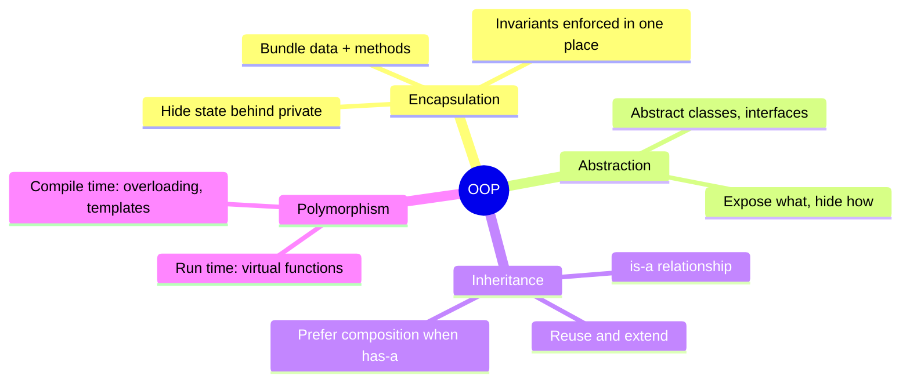
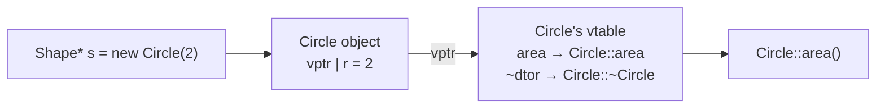

<!-- tab: OOP pillars -->

## The four pillars



```cpp
class Account {                       // encapsulation: balance can only change through methods
    long long balance = 0;
public:
    void deposit(long long amt) { if (amt <= 0) throw std::invalid_argument("amt"); balance += amt; }
    long long get() const { return balance; }
};

struct Shape {                        // abstraction: interface only
    virtual double area() const = 0;  // pure virtual → abstract class
    virtual ~Shape() = default;       // virtual destructor for safe delete through base pointer
};
struct Circle : Shape {               // inheritance
    double r; explicit Circle(double r) : r(r) {}
    double area() const override { return 3.14159 * r * r; }   // runtime polymorphism
};
```

## Polymorphism in C++

| Compile-time (static) | Run-time (dynamic) |
|---|---|
| Function overloading, operator overloading, templates | Virtual functions through base pointer/reference |
| Resolved by the compiler | Resolved via vtable at runtime |
| No overhead | One indirect call per virtual call |

### How virtual functions work



Each class with virtual functions has a **vtable** (array of function pointers); each object has a hidden **vptr** to its class's vtable. `s->area()` loads the vptr, indexes the table, calls. Constructors can't be virtual; calling a virtual function in a constructor calls the current class's version.

## Access specifiers and inheritance modes

| Base member | public inheritance | protected inheritance | private inheritance |
|---|---|---|---|
| public | public | protected | private |
| protected | protected | protected | private |
| private | not accessible | not accessible | not accessible |

`struct` defaults to public members and public inheritance; `class` defaults to private.

**Types of inheritance**: single, multiple, multilevel, hierarchical, hybrid. **Diamond problem**: `D : B, C` where both derive from `A` → two `A` copies; fix with `virtual` inheritance (`class B : virtual public A`).

## Overloading vs overriding

| Overloading | Overriding |
|---|---|
| Same name, different parameters | Same signature in derived class |
| Same scope | Base/derived; base must be `virtual` |
| Compile time | Run time |

Hiding: a derived function with the same name but different parameters hides all base overloads (bring them back with `using Base::f;`).

<!-- tab: C++ object model -->

## Constructors and the rule of 3/5/0

```cpp
class Buffer {
    size_t n; int* data;
public:
    explicit Buffer(size_t n) : n(n), data(new int[n]{}) {}           // constructor
    ~Buffer() { delete[] data; }                                         // 1. destructor
    Buffer(const Buffer& o) : n(o.n), data(new int[o.n]) {               // 2. copy constructor (deep copy)
        std::copy(o.data, o.data + n, data); }
    Buffer& operator=(Buffer o) { swap(o); return *this; }               // 3. copy assignment (copy-and-swap)
    Buffer(Buffer&& o) noexcept : n(o.n), data(o.data) { o.data = nullptr; o.n = 0; }   // 4. move constructor
    // 5. move assignment is covered by the by-value operator= above
    void swap(Buffer& o) noexcept { std::swap(n, o.n); std::swap(data, o.data); }
};
```

- **Rule of 3**: if you need a custom destructor, copy constructor or copy assignment, you probably need all three. **Rule of 5** adds move constructor and move assignment. **Rule of 0**: use RAII members (`std::vector`, `std::unique_ptr`) and write none.
- **Shallow copy** (default memberwise) of a raw pointer → double free. **Deep copy** allocates new memory.
- Copy constructor parameter must be a reference — by value would recurse infinitely.
- **Initializer list** is required for const members, references, and bases without default constructors.
- `explicit` prevents implicit conversions. `= delete` forbids (e.g., non-copyable). `= default` asks for the compiler version.

## RAII and smart pointers

| Pointer | Ownership | Notes |
|---|---|---|
| `unique_ptr` | Sole owner; move-only | Zero overhead; default choice |
| `shared_ptr` | Shared; reference counted | Control block; atomic ref count |
| `weak_ptr` | Non-owning observer of a `shared_ptr` | Breaks reference cycles; `lock()` to use |

RAII: acquire a resource in a constructor, release it in the destructor, so it's freed even when exceptions are thrown (`lock_guard`, file handles, smart pointers).

## Keywords that show up in interviews
- `static` member: shared by all objects; static function has no `this`.
- `const` member function: can't modify members (except `mutable`).
- `friend`: grants access to private members (breaks encapsulation; use sparingly, e.g., `operator<<`).
- `inline`, `virtual`, `override`, `final` (prevent further overriding/inheritance).
- `this` pointer: implicit pointer to the current object.
- **Object slicing**: assigning a Derived to a Base by value cuts off the derived part — pass by reference or pointer.
- `new`/`delete` call constructors/destructors; `malloc`/`free` don't.

## SOLID (one line each)
- **S**ingle responsibility: one reason to change.
- **O**pen/closed: extend without modifying (new subclass/strategy).
- **L**iskov substitution: subclasses usable wherever the base is (Square-from-Rectangle breaks it).
- **I**nterface segregation: small focused interfaces.
- **D**ependency inversion: depend on abstractions; inject dependencies.

See the LLD fundamentals sheet for patterns and full examples.

<!-- tab: Interview Q&A -->

### Q: What is the difference between an abstract class and an interface?
In C++ both are classes with pure virtual functions; an "interface" is the convention of having only pure virtual functions and no data. An abstract class can have state and implemented methods. Java/C# make the distinction a language feature.

### Q: Why should a base class have a virtual destructor?
Deleting a derived object through a base pointer without a virtual destructor is undefined behaviour — usually only the base destructor runs and derived resources leak.

### Q: What is a vtable?
A per-class table of function pointers for virtual functions; each object stores a vptr to it. Virtual calls go through it, enabling runtime polymorphism.

### Q: Composition vs inheritance?
Inheritance models is-a and couples the subclass to the base's implementation. Composition models has-a and lets you swap behaviour at runtime. Prefer composition unless substitutability is real.

### Q: Can a constructor be virtual? Can it be private?
Not virtual (the object's type isn't established yet; use a virtual `clone()` or factory). Yes private — singletons and factory methods use it.

### Q: What is object slicing?
Copying a derived object into a base object by value: only the base part is copied and virtual dispatch uses the base. Avoid by using references or pointers.

### Q: Shallow vs deep copy?
Shallow copies pointer values (both objects share memory → double free). Deep copies the pointed-to data. Needed when a class owns raw resources.

<!-- tab: MCQs -->

```quiz
Q: Which OOP concept is achieved through private data members with public methods?
* Encapsulation
- Inheritance
- Polymorphism
- Overloading
> State is hidden and accessed through a controlled interface.

Q: Runtime polymorphism in C++ is achieved through…
- Function overloading
- Templates
* Virtual functions
- Operator overloading
> Dispatch through the vtable.

Q: A class with at least one pure virtual function is…
- Final
* Abstract and cannot be instantiated
- A template
- A friend class
> Derived classes must override it to be concrete.

Q: Why must a copy constructor take its parameter by reference?
- For speed
* Passing by value would call the copy constructor recursively
- Because it's const
- It doesn't have to
> Infinite recursion.

Q: The diamond problem in C++ is resolved with…
- Friend classes
* Virtual inheritance
- Templates
- Static members
> Only one shared base subobject.

Q: Which smart pointer breaks reference cycles?
- unique_ptr
- shared_ptr
* weak_ptr
- auto_ptr
> It doesn't increase the reference count.

Q: Function overloading is resolved at…
* Compile time
- Link time
- Run time
- Load time
> Based on argument types.

Q: Members of a struct are by default…
* public
- private
- protected
- static
> class defaults to private.

Q: In private inheritance, public members of the base become…
- public
- protected
* private
- inaccessible
> Accessible inside the derived class only.

Q: Which can't be overloaded in C++?
- +
- []
* :: (scope resolution)
- ()
> Also can't overload ., .*, ?:, sizeof.

Q: Object slicing happens when…
* A derived object is assigned to a base object by value
- A base pointer points to a derived object
- A class has no constructor
- A destructor is virtual
> The derived part is lost.

Q: The Liskov Substitution Principle is violated by…
- A Circle implementing Shape correctly
* A Square subclass of Rectangle that breaks setWidth/setHeight expectations
- Using interfaces
- Dependency injection
> Clients expecting a Rectangle get surprised.

Q: A static member function…
- Can access this
* Has no this pointer
- Must be virtual
- Is called per object only
> It belongs to the class.

Q: new differs from malloc because new…
* Calls the constructor and is type-safe
- Is faster always
- Doesn't need delete
- Allocates on the stack
> malloc returns raw void* memory.

Q: Which is TRUE about the rule of zero?
- Always write all five special members
* Use RAII members so no special members need to be written
- Never use destructors
- Avoid smart pointers
> Let members manage their own resources.
```
