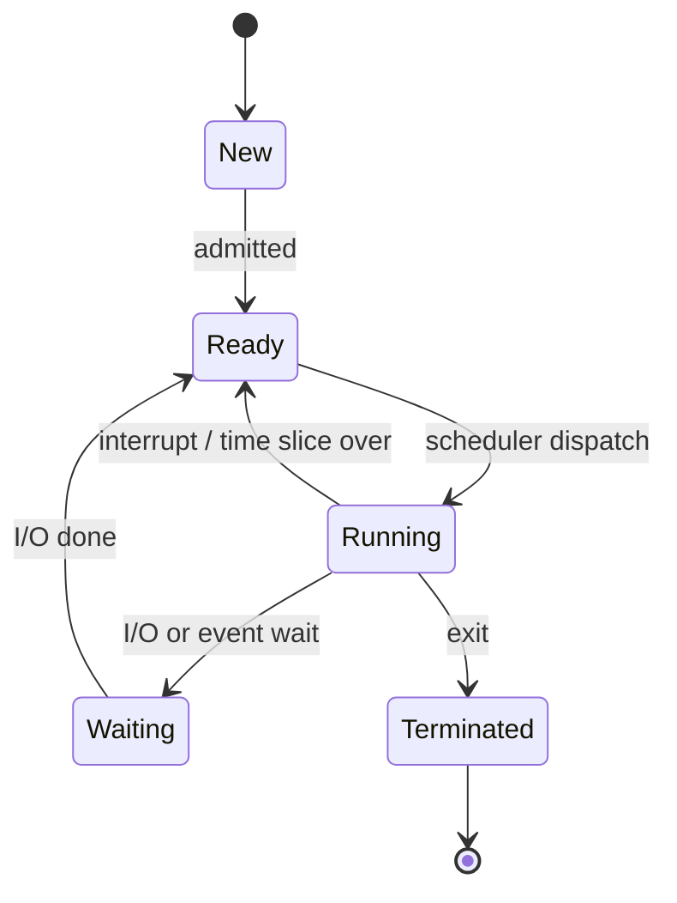
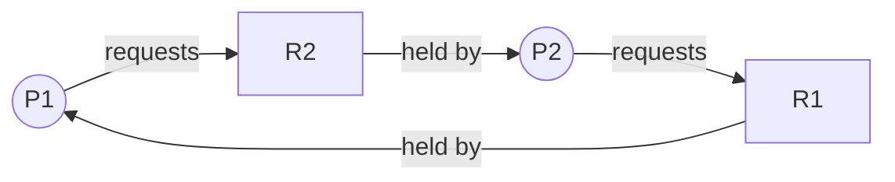
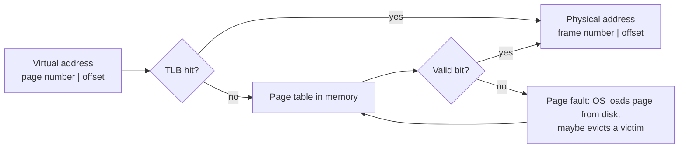

<!-- tab: Processes & threads -->

## Process vs thread

| | Process | Thread |
|---|---|---|
| Memory | Own address space (code, data, heap, stack) | Shares code, data, heap, open files with its process; own stack and registers |
| Creation / switch cost | High (new page tables, TLB flush) | Low |
| Communication | IPC: pipes, sockets, shared memory, message queues | Shared variables (needs synchronization) |
| Crash isolation | One crash doesn't kill others | One thread crashing kills the process |

**PCB** (process control block): PID, state, program counter, registers, scheduling info, memory maps, open files. A **context switch** saves one PCB and loads another — pure overhead.

### Process states



- **fork()** creates a child copy (copy-on-write pages); returns 0 in the child, child's PID in the parent. `n` forks in sequence create 2^n processes.
- **exec()** replaces the process image with a new program.
- **Zombie**: finished child whose parent hasn't called `wait()`; **orphan**: child whose parent exited (adopted by init/systemd).
- **User-level vs kernel-level threads**: user threads are cheap but one blocking call blocks all (many-to-one); Linux uses one-to-one kernel threads.

### Kernel basics
- **User mode vs kernel mode**; a **system call** traps into the kernel (e.g., `read`, `write`, `fork`).
- **Monolithic** kernel (Linux: everything in kernel space, fast) vs **microkernel** (minimal kernel, services in user space, more robust).
- **Interrupts** (hardware) vs **traps/exceptions** (software).

## CPU scheduling

Criteria: maximize CPU utilization and throughput; minimize turnaround time (completion − arrival), waiting time (turnaround − burst), response time (first run − arrival).

| Algorithm | Preemptive? | Notes |
|---|---|---|
| FCFS | No | Simple; **convoy effect** (short jobs stuck behind long) |
| SJF | No | Optimal average waiting time; needs burst prediction; starvation |
| SRTF | Yes | Preemptive SJF |
| Priority | Either | Starvation → fix with **aging** |
| Round Robin | Yes | Time quantum q; good response; q too large → FCFS, too small → switch overhead |
| Multilevel feedback queue | Yes | Jobs move between queues by behaviour; real OSes use variants |

Try it — change the processes and the algorithm, and the Gantt chart and averages update:

```widget scheduler
```

<!-- tab: Synchronization & deadlock -->

## The critical section problem

A solution needs **mutual exclusion**, **progress** (if no one is inside, someone waiting gets in), and **bounded waiting** (no starvation).

**Race condition**: the result depends on interleaving, e.g., two threads doing `count++` (load, add, store) can lose an update.

### Tools
- **Peterson's solution** (2 processes, software; needs memory barriers on modern CPUs).
- **Hardware**: test-and-set, compare-and-swap (CAS) — atomic instructions that build spinlocks.
- **Mutex**: lock owned by one thread; blocking.
- **Semaphore**: integer with `wait()` (P, decrement, block if < 0) and `signal()` (V, increment, wake one). **Binary** semaphore ≈ mutex (but no ownership); **counting** semaphore limits access to N resources.
- **Monitor / condition variable**: mutex + `wait`/`notify`; always wait in a loop because of spurious wakeups.
- **Spinlock**: busy-waits; good only for very short critical sections on multicore.

### Classic problems

**Producer–consumer (bounded buffer)** with semaphores:

```cpp
// empty = N, full = 0, mutex = 1
void producer() { for (;;) { auto item = produce(); wait(empty); wait(mutex); buffer.push(item); signal(mutex); signal(full); } }
void consumer() { for (;;) { wait(full); wait(mutex); auto item = buffer.pop(); signal(mutex); signal(empty); consume(item); } }
```

> [!TRAP]
> Swapping `wait(empty)` and `wait(mutex)` in the producer can deadlock: the producer holds the mutex while waiting for an empty slot, and the consumer can't get the mutex to free one.

- **Readers–writers**: many readers or one writer; first-variant starves writers.
- **Dining philosophers**: five forks; naive "pick left then right" deadlocks. Fixes: pick lower-numbered fork first (ordering), allow at most four to sit, or pick both atomically.

## Deadlock

Four **necessary** conditions (all must hold):
1. **Mutual exclusion** — resources are non-shareable.
2. **Hold and wait** — hold one, wait for another.
3. **No preemption** — resources can't be taken away.
4. **Circular wait** — a cycle of processes each waiting for the next.



| Strategy | How |
|---|---|
| Prevention | Break a condition: order resources (no circular wait), request all at once (no hold and wait), allow preemption |
| Avoidance | **Banker's algorithm**: grant only if the system stays in a safe state |
| Detection + recovery | Detect cycles (wait-for graph); kill or roll back a process |
| Ignore | "Ostrich algorithm" — what most desktop OSes do |

### Banker's algorithm in one example
Need = Max − Allocation. Safe if there's an order where each process's Need ≤ Available, then it finishes and returns its Allocation.

| Process | Allocation | Max | Need |
|---|---|---|---|
| P0 | 0 1 0 | 7 5 3 | 7 4 3 |
| P1 | 2 0 0 | 3 2 2 | 1 2 2 |
| P2 | 3 0 2 | 9 0 2 | 6 0 0 |
| P3 | 2 1 1 | 2 2 2 | 0 1 1 |
| P4 | 0 0 2 | 4 3 3 | 4 3 1 |

Available = 3 3 2 → P1 (avail 5 3 2) → P3 (7 4 3) → P4 (7 4 5) → P0 (7 5 5) → P2 (10 5 7). Safe sequence: **P1, P3, P4, P0, P2**.

**Starvation vs deadlock**: starvation is one process waiting indefinitely while others progress; deadlock is a set where nobody progresses. **Livelock**: processes keep changing state in response to each other but make no progress.

<!-- tab: Memory -->

## Memory management

- **Logical (virtual) address** generated by the CPU; the **MMU** translates it to a physical address.
- **Contiguous allocation** (first fit, best fit, worst fit) suffers **external fragmentation**; fix with compaction or paging.
- **Internal fragmentation**: wasted space inside an allocated block (e.g., last page partly used).

## Paging



- Page = fixed-size block of virtual memory (often 4 KB); frame = same-sized block of physical memory.
- Offset bits = log2(page size). With 32-bit addresses and 4 KB pages: 20-bit page number, 12-bit offset, 2^20 page table entries.
- **TLB**: cache of recent translations. Effective access time = h × (TLB + mem) + (1 − h) × (TLB + 2 × mem) for a single-level table.
- **Multi-level page tables** save memory for sparse address spaces; **inverted page table**: one entry per frame.
- **Segmentation**: variable-sized logical segments (code, stack, heap); external fragmentation. Paged segmentation combines both.

## Virtual memory and page replacement

**Demand paging** loads pages only when touched; a **page fault** traps to the OS. **Thrashing**: the process spends more time paging than running because its working set doesn't fit; fix by reducing multiprogramming or giving it more frames.

Simulate FIFO, LRU and Optimal on any reference string (try `1 2 3 4 1 2 5 1 2 3 4 5` with 3 and then 4 frames for Belady's anomaly):

```widget pagereplace
```

| Algorithm | Idea | Notes |
|---|---|---|
| FIFO | Evict the oldest loaded page | Suffers **Belady's anomaly** (more frames → more faults) |
| Optimal (OPT) | Evict the page used farthest in the future | Lowest faults; not implementable; benchmark |
| LRU | Evict least recently used | Stack algorithm (no Belady); costly in hardware |
| Clock / second chance | Approximate LRU with a reference bit | What real OSes use |

## Stack vs heap
Stack: per-thread, automatic, LIFO, fast, limited size (stack overflow on deep recursion). Heap: shared, `new`/`malloc`, fragmentation, leaks if not freed.

<!-- tab: Files, disks & I/O -->

## File systems
- **Inode** (Unix): metadata (size, owner, permissions, timestamps, block pointers — direct, single, double, triple indirect), not the name. A directory maps names → inode numbers.
- **Hard link**: another name for the same inode (same file); **soft (symbolic) link**: a file containing a path (can dangle, can cross file systems).
- Allocation: contiguous (fast, fragmentation), linked (no random access), indexed (inode/FAT-style).
- **Journaling** (ext4, NTFS): write intent to a log first so a crash can be recovered consistently.

## Disk scheduling
Requests for cylinders 98, 183, 37, 122, 14, 124, 65, 67 with the head at 53:

| Algorithm | Order | Head movement |
|---|---|---|
| FCFS | as given | 640 |
| SSTF | nearest first: 65, 67, 37, 14, 98, 122, 124, 183 | 236 |
| SCAN (toward 0) | 37, 14, 0, 65, 67, 98, 122, 124, 183 | 236 |
| C-SCAN, LOOK, C-LOOK | variants that avoid going to the end or that wrap | — |

SSTF can starve far requests; SCAN ("elevator") is fairer.

## I/O
- **Polling** vs **interrupts** vs **DMA** (device copies data to memory without CPU per byte).
- **Spooling**: buffering jobs for slow devices (print queue).
- **Blocking, non-blocking and async I/O**; `select`/`poll`/`epoll` let one thread watch many sockets (event loops in Node.js, nginx, asyncio).

<!-- tab: Interview Q&A -->

### Q: What happens on a context switch?
An interrupt or system call enters the kernel; the scheduler saves the current registers and program counter into its PCB, picks the next process, restores its state, switches the address space (page table base, possibly TLB flush), and returns to user mode.

### Q: Mutex vs semaphore?
A mutex is a lock with ownership: the thread that locks must unlock; it protects a critical section. A semaphore is a counter that any thread can signal; counting semaphores limit concurrent access to N resources and are used for signalling between threads.

### Q: Explain the four conditions for deadlock and how to prevent one.
Mutual exclusion, hold and wait, no preemption, circular wait. Easiest prevention in practice: impose a global order on locks so circular wait can't happen.

### Q: What is thrashing and how do you fix it?
Too many processes for available memory: page faults dominate, CPU utilization collapses. Reduce the degree of multiprogramming, use working-set or page-fault-frequency allocation, add RAM.

### Q: Why is LRU not subject to Belady's anomaly but FIFO is?
LRU is a stack algorithm: the set of pages in memory with n frames is always a subset of the set with n + 1 frames. FIFO doesn't have this inclusion property.

### Q: What happens when you call fork() three times in a row?
Each call doubles the processes: 2^3 = 8 processes total (7 new).

### Q: Paging vs segmentation?
Paging: fixed-size pages, no external fragmentation, invisible to the programmer. Segmentation: variable-sized logical units matching program structure, external fragmentation.

### Q: What is a race condition? Give an example.
When correctness depends on timing between threads. `balance += amount` from two threads: both read 100, each adds 50, both write 150 — one update lost. Fix with a mutex or atomic operation.

<!-- tab: MCQs -->

```quiz
Q: Which scheduling algorithm gives the minimum average waiting time for a given set of processes?
- FCFS
* SJF
- Round Robin
- Priority
> Proven optimal (non-preemptive, all arrive together).

Q: The convoy effect is associated with…
* FCFS
- SJF
- Round Robin
- SRTF
> Short processes wait behind a long CPU-bound one.

Q: How many child processes are created by three fork() calls in sequence?
- 3
- 6
* 7
- 8
> 8 processes total, 7 of them children.

Q: Belady's anomaly occurs with…
* FIFO
- LRU
- Optimal
- All stack algorithms
> More frames can produce more faults.

Q: Which is NOT a necessary condition for deadlock?
- Mutual exclusion
- Hold and wait
- Circular wait
* Preemption
> The condition is NO preemption.

Q: Banker's algorithm is used for deadlock…
- Prevention
* Avoidance
- Detection
- Recovery
> It grants requests only if the state stays safe.

Q: Thrashing occurs when…
- CPU utilization is too high
* Processes spend most time servicing page faults
- The disk is full
- There are too many threads in one process
> Working sets don't fit in memory.

Q: A binary semaphore differs from a mutex mainly because…
- It can count to 2
* It has no ownership: any thread can signal it
- It's faster
- It can't block
> A mutex must be released by its owner.

Q: Threads of the same process share…
- Stack
- Registers
* Heap and global data
- Program counter
> Each thread has its own stack and registers.

Q: With 4 KB pages, the number of offset bits is…
- 10
* 12
- 14
- 16
> 2^12 = 4096.

Q: A zombie process is…
* A terminated process whose parent hasn't called wait()
- A process with no parent
- A process stuck in an infinite loop
- A process in the waiting state
> Its PCB entry remains until reaped.

Q: Round Robin with a very large time quantum behaves like…
* FCFS
- SJF
- Priority
- SRTF
> Each process finishes in its first slice.

Q: Which page replacement algorithm is optimal but impractical?
- LRU
- FIFO
* OPT (evict page used farthest in the future)
- Clock
> It requires future knowledge.

Q: Which disk scheduling algorithm can cause starvation?
- FCFS
* SSTF
- SCAN
- C-SCAN
> Requests far from the head may wait indefinitely.

Q: A TLB is…
- A type of disk cache
* A cache of page table entries
- A scheduler queue
- A lock
> Translation lookaside buffer.

Q: Aging solves…
- Deadlock
* Starvation in priority scheduling
- Thrashing
- Fragmentation
> Waiting processes gradually gain priority.

Q: External fragmentation is solved by…
- Bigger pages
* Paging or compaction
- More RAM only
- Semaphores
> Paging allocates non-contiguous frames.

Q: Which is executed in kernel mode?
- A for loop in user code
* A system call handler
- printf's formatting
- A Python function
> System calls trap into the kernel.
```
