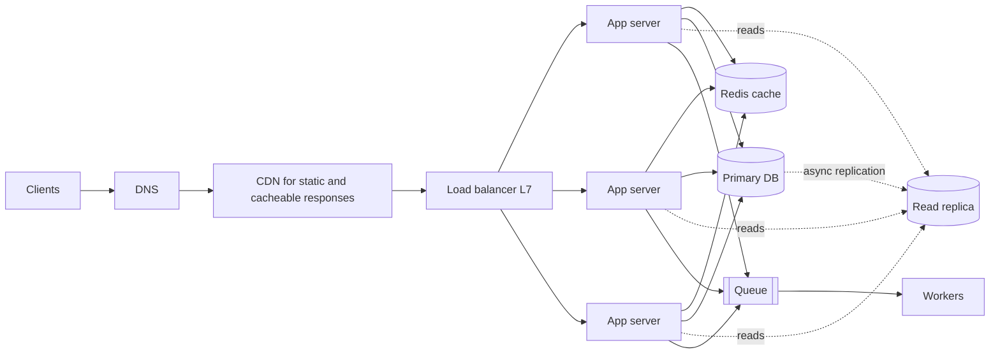
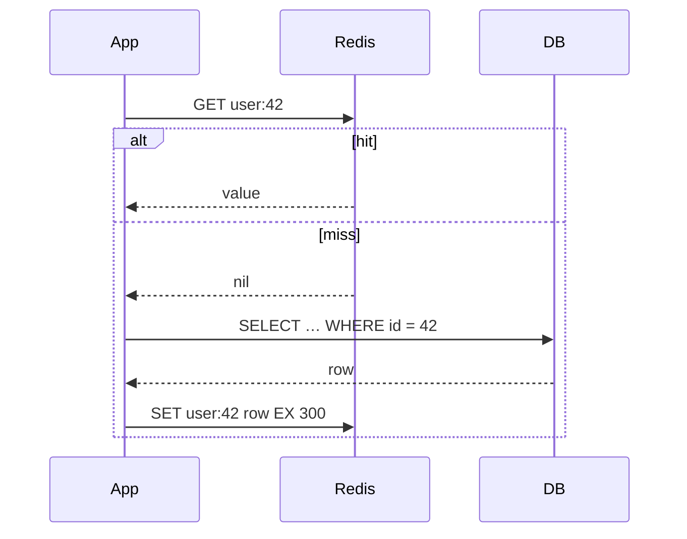
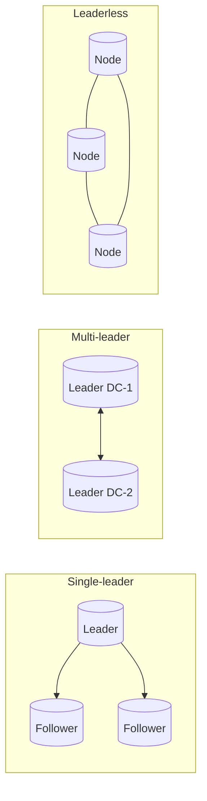
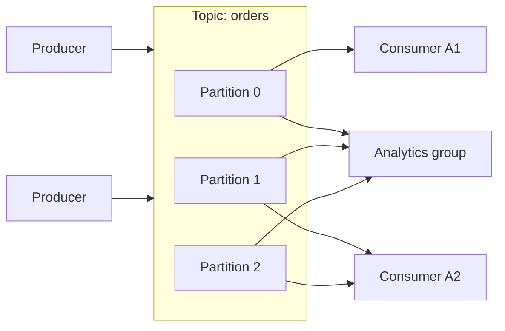
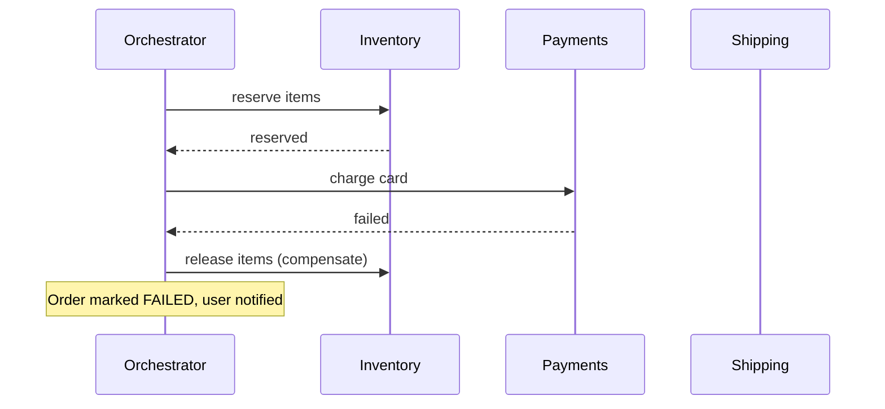

<!-- tab: Framework -->

## The 45-minute delivery framework

Interviewers grade the process as much as the final picture. Run every HLD round in this order and say each step out loud before you start it.

```mermaid
%% caption: Where the 45 minutes go
gantt
  dateFormat  mm
  axisFormat  %M min
  section Scope
  Functional requirements       :a1, 00, 4m
  Non-functional requirements   :a2, after a1, 3m
  Estimation (only if it changes design) :a3, after a2, 3m
  section Shape
  Core entities                 :b1, after a3, 2m
  API                           :b2, after b1, 5m
  High-level design             :b3, after b2, 12m
  section Depth
  Deep dives                    :c1, after b3, 12m
  Wrap-up and trade-offs        :c2, after c1, 4m
```



### 1. Functional requirements (about 4 min)
List what users can do as "Users should be able to…". Pick the **top 3**, say what you are leaving out, and ask 2–3 targeted questions. Example for a URL shortener: create a short link, redirect, optional custom alias and expiry. Analytics is out of scope unless asked.

### 2. Non-functional requirements (about 3 min)
Quantify, don't list adjectives. "Low latency" is weak; "redirect p99 under 100 ms" is strong. Cover:

- **Scale**: users, QPS, data size.
- **Latency** targets for the hot path.
- **Availability vs consistency**: say which one wins for which data, in CAP or PACELC terms.
- **Durability**, **security**, **compliance** when relevant (payments, PII).

### 3. Estimation (only when it changes the design)
Do the math that decides something: whether one database fits, whether you need a cache, how many servers. Skip vanity numbers.

```widget estimator dau=100000000 writes=1 reads=100 size=500 years=5 peak=3
```

### 4. Core entities (about 2 min)
The nouns: User, Link, Message, Ride. Keep it to names and the one or two fields that matter. You refine the schema later.

### 5. API (about 5 min)
REST by default. Derive the user from the auth token, never trust a `userId` in the body. Use cursor pagination for feeds.

```http
POST /v1/links            { "url": "...", "alias": "opt", "expiresAt": "opt" }  -> 201 { "code": "aZ3k9Q" }
GET  /{code}              -> 302 Location: https://...
GET  /v1/feed?cursor=abc&limit=20
```

### 6. High-level design (about 12 min)
Draw boxes for each API endpoint's path through the system. Start with the simplest design that meets the functional requirements, then evolve it to meet the non-functional ones.

### 7. Deep dives (about 12 min)
Pick 2–3 places where the design is weakest under the non-functional requirements: hot keys, consistency, failures, scale. Interviewers often steer here; follow them.

> [!TRAP]
> The two most common fails: over-engineering before requirements are clear (Kafka in minute three), and finishing an incomplete complex design instead of a correct simple one.

> [!SAY]
> "Let me first get a working design end to end, then I'll harden the parts that break at our scale."

## Common mistakes interviewers mark down

| Mistake | What to do instead |
|---|---|
| No numbers | One line of math for QPS and storage, then a decision from it |
| Ignoring CAP | State the choice per data type: "seat inventory is CP, show listings are AP" |
| No failure analysis | For each box, ask "what if this dies?" and answer it |
| No hot-key plan | Cache, replicate the hot key, or add a random suffix and fan in |
| Silent drawing | Narrate trade-offs as you draw |
| Gold-plating | Leave room for the interviewer's questions; stop adding boxes |

<!-- tab: Building blocks -->

## Scaling basics

**Vertical scaling** (bigger machine) is simple and keeps consistency easy, but has a ceiling and a single point of failure. **Horizontal scaling** (more machines) needs **stateless services**: keep session state in Redis or a token, not in server memory, so any instance can serve any request.



### Load balancers
- **L4** routes by IP and port (fast, no content awareness). **L7** routes by HTTP path, header or cookie (can do TLS termination, sticky sessions, canary routing).
- Algorithms: round robin, least connections, weighted, consistent hashing (for cache affinity).
- Health checks remove dead instances. The LB itself is made redundant with an active-passive pair or DNS with multiple LBs.

### CDN
Edge caches close to users. Use it for static files, video segments, and cacheable API responses (with `Cache-Control`). **Pull CDN**: fetches from the origin on a miss. **Push CDN**: you upload ahead of time (good for large, predictable content).

## Caching



| Strategy | Write path | Good for | Risk |
|---|---|---|---|
| Cache-aside (lazy) | App writes DB, deletes cache key | Read-heavy, the default | First read after a miss is slow |
| Read-through | Cache library loads from DB on miss | Simpler app code | Same as above |
| Write-through | Write cache and DB together | Read-after-write consistency | Slower writes, caches cold data |
| Write-back (write-behind) | Write cache, flush to DB later | Write-heavy counters | Data loss if the cache dies |
| Write-around | Write DB only | Data rarely re-read | Misses right after writes |

**Eviction**: LRU (default), LFU (stable popularity), TTL (freshness). **Invalidate by deleting** the key on write rather than updating it, to avoid racing writers leaving a stale value.

> [!TRAP]
> **Cache stampede**: a hot key expires and thousands of requests hit the DB at once. Fixes: a per-key lock or single-flight (one request rebuilds, others wait), early probabilistic refresh, and jittered TTLs so keys don't expire together.

Other failure modes to name: **penetration** (requests for keys that don't exist; cache a null or use a Bloom filter) and **avalanche** (many keys expire together or the cache restarts; jitter TTLs, warm up, rate-limit DB access).

## Databases

### SQL vs NoSQL

| | Relational (PostgreSQL, MySQL) | Key-value / wide-column (DynamoDB, Cassandra) | Document (MongoDB) |
|---|---|---|---|
| Model | Tables, joins, schema | Partition key → items | JSON documents |
| Transactions | Full ACID | Single item (some offer limited multi-item) | Document-level, multi-doc in newer versions |
| Scale | Vertical + read replicas; sharding is manual | Horizontal by design | Horizontal with sharding |
| Pick when | Relationships, money, constraints | Huge write volume, simple access by key | Flexible nested data |

> [!SAY]
> "I'll start with Postgres because the data is relational and the volume fits one primary with replicas. If writes outgrow it, I'd shard by user ID."

### Indexing
B+ tree indexes speed up lookups and range scans at the cost of slower writes and extra storage. Hash indexes handle equality only. Composite index `(a, b)` serves queries on `a` and on `a, b` but not on `b` alone (leftmost-prefix rule). Inverted indexes (Elasticsearch) power full-text search. Geospatial indexes (geohash, R-tree, quadtree) power "near me".

### Transactions and isolation
ACID: atomicity, consistency, isolation, durability. Isolation levels from weakest to strongest: read uncommitted, read committed (Postgres default), repeatable read (MySQL InnoDB default), serializable. See the DBMS sheet for anomalies.

### Replication



- **Single-leader**: all writes to one node; async replication gives **replica lag** (read-your-writes problems), sync gives durability but slower writes.
- **Multi-leader**: writes in each region; needs conflict resolution (last-write-wins, CRDTs).
- **Leaderless** (Dynamo, Cassandra): write to W replicas, read from R; if **R + W > N** reads see the latest write. Quorum example: N=3, W=2, R=2.

## Partitioning (sharding)

Split data across machines by a **shard key**. Choose a key with high cardinality and even access, that keeps related data together for the common query.

| Method | How | Pros | Cons |
|---|---|---|---|
| Range | `A–F → shard 1` | Range scans | Hot spots on sequential keys |
| Hash | `hash(key) % N` | Even spread | Range queries hit all shards; resharding moves almost everything |
| Consistent hashing | Keys and nodes on a ring | Adding a node moves ~1/N of keys | Needs virtual nodes for balance |
| Directory | Lookup table key → shard | Flexible | Lookup service is a dependency |

```widget hashring nodes=4 vnodes=3 keys=30
```

Problems sharding creates: cross-shard joins and transactions, hot partitions (a celebrity), and resharding. Mitigations: denormalize for the main query, pick a key that matches access, split hot keys with a suffix.

## CAP and PACELC

**CAP**: during a network **partition**, a distributed store must choose **consistency** (refuse some requests) or **availability** (answer, possibly stale). Partitions are not optional, so the real choice is C or A during one.

**PACELC** adds: **else** (no partition), choose **latency** or **consistency**. DynamoDB and Cassandra are PA/EL; Spanner and HBase are PC/EC.

| Data | Choice | Why |
|---|---|---|
| Bank balance, seat inventory | Consistency | Double spend or double booking is unacceptable |
| Likes count, feed, profile picture | Availability | Slightly stale is fine |

Consistency models from strong to weak: linearizable → sequential → causal → read-your-writes / monotonic reads → eventual.

## Async messaging

**Queues** (SQS, RabbitMQ): each message goes to one consumer; deleted when acknowledged. **Logs / streams** (Kafka, Kinesis): messages are kept for a retention period; many consumer groups read independently by **offset**; order is guaranteed **within a partition**.



Use queues to absorb spikes, decouple slow work (email, transcoding), and retry safely. Delivery guarantees: **at-most-once**, **at-least-once** (default; make consumers **idempotent**), **exactly-once** (Kafka transactions, or at-least-once plus dedup). Dead-letter queues hold messages that keep failing. **Backpressure**: when consumers lag, slow producers or shed load.

## Estimation and APIs

### Numbers to know

| Thing | Value |
|---|---|
| Seconds per day | 86,400 ≈ 10⁵ |
| 1M requests/day | ≈ 12 QPS |
| 100M requests/day | ≈ 1,200 QPS (peak ≈ 3×) |
| Memory read 1 MB | ~250 µs (sequential) |
| SSD random read | ~100 µs |
| Same-datacenter round trip | ~0.5 ms |
| Cross-continent round trip | ~150 ms |
| Redis on one node | ~100K simple ops/s |
| Postgres on one good node | a few thousand writes/s, ~10K+ simple reads/s |
| Kafka partition | ~10 MB/s write is safe |

Powers of two: 2¹⁰ ≈ 1K, 2²⁰ ≈ 1M, 2³⁰ ≈ 1G, 2⁴⁰ ≈ 1T. A char is 1 byte (ASCII), an int 4, a long or timestamp 8, a UUID 16.

### API design rules
- Nouns for resources, verbs from HTTP methods. Version in the path (`/v1`).
- **Idempotency keys** for unsafe retries: the client sends `Idempotency-Key`; the server stores the result and returns it for repeats.
- Pagination: **cursor** (stable under inserts) over offset.
- Errors: 400 bad input, 401 unauthenticated, 403 forbidden, 404, 409 conflict, 429 rate limited, 5xx server.
- **REST** for public CRUD, **gRPC** (HTTP/2, protobuf, streaming) between services, **GraphQL** when clients need flexible shapes, **WebSockets** or **SSE** for server push.

<!-- tab: Patterns -->

## Architectural patterns you will reuse

### Monolith vs microservices
Start with a modular monolith unless teams or scaling needs differ by component. Microservices bring independent deploys and scaling, at the cost of network calls, distributed transactions and operational load.

### Event-driven architecture
Services publish events (`OrderPlaced`) and others react. Loose coupling and easy fan-out; harder to trace and reason about ordering.

### CQRS
Separate the write model (normalized, transactional) from read models (denormalized views built from events). Used for feeds, dashboards and search.

### Saga
A distributed transaction as a sequence of local transactions with **compensating actions** if a step fails.



### Outbox pattern
Write the business row and an `outbox` event row in **one DB transaction**; a relay publishes outbox rows to Kafka. Solves "DB committed but the event was lost".

### Leader election
One node coordinates (a scheduler, the Kafka controller). Done with ZooKeeper/etcd leases or Raft. Use **fencing tokens** so a paused old leader can't write after losing the lease.

### Idempotency
An operation that has the same effect if applied once or many times. Achieve it with idempotency keys, unique constraints, conditional writes (`UPDATE … WHERE version = 7`), or dedup tables.

### Backpressure, retries and circuit breakers
Retry with **exponential backoff and jitter**; cap attempts. A **circuit breaker** stops calling a failing dependency for a while (closed → open → half-open). **Bulkheads** isolate thread pools so one slow dependency can't exhaust everything.

## Observability and operations
- **SLI** (what you measure, e.g. p99 latency), **SLO** (target, 99.9% under 200 ms), **SLA** (contract with penalties).
- Three pillars: metrics (Prometheus), logs (structured, centralized), traces (OpenTelemetry spans across services).
- Availability math: 99.9% ≈ 8.8 h downtime/year, 99.99% ≈ 53 min/year. Two dependencies in series multiply: 99.9% × 99.9% ≈ 99.8%.

## Security basics
Authentication (who you are: OAuth 2.0, OIDC, JWT, sessions) vs authorization (what you may do: RBAC, ABAC). TLS in transit, KMS-managed keys at rest. Rate limiting and WAF at the edge. Secrets in a vault, never in code.

<!-- tab: Interview -->

## Questions you should answer in under two minutes

### Q: How would you scale a web app from 1 user to 10 million?
Single server → separate DB → load balancer + stateless app servers → cache (Redis) and CDN → read replicas → async queues for slow work → shard the DB by the main access key → multi-region with geo-DNS. At each step, name the bottleneck that forced it.

### Q: When would you choose NoSQL over SQL?
When access is mostly by key at very high write volume, the schema varies, and you can live without joins and multi-row transactions. Money, inventory and anything needing constraints stays relational.

### Q: Explain consistent hashing and why virtual nodes matter.
Nodes and keys hash onto a ring; a key belongs to the next node clockwise. Adding or removing a node only moves the keys in its arc (about K/N), unlike `hash % N` which remaps almost all keys. With few nodes the arcs are uneven, so each node gets many virtual points to even out load and spread a failed node's keys across many neighbours.

### Q: Cache-aside: should a write update the cache or delete the key?
Delete. If two writers update the cache in a different order than they updated the DB, the cache ends up stale forever (until TTL). Deleting makes the next reader load the committed value.

### Q: What is the difference between a queue and a log like Kafka?
A queue hands each message to one consumer and deletes it after ack. A log retains messages; each consumer group tracks its own offset, so many independent readers and replays are possible. Kafka orders within a partition only.

### Q: How do you make an API safe to retry?
Make the server idempotent: an idempotency key stored with the result in a table with a unique constraint; repeats return the stored result. Clients retry with exponential backoff and jitter.

### Q: How do you choose a shard key?
High cardinality, even read and write distribution, and it keeps the main query on one shard. For chat, `conversation_id`; for a social profile, `user_id`. Avoid timestamps and low-cardinality fields.

### Q: What does R + W > N mean?
In leaderless replication with N replicas, if a write waits for W acks and a read queries R replicas with R + W > N, the read and write sets overlap in at least one node, so the read sees the latest acknowledged write.

## Quick check

```quiz
Q: A service needs 99.99% availability. Roughly how much downtime is that per year?
- 8.8 hours
* 53 minutes
- 5 minutes
- 3.6 days
> 0.01% of 525,600 minutes ≈ 52.6 minutes.

Q: Which write strategy risks losing data if the cache node crashes?
- Write-through
- Write-around
* Write-back
- Cache-aside
> Write-back acknowledges after writing the cache and flushes to the database later.

Q: With hash(key) % N sharding, roughly what fraction of keys move when N goes from 4 to 5?
- 20%
- 25%
* About 80%
- 0%
> Almost every key's modulo changes. Consistent hashing would move about 1/5.

Q: In Kafka, ordering is guaranteed…
- across the whole topic
* within a single partition
- across consumer groups
- only with exactly-once enabled
> Use the entity ID as the message key so its events land in one partition.

Q: PACELC for Cassandra with default settings is best described as…
* PA/EL
- PC/EC
- PA/EC
- PC/EL
> Available under partition, low latency otherwise; consistency is tunable per query.

Q: Which pattern guarantees a DB write and its event are published together?
- Saga
- CQRS
* Transactional outbox
- Circuit breaker
> The event row commits in the same transaction; a relay publishes it afterwards.

Q: 100 million requests per day is roughly how many requests per second on average?
- 120
* 1,200
- 12,000
- 120,000
> 10⁸ / 10⁵ ≈ 10³.

Q: A composite index on (city, created_at) helps which query most?
- WHERE created_at > X
* WHERE city = 'Delhi' ORDER BY created_at DESC
- WHERE name = 'A'
- WHERE created_at = X OR city = Y
> Leftmost prefix: equality on city, then the index is already sorted by created_at.
```
