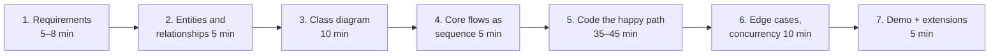
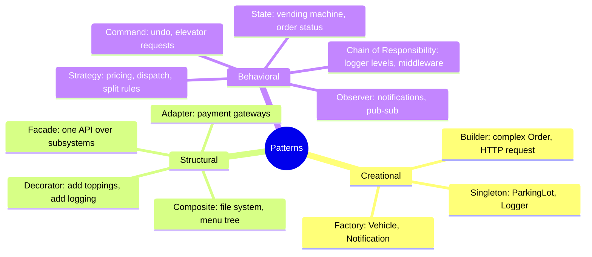
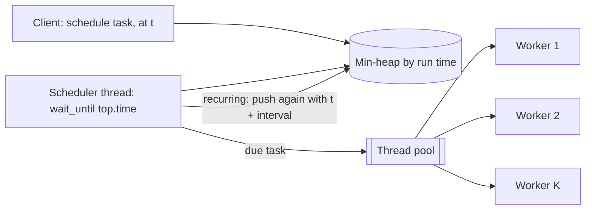

<!-- tab: Round playbook -->

## How a machine-coding / LLD round runs

You usually get 60–90 minutes to design and code a working system (Parking Lot, Splitwise, Snake & Ladder). Grading: correct behaviour, clean object model, extensibility, and how you talk.



### 1. Requirements
Ask what the system must do, and what is out of scope. Write them as a numbered list the interviewer can see. Confirm assumptions ("single building, multiple floors, three vehicle sizes").

### 2. Entities
Underline nouns in the requirements: they become classes. Verbs become methods. Decide ownership: **composition** (a Floor owns its Spots) vs **association** (a Ticket refers to a Vehicle).

### 3. Class diagram
Interfaces first, then concrete classes. Mark where behaviour varies: that's where a pattern goes (Strategy for pricing, State for a vending machine).

### 4. Code
- One entry class (`ParkingLotService`) with the public API from the requirements.
- Enums for fixed types, interfaces for variation points.
- Keep `main()` as a short demo that exercises each requirement.
- Avoid premature generality; add an extension point only where the interviewer hinted at change.

### 5. Concurrency and edge cases
Two people grabbing the last spot, double payments, invalid input. Show a lock or an atomic operation at the exact contended point, not everywhere.

> [!SAY]
> "I'm putting pricing behind a strategy interface because rates are the thing most likely to change. Everything else stays concrete until we need more."

> [!TRAP]
> Spending 30 minutes on diagrams and not having running code. Most machine-coding rounds fail candidates whose code doesn't compile or run.

<!-- tab: OOP and SOLID -->

## Four pillars

| Pillar | Meaning | C++ tool |
|---|---|---|
| Encapsulation | Hide state, expose behaviour; keep invariants inside the class | `private` members, methods that validate |
| Abstraction | Expose what, hide how | Pure virtual interfaces |
| Inheritance | "Is-a" reuse of interface and behaviour | `class Car : public Vehicle` |
| Polymorphism | One interface, many implementations, chosen at runtime | `virtual` functions, vtables |

**Composition over inheritance**: prefer holding a `PricingStrategy*` to subclassing `HourlyParkingLot`, `FlatRateParkingLot`… Inheritance couples you to the parent's implementation; composition lets you swap behaviour at runtime.

## SOLID with one example each

**S — Single responsibility.** A class has one reason to change. `Invoice` computes totals; `InvoicePrinter` formats; `InvoiceRepository` saves.

**O — Open/closed.** Open for extension, closed for modification. Add a new `UPIPayment` class implementing `PaymentMethod` instead of editing a `switch`.

**L — Liskov substitution.** A subclass must work anywhere its parent does. The classic violation: `Square : Rectangle` where `setWidth` silently changes height.

**I — Interface segregation.** Many small interfaces beat one fat one. Split `Machine { print(); scan(); fax(); }` into `Printer`, `Scanner`.

**D — Dependency inversion.** High-level code depends on abstractions. `NotificationService` takes a `MessageSender&`, so tests pass a fake and production passes `SmsSender`.

```cpp
struct MessageSender { virtual ~MessageSender() = default; virtual void send(const std::string& to, const std::string& msg) = 0; };
struct SmsSender : MessageSender { void send(const std::string& to, const std::string& msg) override { /* call SMS gateway */ } };

class NotificationService {
    MessageSender& sender;                       // depends on the abstraction
public:
    explicit NotificationService(MessageSender& s) : sender(s) {}
    void notify(const std::string& user, const std::string& text) { sender.send(user, text); }
};
```

Also worth naming: **DRY** (one source of truth), **KISS**, **YAGNI** (don't build for imagined requirements), **Law of Demeter** (talk to friends, not friends of friends: avoid `a.getB().getC().doX()`).

<!-- tab: Design patterns -->

## The patterns that cover most LLD rounds



### Strategy
Encapsulate interchangeable algorithms behind one interface; pick at runtime.

```cpp
struct PricingStrategy { virtual ~PricingStrategy() = default; virtual double price(int minutes) const = 0; };
struct HourlyPricing : PricingStrategy { double rate; explicit HourlyPricing(double r) : rate(r) {}
    double price(int m) const override { return rate * ((m + 59) / 60); } };
struct FlatPricing : PricingStrategy { double fee; explicit FlatPricing(double f) : fee(f) {}
    double price(int) const override { return fee; } };
```

### Factory
Centralize object creation so callers don't depend on concrete classes.

```cpp
std::unique_ptr<Vehicle> VehicleFactory::create(VehicleType t, std::string plate) {
    switch (t) {
        case VehicleType::Bike:  return std::make_unique<Bike>(std::move(plate));
        case VehicleType::Car:   return std::make_unique<Car>(std::move(plate));
        case VehicleType::Truck: return std::make_unique<Truck>(std::move(plate));
    }
    throw std::invalid_argument("unknown type");
}
```

### Singleton (thread-safe in C++11+)
A function-local static is initialized exactly once, even with concurrent first calls.

```cpp
class Logger {
public:
    static Logger& instance() { static Logger inst; return inst; }   // Meyers singleton
    Logger(const Logger&) = delete; Logger& operator=(const Logger&) = delete;
private:
    Logger() = default;
};
```

> [!TRAP]
> Interviewers often ask "what's wrong with singletons?" Hidden global state, hard to test (can't inject a fake), and lifetime issues at shutdown. Prefer passing dependencies; use a singleton only when exactly one instance is a real requirement.

### Observer
Subjects keep a list of observers and notify them on change. Basis of event systems and pub-sub.

```cpp
struct Observer { virtual ~Observer() = default; virtual void update(const std::string& event) = 0; };
class Subject {
    std::vector<std::weak_ptr<Observer>> obs;       // weak_ptr: don't keep dead observers alive
public:
    void attach(std::shared_ptr<Observer> o) { obs.push_back(o); }
    void notify(const std::string& e) {
        for (auto it = obs.begin(); it != obs.end();) {
            if (auto o = it->lock()) { o->update(e); ++it; } else it = obs.erase(it);
        }
    }
};
```

### State
An object changes behaviour when its internal state changes; each state is a class. Removes giant `if (state == …)` blocks. See the Vending Machine sheet for the full version.

### Builder
Step-by-step construction of an object with many optional parts; ends with `build()` that validates.

### Adapter
Wrap an incompatible interface (a third-party `RazorpayClient`) to match yours (`PaymentGateway`).

### Decorator
Wrap an object to add behaviour without subclassing every combination: `Milk(Sugar(Coffee()))`.

### Command
Turn a request into an object (`MoveCommand`) so you can queue, log or undo it.

### Chain of Responsibility
Pass a request along handlers until one handles it: log levels, HTTP middleware, approval workflows.

### Composite
Treat single objects and groups the same way through one interface: `File` and `Directory` both implement `size()`.

### Template Method
A base class fixes the algorithm's skeleton (`playGame(): init(); while(!over) makeMove(); printWinner();`) and subclasses fill in steps.

<!-- tab: Concurrency -->

## Concurrency for LLD in C++

Shared mutable state + more than one thread = you need synchronization. Name the **critical section** precisely.

| Tool | Use for |
|---|---|
| `std::mutex` + `std::lock_guard` / `std::unique_lock` | Protect a critical section |
| `std::shared_mutex` + `shared_lock` | Many readers, few writers (caches, config) |
| `std::condition_variable` | Wait until a condition holds (queue non-empty) |
| `std::atomic<T>` | Lock-free counters and flags |
| `std::scoped_lock(a, b)` | Lock several mutexes without deadlock |

### Blocking queue (the building block for thread pools, loggers, pub-sub)

```cpp
template <class T>
class BlockingQueue {
    std::queue<T> q; std::mutex m; std::condition_variable notEmpty, notFull; size_t cap;
public:
    explicit BlockingQueue(size_t c) : cap(c) {}
    void push(T v) {
        std::unique_lock<std::mutex> lk(m);
        notFull.wait(lk, [&] { return q.size() < cap; });     // predicate guards against spurious wakeups
        q.push(std::move(v));
        notEmpty.notify_one();
    }
    T pop() {
        std::unique_lock<std::mutex> lk(m);
        notEmpty.wait(lk, [&] { return !q.empty(); });
        T v = std::move(q.front()); q.pop();
        notFull.notify_one();
        return v;
    }
};
```

### Thread pool

```cpp
class ThreadPool {
    std::vector<std::thread> workers; BlockingQueue<std::function<void()>> tasks{1024}; std::atomic<bool> stop{false};
public:
    explicit ThreadPool(int n) {
        for (int i = 0; i < n; ++i) workers.emplace_back([this] {
            for (;;) { auto job = tasks.pop(); if (!job) return; job(); }   // empty function = poison pill
        });
    }
    void submit(std::function<void()> f) { tasks.push(std::move(f)); }
    ~ThreadPool() { for (size_t i = 0; i < workers.size(); ++i) tasks.push(nullptr); for (auto& t : workers) t.join(); }
};
```

### Multi-threaded task scheduler (asked at Uber)
Run tasks at a given time or every N seconds with K worker threads. A min-heap ordered by next run time, one scheduler thread that sleeps with `wait_until` on a condition variable, and a pool that executes. Re-insert recurring tasks with `next = now + interval`.



### Deadlock: the four Coffman conditions
Mutual exclusion, hold and wait, no preemption, circular wait. Break any one. In code: always lock in a global order, or use `std::scoped_lock` for several locks at once.

> [!TIP]
> Name the race in plain words before fixing it: "Two threads both read `spot.free == true`, both assign it." Then show the fix: a lock around check-and-assign, or an atomic compare-and-swap.

<!-- tab: Interview -->

### Q: Composition vs inheritance: when do you use each?
Inheritance for a true "is-a" where the subclass can be used anywhere the parent is (Liskov holds) and you want to share interface. Composition for "has-a" and for behaviour you want to swap at runtime. Default to composition; it keeps classes small and avoids fragile base classes.

### Q: Strategy vs State: they look the same, what's the difference?
Both delegate to an interface. In **Strategy** the client picks the algorithm and it rarely changes during the object's life. In **State** the object switches its own state object as events happen, and each state knows the transitions.

### Q: How do you make a singleton thread-safe in C++?
Since C++11 a function-local static is initialized once even under concurrent calls (the "magic static"), so `static T& instance() { static T x; return x; }` is enough. Delete copy and assignment.

### Q: Abstract class vs interface in C++?
C++ has no `interface` keyword. A class with only pure virtual functions and a virtual destructor acts as an interface. An abstract class can also hold state and implemented methods.

### Q: Why must a base class with virtual functions have a virtual destructor?
Deleting a derived object through a base pointer otherwise calls only the base destructor, leaking the derived part (undefined behaviour).

### Q: What is a race condition and how do you prevent it?
The result depends on the timing of threads touching shared data. Prevent with mutual exclusion around the critical section, atomics for single variables, or by not sharing (message passing, thread confinement).

### Q: Which pattern for undo/redo?
Command: each action is an object with `execute()` and `undo()`, pushed on a stack.

```quiz
Q: A Square class extends Rectangle and overrides setWidth to also set height. Which principle breaks?
- Single responsibility
- Open/closed
* Liskov substitution
- Interface segregation
> Code written for Rectangle expects width and height to vary independently.

Q: Which pattern fits "price can be hourly, flat or weekend-rate, chosen per lot"?
* Strategy
- Singleton
- Observer
- Adapter
> Interchangeable algorithms behind one interface.

Q: Which pattern lets File and Directory both answer size()?
- Decorator
* Composite
- Facade
- Builder
> Leaf and container share one component interface.

Q: Why does condition_variable::wait take a predicate?
- To avoid deadlock
* To guard against spurious wakeups and lost signals
- To make the wait faster
- It is required for shared_mutex
> The predicate is rechecked after every wakeup.

Q: Which Coffman condition does lock ordering break?
- Mutual exclusion
- No preemption
- Hold and wait
* Circular wait
> If every thread acquires locks in the same global order, no cycle can form.

Q: Wrapping a third-party SDK so it matches your PaymentGateway interface is…
- Facade
* Adapter
- Proxy
- Bridge
> Adapter converts one interface into another that clients expect.
```
