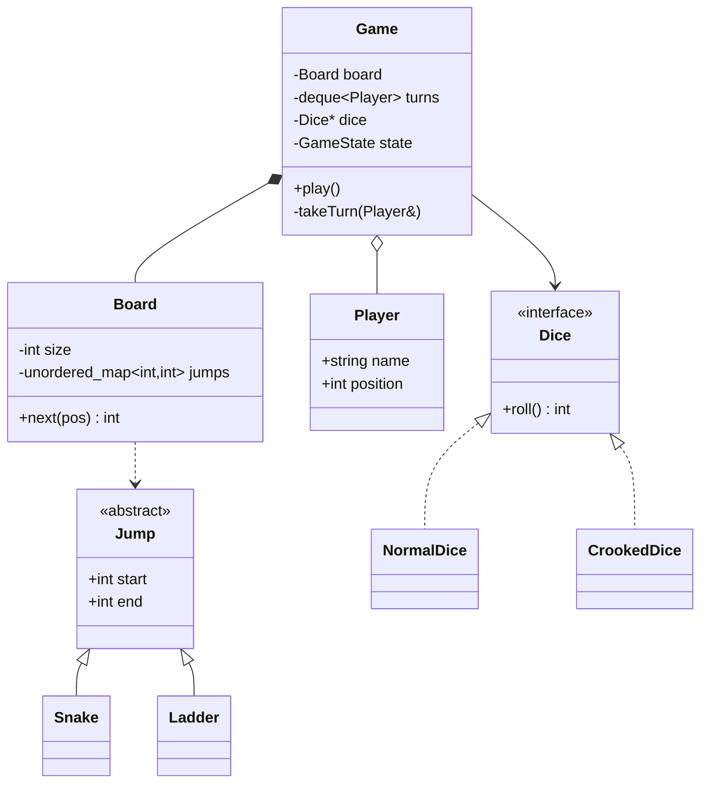
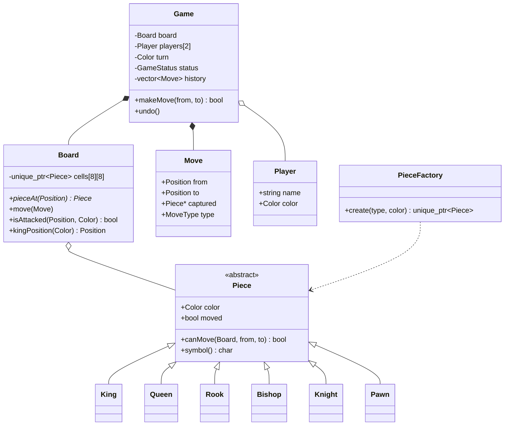
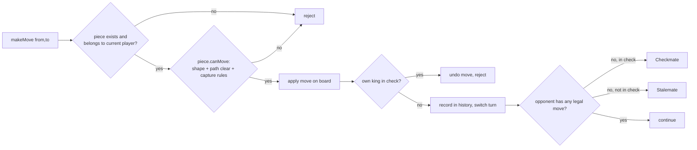

<!-- tab: Snake & Ladder -->

## Requirements
1. Board of 100 cells; snakes (head → tail, down) and ladders (bottom → top, up).
2. 2–4 players take turns rolling one die (configurable: two dice, crooked dice).
3. Land exactly on 100 to win (or "overshoot stays put" — ask).
4. Print each move; the game ends when a player wins (or continues for ranks).

## Classes



Snakes and ladders are the same thing — a jump from start to end — so the board stores one `start → end` map. Validate on setup: no jump starts on 100, a snake goes down, a ladder goes up, no chains/cycles if the rules forbid them.

```cpp
struct Dice { virtual ~Dice() = default; virtual int roll() = 0; };
class NormalDice : public Dice {
    std::mt19937 rng{std::random_device{}()}; int count;
public:
    explicit NormalDice(int n = 1) : count(n) {}
    int roll() override { std::uniform_int_distribution<int> d(1, 6); int s = 0; for (int i = 0; i < count; ++i) s += d(rng); return s; }
};

class Board {
    int size; std::unordered_map<int, int> jumps;
public:
    explicit Board(int n) : size(n) {}
    void addJump(int from, int to) {
        if (from == to || from <= 1 || from >= size || to < 1 || to > size) throw std::invalid_argument("bad jump");
        if (jumps.count(from)) throw std::invalid_argument("cell already has a jump");
        jumps[from] = to;
    }
    int last() const { return size; }
    int resolve(int pos) const { auto it = jumps.find(pos); return it == jumps.end() ? pos : it->second; }
};

struct Player { std::string name; int pos = 0; };

class Game {
    Board board; std::deque<Player> turns; std::unique_ptr<Dice> dice;
public:
    Game(Board b, std::vector<std::string> names, std::unique_ptr<Dice> d) : board(std::move(b)), dice(std::move(d)) { for (auto& n : names) turns.push_back({n}); }
    std::string play() {
        for (;;) {
            Player p = turns.front(); turns.pop_front();
            int r = dice->roll(), target = p.pos + r;
            if (target <= board.last()) {                       // overshoot: stay put
                int landed = board.resolve(target);
                std::cout << p.name << " rolled " << r << ": " << p.pos << " → " << target << (landed != target ? " → " + std::to_string(landed) : "") << "\n";
                p.pos = landed;
            }
            if (p.pos == board.last()) return p.name;
            turns.push_back(p);
        }
    }
};
```

<!-- tab: Chess -->

## Requirements
1. Two players, standard 8×8 board and pieces; alternate turns.
2. Validate moves per piece; can't move into check.
3. Detect check, checkmate, stalemate; support castling, en passant, promotion (mention; implement if time).
4. Move history and undo (extension).

## Classes



### Move validation pipeline



```cpp
enum class Color { White, Black };
struct Pos { int r, c; };
class Board;
struct Piece {
    Color color; bool moved = false;
    explicit Piece(Color c) : color(c) {}
    virtual ~Piece() = default;
    virtual bool canMove(const Board& b, Pos from, Pos to) const = 0;
};
class Board {
    std::array<std::array<std::unique_ptr<Piece>, 8>, 8> cells;
public:
    Piece* at(Pos p) const { return cells[p.r][p.c].get(); }
    bool pathClear(Pos f, Pos t) const {                    // for sliding pieces
        int dr = (t.r > f.r) - (t.r < f.r), dc = (t.c > f.c) - (t.c < f.c);
        for (Pos p{f.r + dr, f.c + dc}; p.r != t.r || p.c != t.c; p.r += dr, p.c += dc) if (at(p)) return false;
        return true;
    }
};
struct Rook : Piece { using Piece::Piece;
    bool canMove(const Board& b, Pos f, Pos t) const override { return (f.r == t.r || f.c == t.c) && b.pathClear(f, t); } };
struct Bishop : Piece { using Piece::Piece;
    bool canMove(const Board& b, Pos f, Pos t) const override { return std::abs(f.r - t.r) == std::abs(f.c - t.c) && b.pathClear(f, t); } };
struct Queen : Piece { using Piece::Piece;
    bool canMove(const Board& b, Pos f, Pos t) const override { return (f.r == t.r || f.c == t.c || std::abs(f.r - t.r) == std::abs(f.c - t.c)) && b.pathClear(f, t); } };
struct Knight : Piece { using Piece::Piece;
    bool canMove(const Board&, Pos f, Pos t) const override { int dr = std::abs(f.r - t.r), dc = std::abs(f.c - t.c); return dr * dc == 2; } };
```

Each piece owns its movement rule (polymorphism instead of a giant switch). The generic checks — destination not own piece, king not left in check — live in `Game`, so they're written once (Template Method).

<!-- tab: Interview -->

### Q: Why are snakes and ladders one class/map?
Both move a token from one cell to another; only direction differs. One `jumps` map keeps the board simple and the turn logic branch-free.

### Q: How do you make the dice pluggable?
A `Dice` interface with `NormalDice`, `MultiDice`, `CrookedDice` (only even numbers) — Strategy. Injecting a fixed-sequence dice also makes the game testable.

### Q: Where does "can't leave your king in check" go in chess?
In the game/board, not in each piece: apply the move, ask whether the king's square is attacked, undo if so. Pieces only know their geometry.

### Q: How do you implement undo?
Command pattern: each `Move` records from, to, captured piece and special flags (castling, promotion); undo reverses it. History is a stack.

```quiz
Q: In chess, the knight's move check |dr| × |dc| == 2 works because…
* A knight moves (1,2) or (2,1)
- Knights move diagonally
- It checks the path is clear
- It's only for castling
> Only 1×2 or 2×1 give a product of 2.

Q: Making the dice an interface primarily helps…
- Performance
* Swapping rules and testing with deterministic rolls
- Memory usage
- Rendering
> Inject a fake dice in tests.

Q: Undo in a board game is best modelled with…
- Singleton
- Observer
* Command (with a history stack)
- Factory
> Each move knows how to reverse itself.
```
