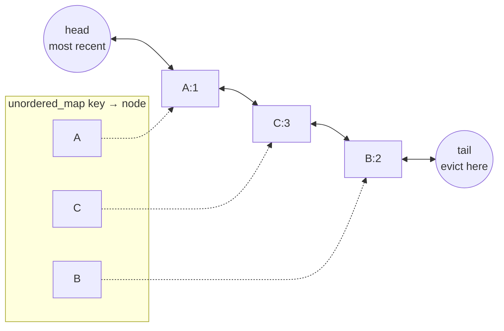
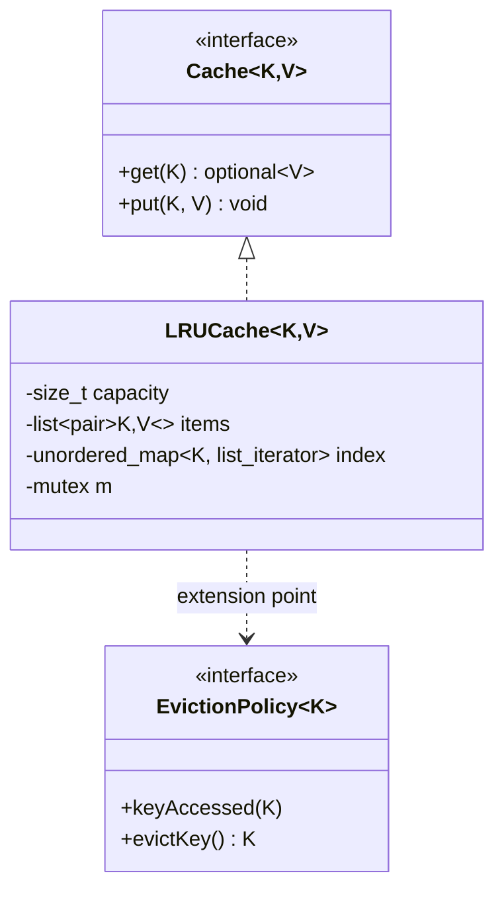
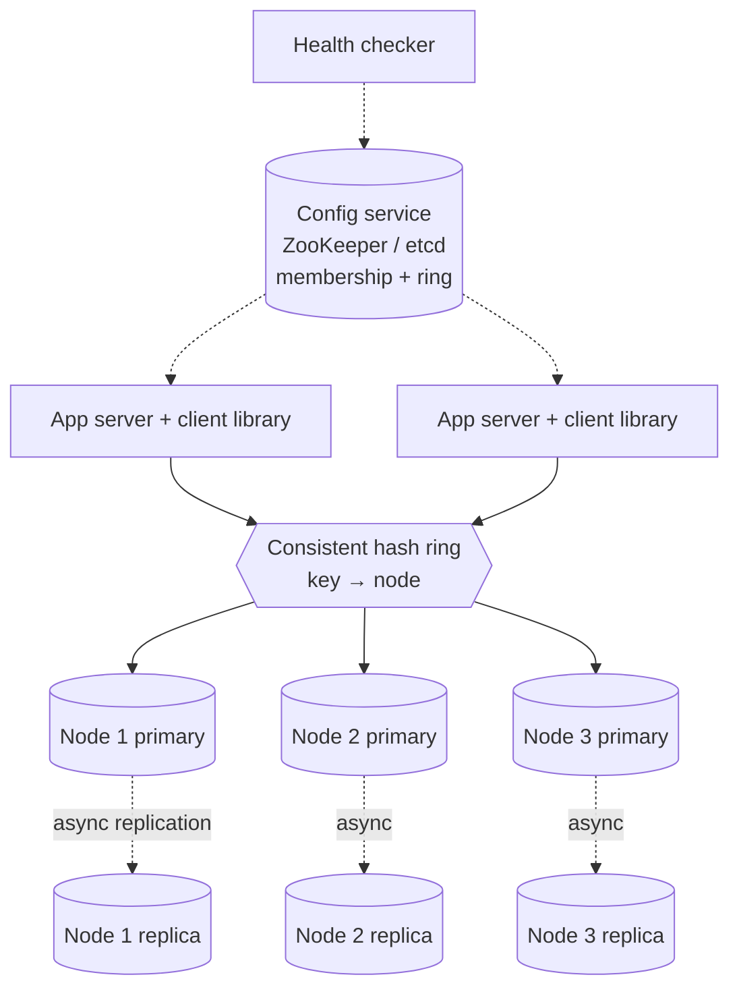

<!-- tab: LLD: LRU cache -->

## Requirements
1. `get(key)` returns the value or a miss; `put(key, value)` inserts or updates.
2. Fixed capacity; when full, evict the **least recently used** entry.
3. Both operations in **O(1)**.
4. Safe to call from many threads.
5. Extensions to mention: TTL per entry, LFU policy, hit-rate metrics.

## The idea: hash map + doubly linked list

```widget lru cap=3
```



- `get`: find node in the map, move it to the head, return the value.
- `put`: if present, update and move to head; else if full, remove the tail node and its map entry; insert at head.

## Class design



## Thread-safe C++ implementation

```cpp
#include <list>
#include <mutex>
#include <optional>
#include <unordered_map>

template <class K, class V>
class LRUCache {
    size_t cap;
    std::list<std::pair<K, V>> items;                                     // front = most recent
    std::unordered_map<K, typename std::list<std::pair<K, V>>::iterator> index;
    mutable std::mutex m;
public:
    explicit LRUCache(size_t capacity) : cap(capacity) {}

    std::optional<V> get(const K& key) {
        std::lock_guard<std::mutex> lk(m);
        auto it = index.find(key);
        if (it == index.end()) return std::nullopt;
        items.splice(items.begin(), items, it->second);                   // O(1) move to front, iterator stays valid
        return it->second->second;
    }

    void put(const K& key, V value) {
        std::lock_guard<std::mutex> lk(m);
        if (auto it = index.find(key); it != index.end()) {
            it->second->second = std::move(value);
            items.splice(items.begin(), items, it->second);
            return;
        }
        if (items.size() == cap) {                                         // evict LRU
            index.erase(items.back().first);
            items.pop_back();
        }
        items.emplace_front(key, std::move(value));
        index[key] = items.begin();
    }
};
```

> [!TIP]
> Why a mutex even for `get`? Because `get` **writes**: it reorders the list. A `shared_mutex` doesn't help for LRU. To scale, **shard** the cache: 16 independent LRUs, key goes to `shard[hash(key) % 16]`, each with its own lock. Contention drops roughly 16×.

### Extensions
- **TTL**: store `expiresAt` in the node; treat expired as a miss on `get` (lazy) and sweep periodically.
- **LFU**: map key → (value, freq), plus `freq → list of keys`, and track `minFreq` for O(1) eviction (LeetCode 460).
- **Write policy**: when this cache fronts a database, choose cache-aside or write-through (see HLD fundamentals).

<!-- tab: HLD: distributed cache -->

## Requirements

**Functional**: `get`, `set` with TTL, `delete` on a cluster that looks like one big cache (Redis or Memcached-like).

**Non-functional**
- 1 TB of hot data, 1M ops/s, p99 under 2 ms.
- Highly available; losing a node must not take the cache down. Some staleness is acceptable (it's a cache), so prefer **availability** over strong consistency.
- Scale out by adding nodes without remapping everything.

## Estimation
1 TB / ~64 GB usable per node ≈ 16 primary nodes; with 1 replica each, 32 nodes. 1M ops/s / 16 ≈ 60K ops/s per primary, comfortably within one node's capacity.

## Architecture



## Deep dive: partitioning

```widget hashring nodes=4 vnodes=5 keys=40
```

- **Consistent hashing with virtual nodes** places each physical node at 100–200 points on the ring. Adding a node takes ~1/N of keys from many neighbours, not all from one.
- **Redis Cluster** does a variant: 16,384 **hash slots** (`CRC16(key) % 16384`), each slot owned by a node; resharding moves slots.
- Routing: a smart client library knows the ring (fetched from the config service) and talks directly to the right node, so no proxy hop. Alternative: a proxy tier (Twemproxy) for thin clients.

## Deep dive: replication and failover
- Each primary has one or more replicas, asynchronous replication (fast writes, tiny loss window).
- A health checker detects a dead primary (missed heartbeats, quorum agreement to avoid false positives), promotes a replica, updates the ring in the config service; clients pick up the change.
- During failover, writes acknowledged by the old primary but not yet replicated can be lost. For a cache that's acceptable; say it.

## Deep dive: hot keys and big keys

| Problem | Fix |
|---|---|
| One key gets 500K reads/s (a celebrity profile) | Replicate the key to several nodes with suffixes `key#1..#8` and read a random one; or a small in-process cache (L1) on app servers with a 1–5 s TTL |
| Hot key for writes (a counter) | Split into N sub-counters and sum on read |
| Big value (10 MB list) | Split it, compress it, or store it in blob storage and cache a pointer |

## Eviction and memory
Each node runs LRU (or approximated LRU like Redis's sampled eviction) once memory hits the limit. TTLs are enforced lazily on access plus an active sampling sweep.

## Consistency with the database
- Cache-aside with **delete on write**.
- Race: reader misses, reads old value from DB, writer updates DB and deletes cache, reader then writes the old value into cache. Mitigations: short TTLs, **delayed double delete**, or versioned values (`SET key val` only if version is newer).
- For read-your-writes after a user edits their profile, read from the DB primary for a few seconds after a write.

<!-- tab: Interview -->

### Q: Why a doubly linked list and not a singly linked one?
Removing a node from the middle in O(1) needs its predecessor. With a doubly linked list each node knows `prev`, and the map gives you the node directly.

### Q: Why can't you use a read-write lock for an LRU cache?
Every `get` mutates the recency order, so reads are writes. Use a plain mutex per shard, or approximate LRU (a clock algorithm) that only flips a bit on read.

### Q: Redis vs Memcached?
Redis: rich data types (lists, sorted sets, hashes, streams), persistence options, replication, Lua scripts, mostly single-threaded command execution. Memcached: simple key-value strings, multi-threaded, no persistence; great for pure caching at high throughput.

### Q: How do you add a node without a storm of misses?
Consistent hashing moves only ~1/N of keys. Warm the new node by copying its slots from neighbours before switching traffic (Redis Cluster migrates slots key by key).

### Q: What happens on a cache stampede?
A hot key expires and many requests rebuild it at once. Use single-flight locking so one request recomputes while others wait or serve the stale value, and jitter TTLs.

```quiz
Q: Time complexity of get and put in the hash map + doubly linked list LRU?
- O(log n)
* O(1)
- O(n)
- O(1) get, O(n) put
> Hash lookup plus constant-time splice.

Q: Which C++ list operation moves a node to the front without invalidating iterators?
- erase + push_front
* splice
- rotate
- swap
> list::splice relinks the node in place.

Q: Redis Cluster splits the key space into how many hash slots?
- 1,024
- 4,096
* 16,384
- 65,536
> CRC16(key) mod 16384.

Q: Best fix for one key receiving 500K reads/s?
- Bigger TTL
* Replicate it under several suffixed keys or cache it in-process
- Move it to the database
- Use LFU eviction
> Spread reads across nodes or avoid the network entirely.

Q: For a cache cluster under a network partition, the usual choice is…
* Availability: serve possibly stale data
- Consistency: refuse reads
- Neither
- Both via 2PC
> A cache is allowed to be stale; the database is the source of truth.
```
