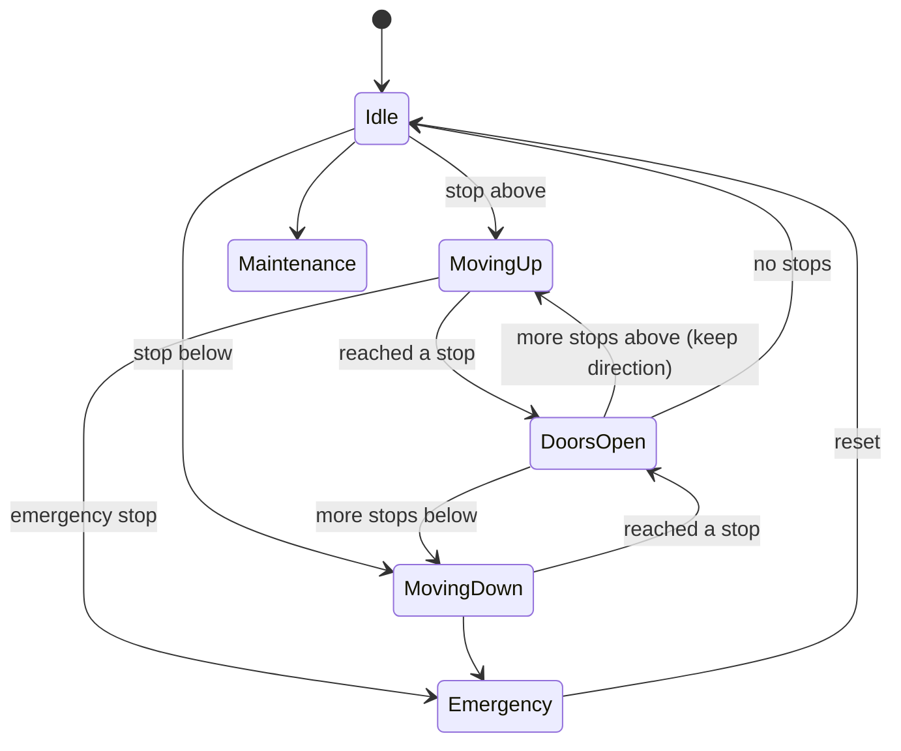
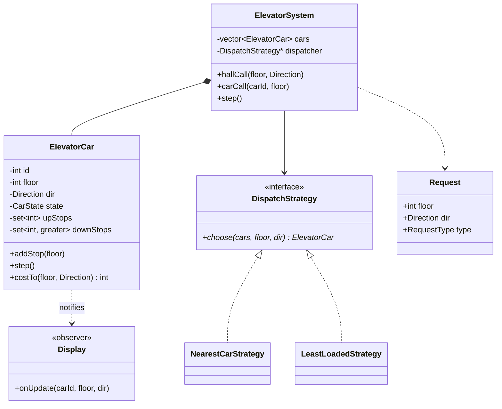

<!-- tab: LLD -->

## Requirements
1. A building has N floors and M elevator cars.
2. **Hall calls**: a person on a floor presses Up or Down. **Car calls**: a person inside presses a floor number.
3. The system assigns each hall call to a car and moves cars efficiently.
4. Each car shows its current floor and direction; doors open and close; capacity limit.
5. Emergency stop and maintenance mode.

## The core idea
Two layers. A **dispatcher** decides *which car* serves a hall call (Strategy). Each **car** decides *in what order* to visit its stops, using the **LOOK** algorithm: keep moving in one direction while there are stops ahead, then reverse. That's the same as disk scheduling (SCAN/LOOK).



## Classes



## C++ code: simulation with a tick

```cpp
#include <climits>
#include <cstdlib>
#include <iostream>
#include <memory>
#include <mutex>
#include <set>
#include <vector>

enum class Dir { Up, Down, Idle };

class ElevatorCar {
public:
    const int id; int floor = 0; Dir dir = Dir::Idle;
    std::set<int> up;                         // stops above, ascending
    std::set<int, std::greater<int>> down;    // stops below, descending
    explicit ElevatorCar(int i) : id(i) {}

    void addStop(int f) { if (f > floor) up.insert(f); else if (f < floor) down.insert(f); else openDoors(); }

    // cost to serve a hall call: distance, plus a penalty if we'd have to turn around first
    int costTo(int f, Dir want) const {
        int d = std::abs(f - floor);
        if (dir == Dir::Idle) return d;
        bool onTheWay = (dir == Dir::Up && f >= floor && want == Dir::Up) || (dir == Dir::Down && f <= floor && want == Dir::Down);
        return onTheWay ? d : d + 2 * 20;     // rough penalty for reversing
    }

    void step() {                              // one floor per tick (LOOK)
        if (dir == Dir::Idle) dir = !up.empty() ? Dir::Up : !down.empty() ? Dir::Down : Dir::Idle;
        if (dir == Dir::Up) {
            if (up.empty()) { dir = down.empty() ? Dir::Idle : Dir::Down; return; }
            ++floor; if (*up.begin() == floor) { up.erase(up.begin()); openDoors(); }
        } else if (dir == Dir::Down) {
            if (down.empty()) { dir = up.empty() ? Dir::Idle : Dir::Up; return; }
            --floor; if (*down.begin() == floor) { down.erase(down.begin()); openDoors(); }
        }
    }
private:
    void openDoors() { std::cout << "Car " << id << " opens at floor " << floor << "\n"; }
};

struct DispatchStrategy { virtual ~DispatchStrategy() = default; virtual ElevatorCar* choose(std::vector<std::unique_ptr<ElevatorCar>>&, int, Dir) = 0; };
struct NearestCarStrategy : DispatchStrategy {
    ElevatorCar* choose(std::vector<std::unique_ptr<ElevatorCar>>& cars, int f, Dir d) override {
        ElevatorCar* best = nullptr; int bestCost = INT_MAX;
        for (auto& c : cars) if (int k = c->costTo(f, d); k < bestCost) { bestCost = k; best = c.get(); }
        return best;
    }
};

class ElevatorSystem {
    std::vector<std::unique_ptr<ElevatorCar>> cars; std::unique_ptr<DispatchStrategy> dispatcher; std::mutex m;
public:
    ElevatorSystem(int n, std::unique_ptr<DispatchStrategy> d) : dispatcher(std::move(d)) { for (int i = 0; i < n; ++i) cars.push_back(std::make_unique<ElevatorCar>(i)); }
    void hallCall(int floor, Dir d) { std::lock_guard<std::mutex> lk(m); dispatcher->choose(cars, floor, d)->addStop(floor); }
    void carCall(int car, int floor) { std::lock_guard<std::mutex> lk(m); cars.at(car)->addStop(floor); }
    void step() { std::lock_guard<std::mutex> lk(m); for (auto& c : cars) c->step(); }   // called by a controller thread every tick
};

int main() {
    ElevatorSystem sys(2, std::make_unique<NearestCarStrategy>());
    sys.hallCall(5, Dir::Down); sys.carCall(1, 8);
    for (int t = 0; t < 12; ++t) sys.step();
}
```

**Concurrency**: buttons are pressed from many threads (or interrupts); a controller thread ticks the simulation. One mutex around the system state keeps it simple and correct; a production design gives each car its own thread and a command queue (Command pattern) so cars don't block each other.

## Dispatcher strategies to discuss
- **Nearest car** with a direction-aware cost (above).
- **Least loaded** to balance wear.
- **Zoning**: cars serve floor ranges during peak hours (morning up-peak: all cars return to the lobby).
- **Destination dispatch**: users enter their destination at the hall, the system groups people going to nearby floors into one car.

<!-- tab: Interview -->

### Q: Which algorithm orders a single car's stops?
LOOK (an elevator variant of SCAN): serve all requests in the current direction, then reverse only if there are requests the other way. It avoids starvation that a pure "nearest stop next" approach causes.

### Q: Why two sorted sets per car?
`up` ascending gives the next stop above in O(1) via `begin()`; `down` descending gives the next stop below. Inserts are O(log n).

### Q: How do you handle a hall call when all cars are busy?
Assign it to the car with the lowest cost even if it means a turnaround later; costs include stops already queued. Re-evaluate assignments periodically.

### Q: What design pattern turns button presses into queued instructions?
Command: each request is an object placed on the car's queue; it can be logged, cancelled or replayed.

```quiz
Q: LOOK differs from SCAN because LOOK…
- Always travels to the top floor before reversing
* Reverses at the last request in the current direction
- Serves the nearest request first
- Uses FIFO order
> SCAN goes to the end; LOOK turns at the last pending stop.

Q: Choosing which car serves a hall call is best modelled as…
* A Strategy (dispatcher)
- A Singleton
- A Decorator
- A Composite
> Different buildings and times of day use different dispatch rules.

Q: Car states like Idle, Moving, DoorsOpen and Emergency suggest…
- Builder
- Observer only
* A state machine
- Prototype
> Transitions depend on the current state and events.
```
