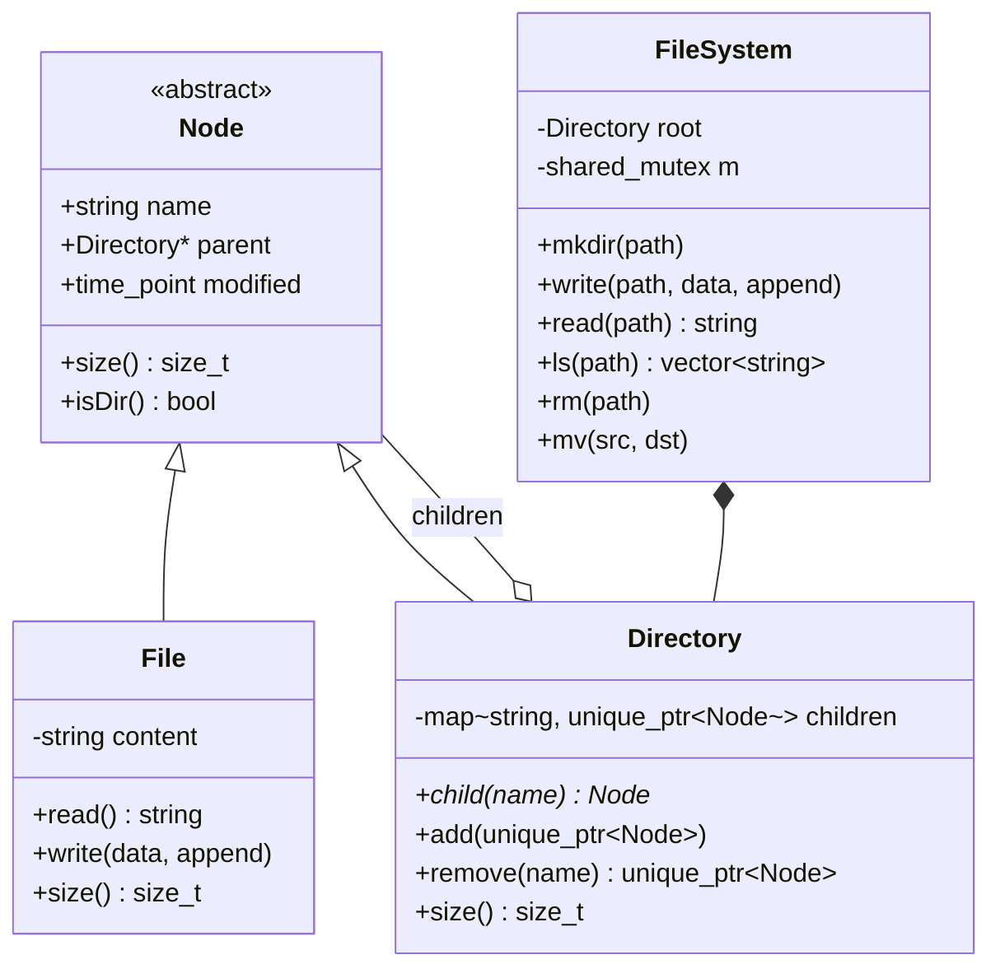
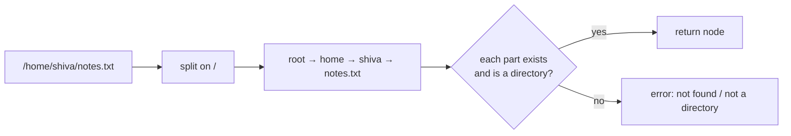
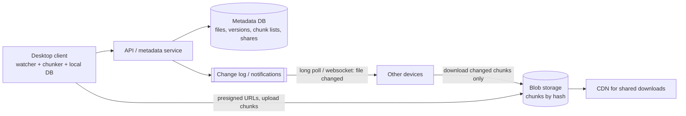

<!-- tab: LLD -->

## Requirements (in-memory file system)
1. `mkdir -p /a/b`, `touch`, `write(path, data)` (append or overwrite), `read(path)`, `ls(path)`, `rm(path)`, `mv(src, dst)`.
2. Paths are absolute; `ls` on a file returns just the file name; directory listings are sorted (LeetCode 588).
3. `size(path)` for a directory is the sum of everything inside.
4. Basic permissions (owner, read/write) — extension.
5. Thread-safe.

## Composite pattern: files and directories share one interface



`Directory::size()` sums `child->size()` recursively; the caller never needs to know whether it holds a file or a directory. That's Composite.

## Path resolution



## C++ code

```cpp
class Directory;
struct Node {
    std::string name; Directory* parent = nullptr;
    explicit Node(std::string n) : name(std::move(n)) {}
    virtual ~Node() = default;
    virtual bool isDir() const = 0;
    virtual size_t size() const = 0;
};
struct File : Node {
    std::string content;
    using Node::Node;
    bool isDir() const override { return false; }
    size_t size() const override { return content.size(); }
};
struct Directory : Node {
    std::map<std::string, std::unique_ptr<Node>> children;      // map keeps ls() sorted
    using Node::Node;
    bool isDir() const override { return true; }
    size_t size() const override { size_t s = 0; for (auto& [_, c] : children) s += c->size(); return s; }
    Node* child(const std::string& n) { auto it = children.find(n); return it == children.end() ? nullptr : it->second.get(); }
};

class FileSystem {
    Directory root{""}; mutable std::shared_mutex m;
    static std::vector<std::string> split(const std::string& p) {
        std::vector<std::string> parts; std::stringstream ss(p); std::string x;
        while (std::getline(ss, x, '/')) if (!x.empty()) parts.push_back(x);
        return parts;
    }
    Node* walk(const std::vector<std::string>& parts, bool create, bool lastIsFile = false) {
        Node* cur = &root;
        for (size_t i = 0; i < parts.size(); ++i) {
            auto* d = dynamic_cast<Directory*>(cur);
            if (!d) throw std::runtime_error("not a directory: " + parts[i - 1]);
            Node* next = d->child(parts[i]);
            if (!next) {
                if (!create) throw std::runtime_error("no such path");
                std::unique_ptr<Node> n = (lastIsFile && i + 1 == parts.size()) ? std::unique_ptr<Node>(new File(parts[i])) : std::unique_ptr<Node>(new Directory(parts[i]));
                n->parent = d; next = n.get(); d->children[parts[i]] = std::move(n);
            }
            cur = next;
        }
        return cur;
    }
public:
    void mkdir(const std::string& p) { std::unique_lock lk(m); walk(split(p), true); }
    void write(const std::string& p, const std::string& data, bool append = true) {
        std::unique_lock lk(m);
        auto* f = dynamic_cast<File*>(walk(split(p), true, true));
        if (!f) throw std::runtime_error("is a directory");
        f->content = append ? f->content + data : data;
    }
    std::string read(const std::string& p) const {
        std::shared_lock lk(m);
        auto* f = dynamic_cast<File*>(const_cast<FileSystem*>(this)->walk(split(p), false));
        if (!f) throw std::runtime_error("is a directory");
        return f->content;
    }
    std::vector<std::string> ls(const std::string& p) const {
        std::shared_lock lk(m);
        Node* n = const_cast<FileSystem*>(this)->walk(split(p), false);
        if (!n->isDir()) return {n->name};
        std::vector<std::string> out; for (auto& [k, _] : static_cast<Directory*>(n)->children) out.push_back(k); return out;
    }
    void rm(const std::string& p) {
        std::unique_lock lk(m); auto parts = split(p); if (parts.empty()) throw std::runtime_error("can't remove root");
        Node* n = walk(parts, false); n->parent->children.erase(n->name);
    }
};
```

**Locking**: a `shared_mutex` over the whole tree: many readers, one writer. Finer-grained designs lock per directory along the path (hand-over-hand locking), but say that only if asked.

### Extensions
- `mv`: detach the node from the old parent's map (`std::move` the `unique_ptr`) and insert under the new parent; reject moving a directory into its own subtree.
- **Permissions**: `owner`, `mode` bits on `Node`; check in `walk` (execute on directories) and in read/write.
- **Search**: `find(path, predicate)` with DFS, where the predicate is a Strategy (by extension, by size).

<!-- tab: HLD: Dropbox / Google Drive -->

## When it becomes a cloud file service

**Functional**: upload, download, share, sync across devices, version history. **Non-functional**: files up to 50 GB, durability 11 nines, sync within seconds, resumable over bad networks.



- **Chunking**: split files into ~4 MB chunks, name each by its SHA-256. Upload only chunks the server doesn't have (dedup across users and versions); resume by retrying failed chunks.
- **Metadata**: a file version = ordered list of chunk hashes. Rename or move touches metadata only.
- **Sync**: the client keeps a cursor into a per-user change log; the server pushes "something changed" over a long-lived connection, the client pulls the delta.
- **Conflicts**: two devices edit offline → keep both ("notes (conflicted copy).txt") rather than silently overwriting.
- **Uploads bypass app servers**: the API returns **presigned URLs** so clients write straight to blob storage.

<!-- tab: Interview -->

### Q: Why is the file system a Composite?
Files (leaves) and directories (composites) implement the same `Node` interface, so operations like `size()`, `print()` and permission checks treat them uniformly and recurse naturally.

### Q: Why `std::map` and not `unordered_map` for children?
`ls` must return names in sorted order; a map keeps them sorted with O(log n) operations. With a hash map you'd sort on every `ls`.

### Q: How do you prevent moving `/a` into `/a/b`?
Walk up from the destination's parents; if you meet the source node, reject.

### Q: How does Dropbox avoid re-uploading an unchanged 2 GB file after a small edit?
Content-defined or fixed-size chunking: only chunks whose hashes changed are uploaded; metadata points the new version at mostly the same chunks.

```quiz
Q: Which pattern lets Directory::size() call size() on files and subdirectories alike?
* Composite
- Iterator
- Bridge
- Flyweight
> Leaves and containers share the component interface.

Q: Best way for clients to upload big files without passing through app servers?
- Base64 in a JSON API call
* Presigned URLs straight to blob storage
- Email attachments
- WebSockets to the database
> App servers only issue short-lived signed URLs.

Q: Naming chunks by their SHA-256 hash enables…
- Encryption
* Deduplication and integrity checks
- Faster DNS
- Compression
> Identical content gets the same name; corruption changes the hash.
```
