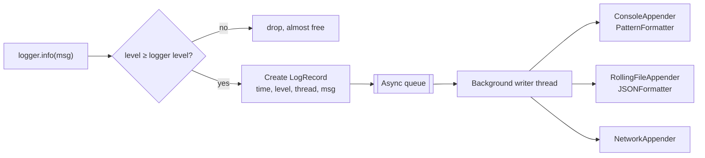
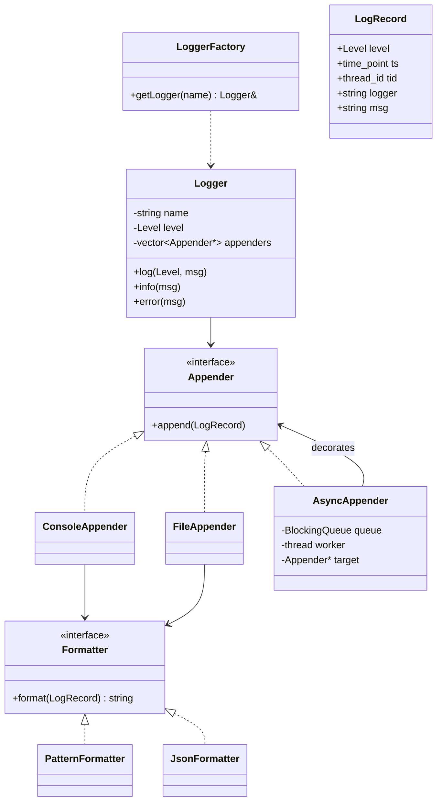
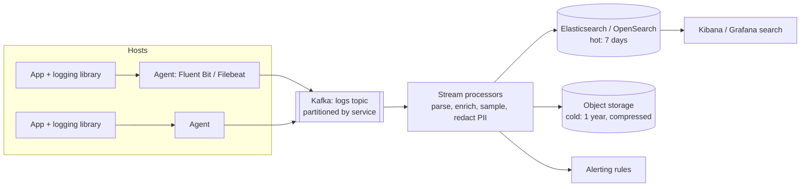

<!-- tab: LLD -->

## Requirements (log4j / spdlog style)
1. `logger.debug/info/warn/error/fatal(message)`.
2. A minimum level per logger; messages below it are dropped cheaply.
3. Multiple **appenders** (console, file, rolling file, network), each with its own **formatter** and level.
4. Thread-safe; logging must not slow the application (async option).
5. Configurable at runtime.

## How a log call flows



## Classes



**Patterns**
- **Singleton / registry**: `LoggerFactory::getLogger("payments")` returns the same logger everywhere.
- **Strategy**: formatters.
- **Decorator**: `AsyncAppender` wraps any appender and makes it asynchronous.
- **Chain of Responsibility**: in log4j, a message passes from a logger to its parent loggers (`com.app.payments` → `com.app` → root), each with appenders; also level filters as a chain.

## C++ code

```cpp
enum class Level { Debug, Info, Warn, Error, Fatal };
const char* name(Level l) { static const char* n[] = {"DEBUG", "INFO", "WARN", "ERROR", "FATAL"}; return n[(int)l]; }

struct LogRecord { Level level; std::chrono::system_clock::time_point ts; std::thread::id tid; std::string logger, msg; };

struct Formatter { virtual ~Formatter() = default; virtual std::string format(const LogRecord&) const = 0; };
struct PatternFormatter : Formatter {
    std::string format(const LogRecord& r) const override {
        auto t = std::chrono::system_clock::to_time_t(r.ts); char buf[32];
        std::strftime(buf, sizeof buf, "%F %T", std::localtime(&t));
        std::ostringstream os; os << buf << " [" << name(r.level) << "] " << r.logger << " - " << r.msg; return os.str();
    }
};

struct Appender { virtual ~Appender() = default; virtual void append(const LogRecord&) = 0; };
class ConsoleAppender : public Appender {
    std::unique_ptr<Formatter> f; std::mutex m;
public:
    explicit ConsoleAppender(std::unique_ptr<Formatter> fm) : f(std::move(fm)) {}
    void append(const LogRecord& r) override { auto s = f->format(r); std::lock_guard<std::mutex> lk(m); std::cout << s << '\n'; }
};

class AsyncAppender : public Appender {                 // decorator: hands records to a background thread
    std::unique_ptr<Appender> target; std::queue<LogRecord> q; std::mutex m; std::condition_variable cv; bool stop = false; std::thread worker;
public:
    explicit AsyncAppender(std::unique_ptr<Appender> t) : target(std::move(t)), worker([this] { run(); }) {}
    void append(const LogRecord& r) override { { std::lock_guard<std::mutex> lk(m); q.push(r); } cv.notify_one(); }
    ~AsyncAppender() override { { std::lock_guard<std::mutex> lk(m); stop = true; } cv.notify_one(); worker.join(); }   // flush on shutdown
private:
    void run() {
        std::unique_lock<std::mutex> lk(m);
        for (;;) {
            cv.wait(lk, [&] { return stop || !q.empty(); });
            while (!q.empty()) { auto r = std::move(q.front()); q.pop(); lk.unlock(); target->append(r); lk.lock(); }
            if (stop) return;
        }
    }
};

class Logger {
    std::string nm; std::atomic<Level> lvl{Level::Info}; std::vector<std::shared_ptr<Appender>> apps;
public:
    explicit Logger(std::string n) : nm(std::move(n)) {}
    void setLevel(Level l) { lvl = l; }
    void addAppender(std::shared_ptr<Appender> a) { apps.push_back(std::move(a)); }
    void log(Level l, const std::string& msg) {
        if (l < lvl.load(std::memory_order_relaxed)) return;              // cheap early exit
        LogRecord r{l, std::chrono::system_clock::now(), std::this_thread::get_id(), nm, msg};
        for (auto& a : apps) a->append(r);
    }
    void info(const std::string& m) { log(Level::Info, m); }
    void error(const std::string& m) { log(Level::Error, m); }
};

class LoggerFactory {                                   // registry singleton
    std::unordered_map<std::string, std::unique_ptr<Logger>> loggers; std::mutex m;
public:
    static LoggerFactory& instance() { static LoggerFactory f; return f; }
    Logger& get(const std::string& n) { std::lock_guard<std::mutex> lk(m); auto& p = loggers[n]; if (!p) p = std::make_unique<Logger>(n); return *p; }
};
```

> [!TIP]
> Two performance points interviewers like: check the level **before** building the message (macros like `LOG_DEBUG(x)` that skip argument evaluation), and use async appenders with a bounded queue plus a policy for when it's full (block, or drop DEBUG first).

<!-- tab: HLD: log pipeline -->

## Where the logs go at company scale



- **Volume**: 10K servers × 1 MB/min ≈ 14 TB/day. Kafka buffers spikes; Elasticsearch keeps a short hot window; object storage is cheap for long retention.
- **Structured logs** (JSON with `trace_id`, `user_id`, `service`) make search and correlation with traces possible.
- **Sampling**: keep all errors, sample debug and info under load.
- **PII redaction** before indexing.

<!-- tab: Interview -->

### Q: How do you keep logging from slowing down request handling?
Early level check, async appenders with a bounded in-memory queue and a background writer, batching writes, and avoiding locks on the hot path (per-thread buffers).

### Q: What happens if the async queue is full?
Pick a policy: block the caller (no loss, possible latency), drop lower-severity records (keep errors), or drop and count drops. Production systems usually drop debug and info first.

### Q: How do you ensure no logs are lost on crash?
You can't fully with async in-memory queues. Flush on graceful shutdown (destructor joins the writer), flush synchronously for ERROR/FATAL, and write to a local file that an agent ships, so a process crash doesn't lose what's already on disk.

### Q: Which pattern is the logger hierarchy?
Chain of Responsibility: a record propagates from a child logger to its ancestors, each with its own appenders, unless additivity is turned off.

```quiz
Q: AsyncAppender wrapping a FileAppender is an example of…
- Adapter
* Decorator
- Facade
- Composite
> Same interface, added behaviour.

Q: The cheapest way to skip a DEBUG message in production is…
- Format it then discard
* Check the level before building the message
- Send it to /dev/null
- Lower the thread priority
> Avoid formatting and allocation entirely.

Q: Why put Kafka between log agents and Elasticsearch?
- Kafka indexes text
* To buffer spikes and decouple producers from indexing speed
- Elasticsearch can't accept HTTP
- To encrypt logs
> Indexing slowdowns shouldn't make agents drop logs.
```
