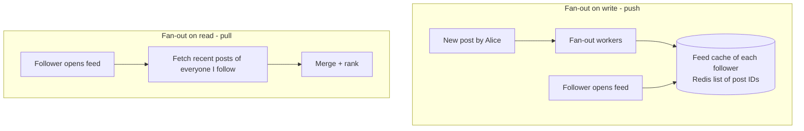
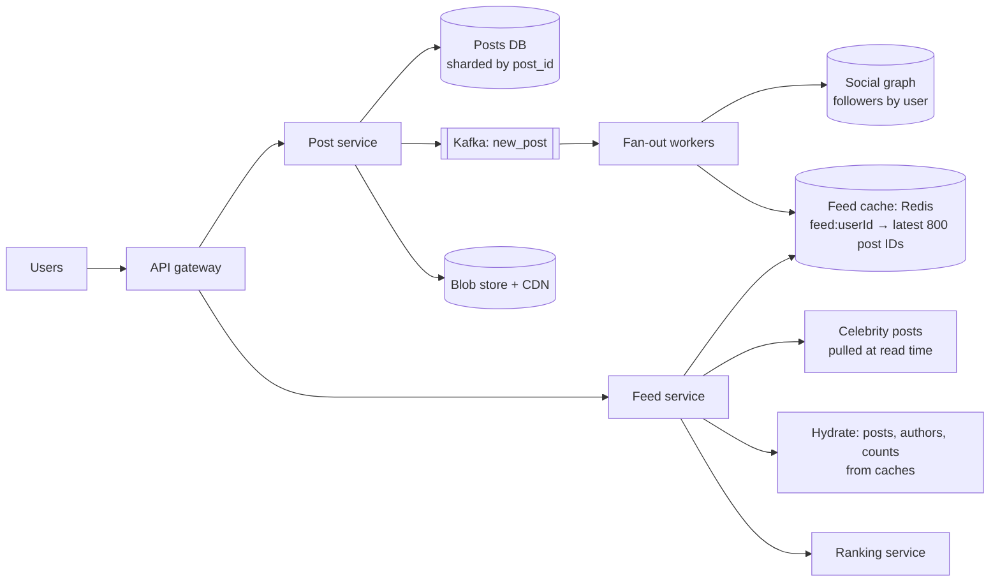

<!-- tab: HLD -->

## Requirements

**Functional**
1. Users create posts (text, images).
2. Users follow other users (asymmetric, like Twitter/Instagram).
3. Users see a feed of posts from people they follow, newest or ranked first, with infinite scroll.

**Non-functional**
- Feed load p99 under 500 ms.
- Eventual consistency is fine: a new post can take a few seconds to appear.
- Scale: 500M DAU, each opens the feed 10 times a day; 50M posts/day. Some accounts have 100M followers.

## Estimation
Feed reads: 500M × 10 / 10⁵ ≈ 50K reads/s average, 150K peak. Post writes: 50M / 10⁵ ≈ 600/s. Reads dominate ~100:1, so pay at write time to make reads cheap.

## API

```http
POST /v1/posts                 { text, mediaIds[] }
POST /v1/users/{id}/follow
GET  /v1/feed?cursor=…&limit=20
```

## Fan-out on write vs fan-out on read



| | Fan-out on write | Fan-out on read |
|---|---|---|
| Write cost | One write per follower | One write |
| Read cost | One cache read | Query N followees and merge |
| Problem | A celebrity with 100M followers = 100M writes per post | Slow feeds for users following many accounts |
| Best for | Normal users | Celebrities |

**Hybrid (what Twitter and Instagram do):** push posts from normal users into followers' feed caches; for celebrities (say > 100K followers), don't fan out. At read time, merge the precomputed feed with recent posts from the few celebrities the user follows.

## High-level design



### Feed read path
1. Read the top ~200 post IDs from `feed:{userId}` in Redis.
2. Fetch recent posts from followed celebrities and merge by time.
3. **Hydrate**: batch-get post bodies, author names, like counts from caches (multi-get).
4. Rank (recency + engagement + affinity), return 20 with a cursor.

### Feed write path
1. Post service stores the post and publishes `new_post` to Kafka.
2. Fan-out workers page through the author's followers and `LPUSH` the post ID into each follower's feed list, trimming to ~800 (`LTRIM`).
3. Skip inactive users (no login in 30 days); build their feed on demand when they return.

## Deep dives
- **Celebrity problem**: hybrid approach above; also rate-limit fan-out workers so one celebrity doesn't stall everyone's fan-out.
- **Feed cache memory**: 500M users × 800 IDs × 8 bytes ≈ 3.2 TB of Redis, so cache only active users' feeds.
- **Pagination**: cursor = last seen post ID/score, stable even as new posts arrive at the top.
- **Ranking**: start with reverse-chronological; move to an ML model scoring candidates (two-stage: candidate generation then ranking).
- **Deletes and privacy**: when a post is deleted, filter at hydration time (cheaper than removing from millions of lists).
- **Counts** (likes, comments): sharded counters in Redis, flushed to the DB asynchronously.

<!-- tab: Interview -->

### Q: Push or pull?
Hybrid. Push for most users because reads dominate; pull for celebrities because pushing to 100M followers per post is too expensive. Merge at read time.

### Q: How big is the fan-out cost per day?
50M posts × average 200 followers = 10B feed inserts/day ≈ 115K writes/s, fine for a Redis cluster. The tail (celebrities) is what breaks it, hence the hybrid.

### Q: A user follows someone new. When do that person's posts show up?
Backfill: fetch the followee's recent posts and merge them into the follower's feed cache, or just let the read path pull them for the first few hours.

### Q: How do you paginate a feed that changes constantly?
Cursor-based: return items older than the last item's score/ID. Offsets would skip or duplicate posts when new ones are inserted at the top.

```quiz
Q: Main drawback of pure fan-out on write?
- Slow feed reads
* Massive write amplification for accounts with millions of followers
- Inconsistent ordering
- Needs SQL joins
> One celebrity post becomes millions of cache writes.

Q: What's stored in each user's feed cache?
* Post IDs (then hydrated)
- Full post bodies and images
- Follower lists
- Only counts
> IDs keep the cache small; bodies come from a shared post cache.

Q: Which pagination is right for an infinite-scroll feed?
- OFFSET/LIMIT
* Cursor based on the last item seen
- Page numbers
- Random sampling
> Stable under inserts at the head.
```
