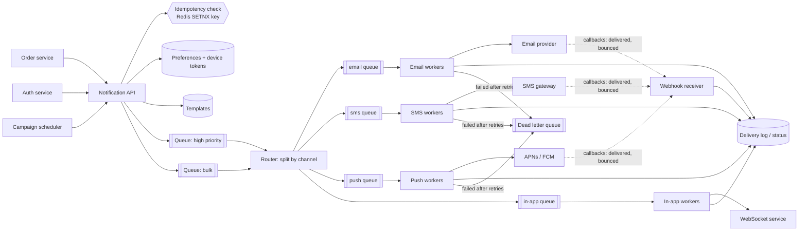
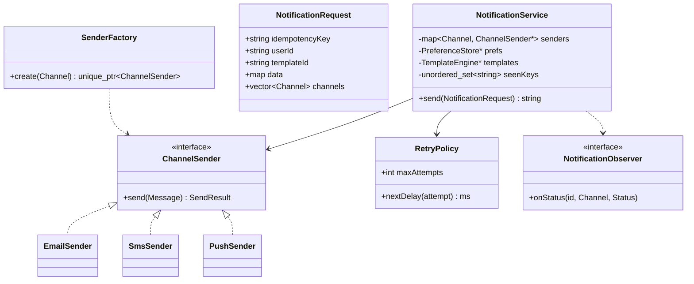

<!-- tab: HLD -->

## Requirements

**Functional**
1. Internal services send a notification to a user (or a segment) through **email, SMS, push, in-app**.
2. Templates with variables; user preferences (opt-outs, quiet hours, channel choice).
3. Scheduled and bulk sends (a campaign to 10M users).
4. Delivery status tracking.

**Non-functional**
- At-least-once delivery, but **no visible duplicates** (idempotency).
- Transactional messages (OTP, payment receipt) delivered in seconds; marketing can wait.
- Scale: 1B notifications/day, bursts of 50K/s during campaigns.
- One slow provider (an SMS vendor) must not block other channels.

## Estimation
1B/day ≈ 12K/s average, peak ~50K/s. Message metadata ~1 KB → 1 TB/day of logs; keep 30 days hot.

## API

```http
POST /v1/notifications
Idempotency-Key: order-981-receipt
{ "userId": "u42", "template": "payment_success", "data": { "amount": "₹499" },
  "channels": ["push", "email"], "priority": "high", "sendAt": null }
→ 202 { "notificationId": "n_7f3" }
```

## Architecture



**Why a queue per channel:** isolation. If the SMS provider slows down, only the SMS queue backs up; push and email keep flowing (bulkhead pattern). Workers per channel scale independently.

## Deep dives

### Idempotency and dedup
- The caller sends an `Idempotency-Key`. The API does `SET key notifId NX EX 86400` in Redis; if the key exists, return the original `notificationId`.
- Workers can still process a message twice (at-least-once queues). Store `(notification_id, channel)` in the delivery log with a unique constraint and check before calling the provider. Providers like SES also accept a client token.

### Retries
Exponential backoff with jitter (1 s, 2 s, 4 s … capped), a max attempt count, then the **dead-letter queue** for inspection. Distinguish **retryable** errors (timeouts, 5xx, 429) from **permanent** ones (invalid number, unsubscribed).

### Priorities
Separate queues (or topics) for transactional and bulk. Workers poll high priority first. OTPs never sit behind a 10M-user campaign.

### Preferences and quiet hours
Check preferences before enqueueing. For quiet hours, schedule for the user's local morning instead of dropping. Always honour unsubscribe for marketing (legal requirement).

### Fan-out for campaigns
A campaign "send to 10M users in segment X" is expanded by a batch job that pages through the segment and enqueues in chunks, with a rate limit per provider to stay inside their quotas.

### Rate limiting per user
Cap marketing notifications per user per day (token bucket keyed by user and category) so users don't get spammed by several teams.

<!-- tab: LLD -->

## Single-process notification service



```cpp
enum class Channel { Email, Sms, Push };
enum class SendResult { Ok, Retryable, Permanent };

struct Message { std::string to, subject, body; };
struct ChannelSender { virtual ~ChannelSender() = default; virtual SendResult send(const Message&) = 0; };
struct EmailSender : ChannelSender { SendResult send(const Message& m) override { /* SMTP / SES call */ return SendResult::Ok; } };
struct SmsSender   : ChannelSender { SendResult send(const Message& m) override { return SendResult::Ok; } };

struct TemplateEngine {                       // "Hi {{name}}" + {name: "Shiva"}
    std::string render(std::string t, const std::map<std::string, std::string>& data) const {
        for (auto& [k, v] : data) for (size_t p; (p = t.find("{{" + k + "}}")) != std::string::npos;) t.replace(p, k.size() + 4, v);
        return t;
    }
};

class NotificationService {
    std::map<Channel, std::unique_ptr<ChannelSender>> senders;
    TemplateEngine tpl; std::unordered_set<std::string> seen; std::mutex m;
public:
    void registerSender(Channel c, std::unique_ptr<ChannelSender> s) { senders[c] = std::move(s); }
    bool send(const std::string& idemKey, Channel c, const std::string& to, const std::string& t, const std::map<std::string, std::string>& data) {
        { std::lock_guard<std::mutex> lk(m); if (!seen.insert(idemKey).second) return true; }   // duplicate: already handled
        Message msg{to, "", tpl.render(t, data)};
        for (int attempt = 0; attempt < 4; ++attempt) {
            SendResult r = senders.at(c)->send(msg);
            if (r == SendResult::Ok) return true;
            if (r == SendResult::Permanent) return false;
            std::this_thread::sleep_for(std::chrono::milliseconds(100 << attempt));   // backoff: 100, 200, 400 ms
        }
        return false;                                                                  // → dead-letter in a real system
    }
};
```

Patterns: **Factory** creates senders per channel, **Strategy** for retry policy, **Observer** for status callbacks, **Template method** if each sender shares a "validate → render → send → log" skeleton.

<!-- tab: Interview -->

### Q: How do you guarantee an OTP isn't delayed by a marketing campaign?
Separate high-priority and bulk queues with dedicated worker capacity; route by message type at the API.

### Q: The SMS provider is down for 10 minutes. What happens?
SMS messages accumulate in the SMS queue; workers retry with backoff; a circuit breaker stops hammering the provider and optionally fails over to a secondary SMS vendor. Other channels are unaffected because each channel has its own queue and workers.

### Q: How do you avoid sending the same push twice?
Idempotency key at the API (Redis SETNX) and a unique `(notification_id, channel)` in the delivery log checked by workers. Exactly-once isn't possible end to end with external providers; dedup makes duplicates rare.

### Q: How do you track whether an email was opened?
A tracking pixel and wrapped links; provider webhooks for delivered and bounced. Store events in the delivery log keyed by `notification_id`.

```quiz
Q: Why one queue per channel?
- Lower storage cost
* A slow provider only backs up its own channel
- Queues require it
- To keep messages ordered across channels
> Bulkhead isolation.

Q: A provider returns "invalid phone number". The worker should…
- Retry with backoff forever
* Mark it permanently failed, no retry
- Send via email instead automatically
- Put it back on the same queue
> Permanent errors don't get better with retries.

Q: Which store fits the idempotency check at the API?
* Redis SET with NX and a TTL
- A CDN
- Kafka
- Blob storage
> Atomic set-if-absent with expiry.
```
