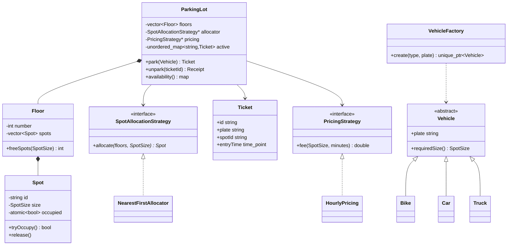
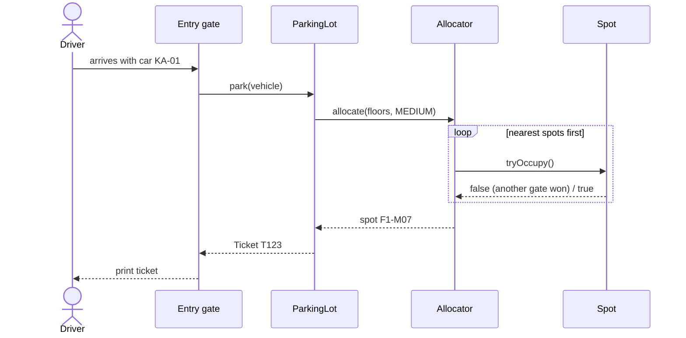
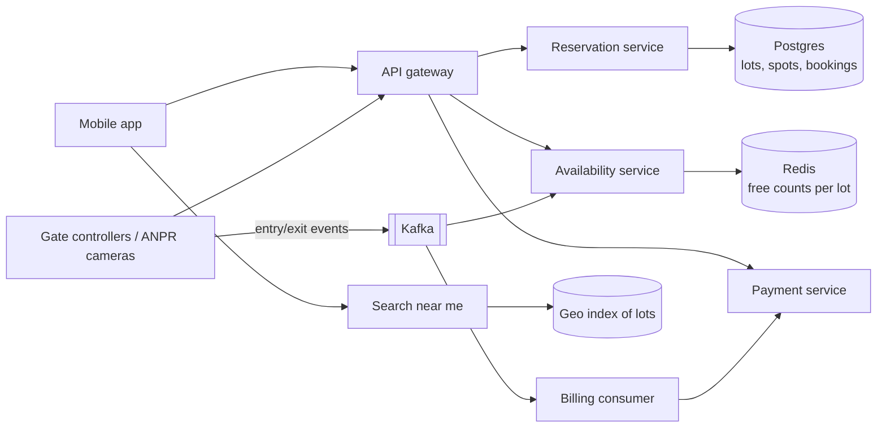

<!-- tab: LLD -->

## Requirements
1. A lot has several floors; each floor has spots of sizes **small** (bike), **medium** (car), **large** (truck/bus).
2. A vehicle enters, gets the nearest free spot that fits, and receives a ticket.
3. On exit, the fee is computed from the duration and a pricing rule; the spot is freed.
4. Show free-spot counts per floor and size (display boards).
5. Several entry and exit gates work at the same time, so two cars must never get the same spot.

Out of scope: reservations, EV charging (mention as extensions).

## Entities and relationships



**Patterns used**
- **Strategy** for spot allocation (nearest, by floor, by gate) and pricing (hourly, flat, weekend).
- **Factory** to create vehicles from a type.
- **Singleton** for `ParkingLot` only if the interviewer insists there's exactly one; otherwise pass it in.
- **Observer** (extension) for display boards that update when spots change.

## Park flow



## C++ code (compiles with C++17)

```cpp
#include <atomic>
#include <chrono>
#include <memory>
#include <mutex>
#include <stdexcept>
#include <string>
#include <unordered_map>
#include <vector>
using Clock = std::chrono::system_clock;

enum class SpotSize { Small, Medium, Large };
enum class VehicleType { Bike, Car, Truck };

class Vehicle {
public:
    explicit Vehicle(std::string p) : plate(std::move(p)) {}
    virtual ~Vehicle() = default;
    virtual SpotSize requiredSize() const = 0;
    const std::string plate;
};
struct Bike  : Vehicle { using Vehicle::Vehicle; SpotSize requiredSize() const override { return SpotSize::Small; } };
struct Car   : Vehicle { using Vehicle::Vehicle; SpotSize requiredSize() const override { return SpotSize::Medium; } };
struct Truck : Vehicle { using Vehicle::Vehicle; SpotSize requiredSize() const override { return SpotSize::Large; } };

struct VehicleFactory {
    static std::unique_ptr<Vehicle> create(VehicleType t, const std::string& plate) {
        switch (t) {
            case VehicleType::Bike:  return std::make_unique<Bike>(plate);
            case VehicleType::Car:   return std::make_unique<Car>(plate);
            case VehicleType::Truck: return std::make_unique<Truck>(plate);
        }
        throw std::invalid_argument("type");
    }
};

class Spot {
    std::atomic<bool> occupied{false};
public:
    Spot(std::string i, SpotSize s) : id(std::move(i)), size(s) {}
    bool tryOccupy() { bool expected = false; return occupied.compare_exchange_strong(expected, true); }  // lock-free claim
    void release() { occupied.store(false); }
    bool isFree() const { return !occupied.load(); }
    const std::string id; const SpotSize size;
};

struct Floor { int number; std::vector<std::unique_ptr<Spot>> spots; };

struct SpotAllocationStrategy { virtual ~SpotAllocationStrategy() = default; virtual Spot* allocate(std::vector<Floor>&, SpotSize) = 0; };
struct NearestFirstAllocator : SpotAllocationStrategy {
    Spot* allocate(std::vector<Floor>& floors, SpotSize need) override {
        for (auto& f : floors)
            for (auto& s : f.spots)
                if (s->size == need && s->isFree() && s->tryOccupy()) return s.get();   // CAS wins or we keep looking
        return nullptr;
    }
};

struct PricingStrategy { virtual ~PricingStrategy() = default; virtual double fee(SpotSize, long minutes) const = 0; };
struct HourlyPricing : PricingStrategy {
    double fee(SpotSize s, long m) const override {
        static const double rate[] = {10, 30, 60};                // per hour, rounded up
        long hours = std::max(1L, (m + 59) / 60);
        return rate[static_cast<int>(s)] * hours;
    }
};

struct Ticket { std::string id, plate; Spot* spot; Clock::time_point entry; };

class ParkingLot {
    std::vector<Floor> floors;
    std::unique_ptr<SpotAllocationStrategy> allocator;
    std::unique_ptr<PricingStrategy> pricing;
    std::unordered_map<std::string, Ticket> active;   // ticketId -> ticket
    std::mutex ticketsMutex;
    std::atomic<long> seq{1};
public:
    ParkingLot(std::vector<Floor> f, std::unique_ptr<SpotAllocationStrategy> a, std::unique_ptr<PricingStrategy> p)
        : floors(std::move(f)), allocator(std::move(a)), pricing(std::move(p)) {}

    Ticket park(const Vehicle& v) {
        Spot* s = allocator->allocate(floors, v.requiredSize());
        if (!s) throw std::runtime_error("lot full for this size");
        Ticket t{"T" + std::to_string(seq++), v.plate, s, Clock::now()};
        std::lock_guard<std::mutex> lk(ticketsMutex);
        active.emplace(t.id, t);
        return t;
    }

    double unpark(const std::string& ticketId) {
        Ticket t;
        {
            std::lock_guard<std::mutex> lk(ticketsMutex);
            auto it = active.find(ticketId);
            if (it == active.end()) throw std::invalid_argument("unknown or already used ticket");
            t = it->second; active.erase(it);
        }
        long mins = std::chrono::duration_cast<std::chrono::minutes>(Clock::now() - t.entry).count();
        double amount = pricing->fee(t.spot->size, mins);
        t.spot->release();
        return amount;
    }
};
```

> [!SAY]
> "Allocation is the only contended operation. Instead of one big lock, each spot is claimed with a compare-and-swap, so two gates can scan at the same time and exactly one wins each spot."

### Edge cases to mention
- Lost ticket: charge the daily maximum after plate lookup.
- A car may park in a larger spot when its size is full (configurable fallback in the allocator).
- Display boards: keep per-floor `atomic<int>` counters updated on occupy and release, or make boards Observers.
- Payment failure at exit: keep the ticket active until payment succeeds.

<!-- tab: HLD: smart parking at city scale -->

## If the interviewer scales it up
"Design a parking app for 5,000 lots across a city, with reservations and live availability."



- **Reservations** are a booking problem: hold a spot with a TTL, confirm on payment (same pattern as BookMyShow), unique constraint on `(spot_id, time_slot)`.
- **Availability** is high-read: gates publish events; a consumer updates Redis counters; the app reads Redis. Slight staleness is fine.
- **Search** uses a geo index (geohash in Redis `GEOSEARCH` or PostGIS).
- **Gates** must keep working if the cloud is unreachable: local controller with its own state, syncs later.

<!-- tab: Interview -->

### Q: How do you stop two cars getting the same spot?
Make "check free and mark occupied" atomic: a compare-and-swap on the spot's flag, or a lock around allocation. In a database-backed version: `UPDATE spots SET occupied = true WHERE id = ? AND occupied = false` and check the affected row count.

### Q: Where does the pricing rule live and why?
Behind a `PricingStrategy` interface injected into the lot. Rates change often (weekends, events); new rules become new classes without touching parking logic (open/closed).

### Q: Should ParkingLot be a singleton?
Only if the requirement truly says one lot per process. It makes testing harder; dependency injection is usually better. Interviewers like hearing both sides.

### Q: How would you find the nearest free spot quickly with thousands of spots?
Keep a min-heap (or ordered set) of free spots per size, keyed by distance from the entrance; pop to allocate, push back on release. O(log n) instead of a scan.

### Q: How would you add EV charging spots?
New `SpotType` with a `ChargerSpot` subclass, an allocator that prefers it for EVs, and pricing that adds energy cost: a strategy decorator.

```quiz
Q: Which pattern lets you switch between hourly and flat pricing without editing ParkingLot?
- Singleton
* Strategy
- Observer
- Builder
> The lot depends on a PricingStrategy interface.

Q: compare_exchange_strong(expected=false, true) on a spot flag returns true when…
* This thread changed it from free to occupied
- The spot was already occupied
- Any thread has ever occupied it
- The lock is held
> CAS succeeds only if the current value equals expected.

Q: Data structure for O(log n) nearest-free-spot allocation?
- Linked list
* Min-heap or ordered set keyed by distance
- Hash map
- Stack
> Pop the closest free spot; push it back on release.

Q: Display boards that refresh whenever a spot changes suggest which pattern?
- Factory
- Command
* Observer
- Adapter
> Boards subscribe to spot events.
```
