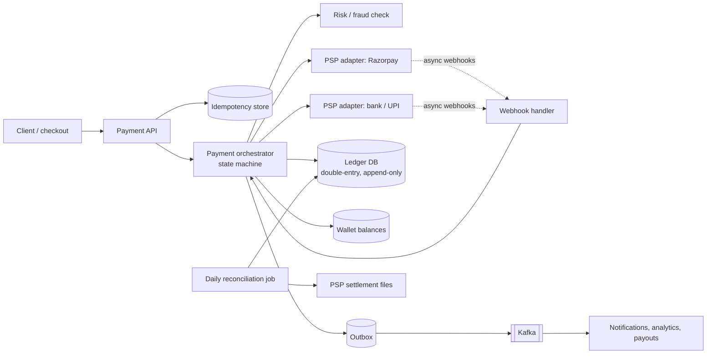
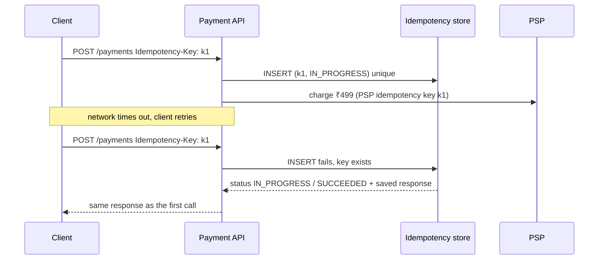
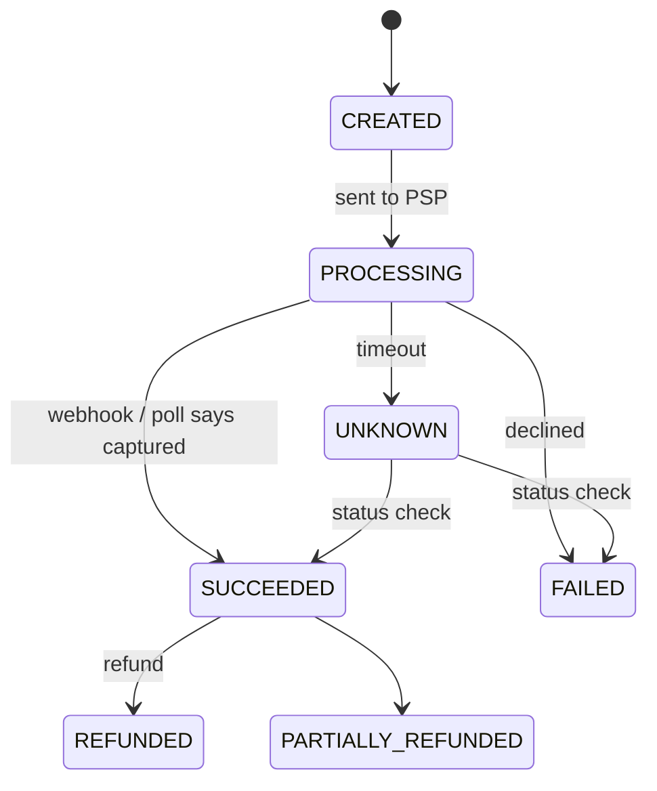

<!-- tab: HLD -->

## Requirements

**Functional**
1. Merchants (or our app) charge a customer by card/UPI/wallet through external payment service providers (PSPs: Stripe, Razorpay, banks).
2. Users hold a wallet balance, add money, and transfer to other users.
3. Refunds; payouts to merchants; transaction history.

**Non-functional**
- **Correctness over everything**: never charge twice, never lose money, every rupee accounted for.
- Strong consistency for balances; full audit trail.
- Highly available, but a failed payment is better than a wrong one.
- Scale: ~1,000–10,000 payments/s at peak (UPI-scale is higher; ask).

## Building blocks



## Deep dive: idempotency (never charge twice)



- The client generates the key (UUID per checkout attempt). The server stores key → request hash → response with a **unique constraint**.
- Pass the same key (or our payment ID) to the PSP so their side is idempotent too.
- If the request body differs for the same key, return 422: it's a client bug.

## Deep dive: payment state machine



Every transition is a conditional update (`WHERE state = 'PROCESSING'`) so duplicate webhooks can't move it twice. **Timeouts are not failures**: a timed-out charge may have succeeded, so mark it UNKNOWN and query the PSP before telling the user anything.

## Deep dive: double-entry ledger

Every money movement writes **two entries that sum to zero**: a debit to one account and a credit to another. Balances are derived from (or checked against) the ledger, which is append-only — mistakes are fixed with new reversing entries, never updates.

| txn_id | account | debit | credit |
|---|---|---|---|
| t1 | user:shiva:wallet | 500 | |
| t1 | user:asha:wallet | | 500 |
| t2 | user:shiva:wallet | 499 | |
| t2 | merchant:zomato | | 489 |
| t2 | platform:fees | | 10 |

Invariant: sum of all debits = sum of all credits, per transaction and overall. Reconciliation jobs check it.

## Deep dive: wallet transfer without races

```sql
BEGIN;
-- lock both wallets in a fixed order (lower id first) to avoid deadlock
SELECT balance FROM wallets WHERE id IN ('asha','shiva') ORDER BY id FOR UPDATE;
UPDATE wallets SET balance = balance - 500 WHERE id = 'shiva' AND balance >= 500;   -- check affected rows = 1
UPDATE wallets SET balance = balance + 500 WHERE id = 'asha';
INSERT INTO ledger (txn_id, account, debit, credit) VALUES ('t1','shiva',500,0), ('t1','asha',0,500);
INSERT INTO outbox (event) VALUES ('{"type":"TransferCompleted","txn":"t1"}');
COMMIT;
```

Across services or shards, use a **saga** with compensations, not two-phase commit.

## Reconciliation
Daily, compare our ledger with PSP settlement reports and bank statements; mismatches go to a queue for investigation. This catches lost webhooks, double captures and fee errors.

```mermaid
classDiagram
  class Wallet {
    +string id
    +string userId
    -long balancePaise
    -mutex m
    +debit(amount, txnId)
    +credit(amount, txnId)
  }
  class Transaction {
    +string id
    +TxnType type
    +string from
    +string to
    +long amount
    +TxnStatus status
    +time_point ts
  }
  class LedgerEntry {
    +string txnId
    +string account
    +long debit
    +long credit
  }
  class WalletService {
    +addMoney(userId, amount, PaymentMethod, idemKey) Transaction
    +transfer(from, to, amount, idemKey) Transaction
    +history(userId) vector~Transaction~
  }
  class PaymentMethod {
    <<interface>>
    +charge(amount) bool
  }
  class CardPayment
  class UpiPayment
  class PaymentGatewayAdapter {
    <<interface>>
    +charge(amount, key) PspResult
  }
  WalletService --> Wallet
  WalletService --> Transaction
  WalletService --> LedgerEntry
  WalletService --> PaymentMethod
  PaymentMethod <|.. CardPayment
  PaymentMethod <|.. UpiPayment
  CardPayment --> PaymentGatewayAdapter
```

<!-- tab: LLD: digital wallet -->



```cpp
using Paise = long long;
struct Wallet { std::string id; Paise balance = 0; std::mutex m; };

class WalletService {
    std::unordered_map<std::string, std::unique_ptr<Wallet>> wallets;
    std::unordered_map<std::string, std::string> idem;          // idempotency key -> txn id
    std::mutex idemM; long seq = 0;
public:
    Wallet& create(const std::string& id) { auto& w = wallets[id]; w = std::make_unique<Wallet>(); w->id = id; return *w; }
    std::string transfer(const std::string& from, const std::string& to, Paise amt, const std::string& key) {
        if (amt <= 0 || from == to) throw std::invalid_argument("bad transfer");
        { std::lock_guard<std::mutex> lk(idemM); if (auto it = idem.find(key); it != idem.end()) return it->second; }
        Wallet& a = *wallets.at(from); Wallet& b = *wallets.at(to);
        std::scoped_lock lk(a.m, b.m);                           // locks both without deadlock
        if (a.balance < amt) throw std::runtime_error("insufficient balance");
        a.balance -= amt; b.balance += amt;
        std::lock_guard<std::mutex> lk2(idemM);
        std::string txn = "t" + std::to_string(++seq); idem[key] = txn;   // + ledger entries in a real system
        return txn;
    }
};
```

Patterns: **Adapter** per PSP, **Strategy** for payment method, **State** for transaction status, **Observer/outbox** for notifications.

<!-- tab: Interview -->

### Q: How do you prevent double charging when the client retries?
Idempotency keys: unique key per payment attempt stored with the result; retries return the stored result. Pass the key to the PSP too. Webhooks are deduplicated by event ID and state transitions are conditional.

### Q: The PSP call timed out. Did the payment succeed?
Unknown. Never assume failure. Mark UNKNOWN, query the PSP's status API (or wait for the webhook), then resolve. Tell the user "processing".

### Q: Why double-entry bookkeeping?
Every movement balances to zero, so money can't appear or vanish silently; errors show up as imbalances. Append-only entries give a full audit trail.

### Q: Why not use floats for amounts?
Binary floating point can't represent decimals exactly; rounding errors accumulate. Use integers in the minor unit (paise) or a decimal type.

### Q: How do you update balances in two different databases atomically?
Avoid 2PC; use a saga: debit A (local transaction + outbox event), credit B on the event, and if B fails, compensate by crediting A back. Reconciliation catches anything that slips.

```quiz
Q: A payment request times out. The correct state is…
- FAILED
- SUCCEEDED
* UNKNOWN until checked with the PSP
- REFUNDED
> The charge may have gone through; verify before acting.

Q: In double-entry accounting, each transaction's debits and credits must…
* Sum to the same amount
- Be written to different databases
- Be updated in place when wrong
- Include a refund
> That's the invariant reconciliation checks.

Q: Locking wallets in a fixed order (by ID) prevents…
- Lost updates
* Deadlocks between opposite transfers
- Double charging
- Fraud
> A→B and B→A transfers can't each hold one lock and wait for the other.

Q: A duplicate webhook arrives for an already SUCCEEDED payment. You should…
- Credit the merchant again
* Ignore it: the conditional state transition fails harmlessly
- Refund the customer
- Crash
> Idempotent event handling.
```
