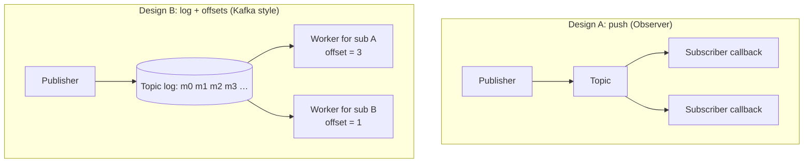
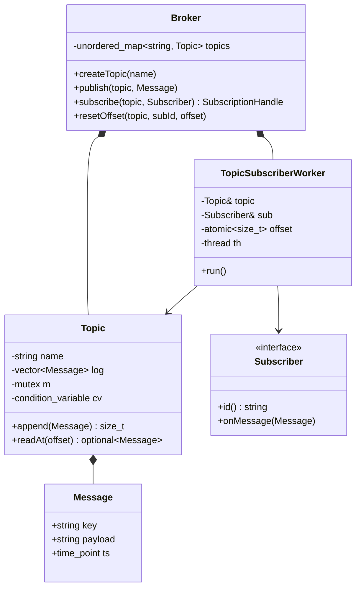
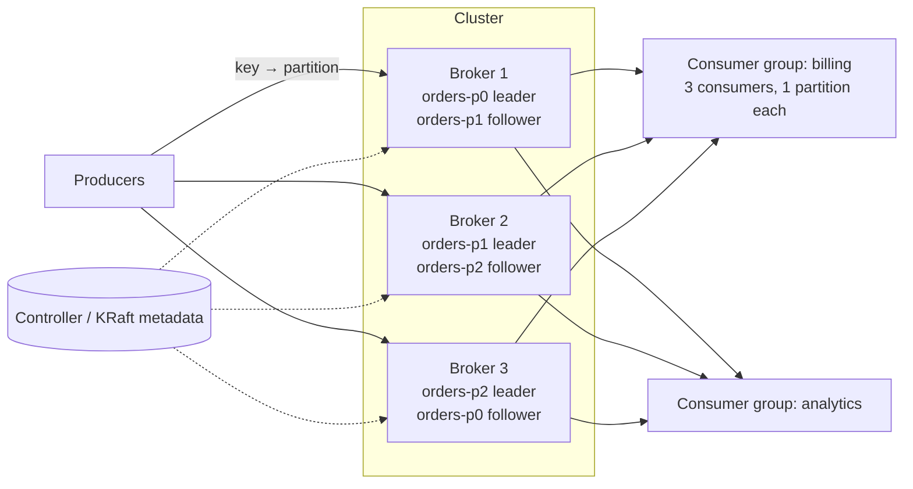

<!-- tab: LLD -->

## Requirements (in-memory, single process)
1. Publishers publish messages to named **topics**.
2. Subscribers subscribe to topics and receive every message published after they subscribe.
3. Each subscriber processes messages **in order**, at its own pace, without a slow subscriber blocking others.
4. Subscribers can **replay** from an offset (Kafka-like) — extension.
5. Thread-safe for concurrent publishers and subscribers.

## Two designs



Design A is the Observer pattern; it's simple but a slow callback blocks the publisher unless each subscriber gets its own queue. Design B stores messages once and keeps an **offset per subscriber**, which gives ordering, independent speed and replay. Code B.

## Classes



## C++ code

```cpp
struct Message { std::string payload; };

class Topic {
    std::vector<Message> log; mutable std::mutex m; std::condition_variable cv; bool closed = false;
public:
    void append(Message msg) { { std::lock_guard<std::mutex> lk(m); log.push_back(std::move(msg)); } cv.notify_all(); }
    // Blocks until a message exists at offset (or the topic is closed).
    std::optional<Message> waitAt(size_t off) {
        std::unique_lock<std::mutex> lk(m);
        cv.wait(lk, [&] { return off < log.size() || closed; });
        if (off < log.size()) return log[off];
        return std::nullopt;
    }
    void close() { { std::lock_guard<std::mutex> lk(m); closed = true; } cv.notify_all(); }
};

struct Subscriber { virtual ~Subscriber() = default; virtual void onMessage(const Message&) = 0; };

class Worker {                                    // one per (topic, subscriber): ordered, independent pace
    Topic& t; Subscriber& s; std::atomic<size_t> offset{0}; std::thread th;
public:
    Worker(Topic& topic, Subscriber& sub) : t(topic), s(sub), th([this] { run(); }) {}
    void reset(size_t o) { offset = o; }          // replay (takes effect on next read)
    ~Worker() { th.join(); }
private:
    void run() { while (auto m = t.waitAt(offset.load())) { s.onMessage(*m); ++offset; } }
};

class Broker {
    std::unordered_map<std::string, std::unique_ptr<Topic>> topics; std::vector<std::unique_ptr<Worker>> workers; std::mutex m;
public:
    Topic& topic(const std::string& n) { std::lock_guard<std::mutex> lk(m); auto& t = topics[n]; if (!t) t = std::make_unique<Topic>(); return *t; }
    void publish(const std::string& n, Message msg) { topic(n).append(std::move(msg)); }
    void subscribe(const std::string& n, Subscriber& s) { auto& t = topic(n); std::lock_guard<std::mutex> lk(m); workers.push_back(std::make_unique<Worker>(t, s)); }
    ~Broker() { for (auto& [_, t] : topics) t->close(); workers.clear(); }   // close topics so workers exit, then join
};
```

> [!TIP]
> The vector grows forever. Mention **retention**: keep messages for a time window or until all subscribers' offsets pass them, then drop a prefix (a ring buffer or segmented log).

<!-- tab: HLD: Kafka-style broker -->

## Scaling it out



- **Partitions** are the unit of parallelism and ordering. A message's key decides its partition (`hash(key) % P`), so all events for one order stay in order.
- **Replication**: each partition has a leader and followers; the **ISR** (in-sync replicas) set acknowledges writes. `acks=all` + `min.insync.replicas=2` survives one broker failure without data loss.
- **Consumer groups**: within a group, each partition is read by exactly one consumer; across groups everyone gets everything. More consumers than partitions sit idle.
- **Offsets** are committed per group per partition. Commit **after** processing for at-least-once; make processing idempotent.
- **Storage**: append-only segment files on disk, sequential I/O and the page cache make it fast; zero-copy `sendfile` to consumers.
- **Exactly-once**: idempotent producer (sequence numbers per partition) + transactions that write output and commit offsets atomically.

<!-- tab: Interview -->

### Q: Queue vs pub-sub?
A queue delivers each message to one consumer (work distribution). Pub-sub delivers each message to every subscriber (broadcast). Kafka does both: consumer groups compete within a group and broadcast across groups.

### Q: How do you preserve order?
Order is only guaranteed within a partition. Choose a key so related events share a partition, and have one consumer per partition process sequentially.

### Q: A consumer crashes after processing but before committing its offset. What happens?
The message is redelivered to another consumer: at-least-once. Make the handler idempotent (dedup by message ID or use upserts).

### Q: How do you handle a slow subscriber in the in-memory design?
Each subscriber has its own worker and offset, so slowness only delays itself. Add backpressure or drop policies if its lag exceeds retention.

```quiz
Q: A topic has 6 partitions and a consumer group has 8 consumers. How many consumers are idle?
- 0
* 2
- 6
- 8
> One partition can be consumed by only one member of a group.

Q: Committing the offset before processing gives…
* At-most-once delivery
- At-least-once delivery
- Exactly-once delivery
- No delivery
> If you crash after committing, the message is never processed.

Q: All events for order #42 must be processed in order. You should…
- Use one partition for the whole topic
* Use order ID as the message key
- Use a random key
- Disable replication
> Same key → same partition → ordered.

Q: acks=all with min.insync.replicas=2 and replication factor 3 tolerates…
- No broker failures
* One broker failure without losing acknowledged writes
- Two broker failures with writes still accepted
- Any number of failures
> Two in-sync copies remain after one broker dies.
```
