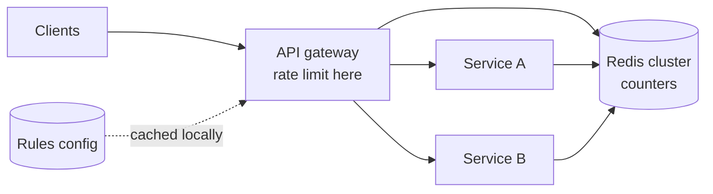
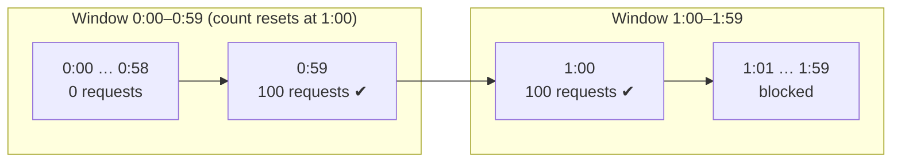
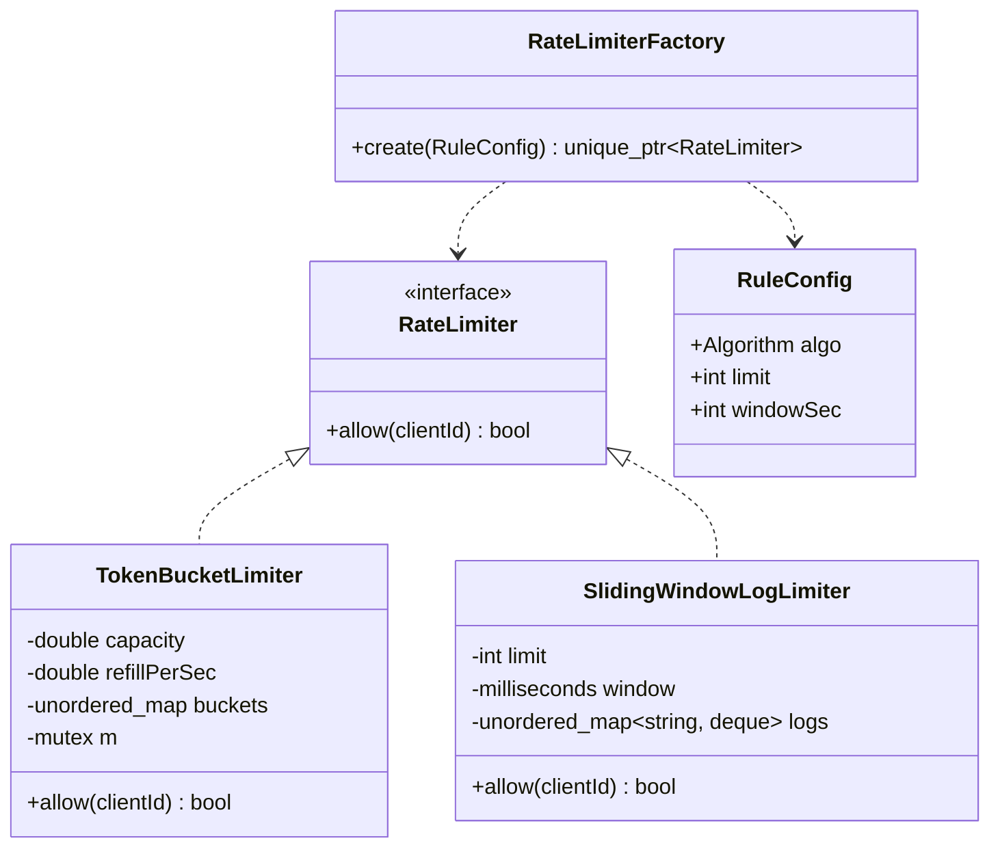

<!-- tab: HLD -->

## Requirements

**Functional**
1. Limit requests per client (user ID, API key or IP) per rule, e.g. 100 requests per minute.
2. Return HTTP 429 with `Retry-After` and `X-RateLimit-Remaining` headers when limited.
3. Rules are configurable per endpoint and plan tier.

**Non-functional**
- Adds under 5 ms to each request.
- Works across many API servers (a distributed limit, not per server).
- Highly available: if the limiter fails, the API should keep working (fail open) unless the rule protects something critical.
- Scale: 1M requests/s across 100M clients.

## Where does the limiter live?



| Placement | Pros | Cons |
|---|---|---|
| Client side | Free | Can't be trusted |
| API gateway / middleware | One place, before any work is done | Gateway must know identities |
| Inside each service | Fine-grained, per-endpoint costs | Repeated in every service |

Put it in the **gateway** for coarse limits (per key, per IP) and inside services only for expensive operations.

## Algorithms

```widget tokenbucket cap=5 rate=1
```

| Algorithm | How | Memory per client | Burst behaviour | Notes |
|---|---|---|---|---|
| Token bucket | Tokens refill at rate r up to capacity b; each request takes one | 2 numbers | Allows bursts up to b | Stripe and AWS use variants; the default answer |
| Leaky bucket | Requests queue and drain at a fixed rate | Queue | Smooths output, no bursts | Good for protecting a downstream |
| Fixed window counter | Count per calendar minute | 1 counter | Up to 2× limit at window edges | Simplest |
| Sliding window log | Store each timestamp; count those in the last 60 s | One entry per request | Exact | Memory heavy |
| Sliding window counter | Weighted mix of current and previous window counts | 2 counters | Close approximation | Cloudflare uses this |



The diagram shows 200 requests accepted inside two seconds even though each window is "within the limit". The sliding window counter fixes it: `estimate = current + previous × (1 − elapsed_fraction_of_current_window)`.

## Distributed counting with Redis

Each check is a read-modify-write, so two API servers can race. Make it atomic with a **Lua script** (Redis runs it single-threaded):

```lua
-- KEYS[1] = bucket key, ARGV = capacity, refill_per_sec, now_ms
local b = redis.call('HMGET', KEYS[1], 'tokens', 'ts')
local cap, rate, now = tonumber(ARGV[1]), tonumber(ARGV[2]), tonumber(ARGV[3])
local tokens = tonumber(b[1]) or cap
local ts = tonumber(b[2]) or now
tokens = math.min(cap, tokens + (now - ts) / 1000 * rate)
local allowed = 0
if tokens >= 1 then tokens = tokens - 1; allowed = 1 end
redis.call('HSET', KEYS[1], 'tokens', tokens, 'ts', now)
redis.call('PEXPIRE', KEYS[1], math.ceil(cap / rate * 1000) * 2)
return { allowed, tokens }
```

Shard keys across the Redis cluster by client ID (Redis Cluster hashes keys to slots). One Redis node handles ~100K ops/s, so 1M req/s needs ~10–20 shards with replicas.

> [!TIP]
> **Latency trick:** keep a small local token budget in each gateway (say 10% of the limit) and sync with Redis in batches. Slightly less exact, far fewer network calls.

## Failures and edge cases
- **Redis unavailable**: fail open (allow) for normal APIs, fail closed for login or OTP endpoints that protect against abuse.
- **Clock skew** between servers: use Redis server time (`TIME`) inside the script.
- **Hot client** (one key at huge QPS): its key lives on one shard; local pre-limiting in the gateway absorbs most of it.
- **Response**: `429 Too Many Requests`, `Retry-After: 12`, `X-RateLimit-Limit`, `X-RateLimit-Remaining`, `X-RateLimit-Reset`.

<!-- tab: LLD -->

## Classes



```cpp
class RateLimiter { public: virtual ~RateLimiter() = default; virtual bool allow(const std::string& client) = 0; };

class TokenBucketLimiter : public RateLimiter {
    struct Bucket { double tokens; std::chrono::steady_clock::time_point last; };
    double cap, rate; std::unordered_map<std::string, Bucket> buckets; std::mutex m;
public:
    TokenBucketLimiter(double capacity, double perSec) : cap(capacity), rate(perSec) {}
    bool allow(const std::string& client) override {
        auto now = std::chrono::steady_clock::now();
        std::lock_guard<std::mutex> lk(m);
        auto [it, fresh] = buckets.try_emplace(client, Bucket{cap, now});
        Bucket& b = it->second;
        double secs = std::chrono::duration<double>(now - b.last).count();
        b.tokens = std::min(cap, b.tokens + secs * rate); b.last = now;
        if (b.tokens < 1.0) return false;
        b.tokens -= 1.0; return true;
    }
};

class SlidingWindowLogLimiter : public RateLimiter {
    int limit; std::chrono::milliseconds window; std::unordered_map<std::string, std::deque<std::chrono::steady_clock::time_point>> logs; std::mutex m;
public:
    SlidingWindowLogLimiter(int l, std::chrono::milliseconds w) : limit(l), window(w) {}
    bool allow(const std::string& client) override {
        auto now = std::chrono::steady_clock::now();
        std::lock_guard<std::mutex> lk(m);
        auto& q = logs[client];
        while (!q.empty() && now - q.front() >= window) q.pop_front();
        if ((int)q.size() >= limit) return false;
        q.push_back(now); return true;
    }
};
```

> [!TIP]
> One global mutex serializes all clients. Improve with **lock striping**: N mutexes, client goes to `mutex[hash(client) % N]`. Mention it even if you don't code it.

<!-- tab: Interview -->

### Q: Token bucket vs leaky bucket?
Token bucket limits the average rate but allows bursts up to the bucket size; requests are accepted or rejected immediately. Leaky bucket queues requests and releases them at a constant rate, smoothing bursts at the cost of added latency.

### Q: Why is a fixed window counter not enough?
A client can send the full limit at the end of one window and again at the start of the next, doubling the rate across the boundary.

### Q: How do you keep counters consistent across many servers?
Centralize state in Redis and make the read-modify-write atomic with a Lua script or `INCR` + `EXPIRE` in a `MULTI`. Optionally keep a small local allowance per server to save round trips.

### Q: What if Redis goes down?
Decide per rule: fail open for ordinary traffic so an outage of the limiter doesn't become an outage of the API, fail closed for abuse-sensitive endpoints like login and OTP.

### Q: How would you rate-limit by multiple dimensions (user and IP)?
Evaluate each rule independently; reject if any rule fails. Order checks cheapest first.

```quiz
Q: Which algorithm allows short bursts above the average rate?
* Token bucket
- Leaky bucket
- Fixed window, never
- None of them
> Bucket capacity is the allowed burst.

Q: Limit 100/min with a fixed window. Worst-case requests in a 2-second span across a boundary?
- 100
* 200
- 150
- 101
> 100 at the end of one window plus 100 at the start of the next.

Q: Why use a Lua script in Redis for the limiter?
- Lua is faster than C
* It makes read-modify-write atomic
- It encrypts the counters
- It persists counters to disk
> Redis executes the script without interleaving other commands.

Q: Correct status code for a rate-limited request?
- 403
- 503
* 429
- 401
> 429 Too Many Requests, ideally with Retry-After.

Q: Memory per client is highest for…
- Token bucket
- Fixed window
* Sliding window log
- Sliding window counter
> It stores a timestamp per request inside the window.
```
