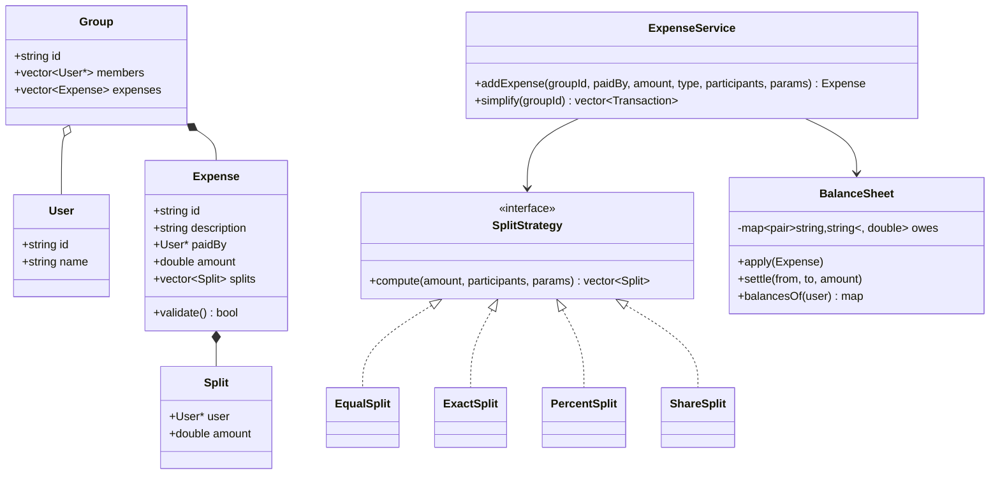
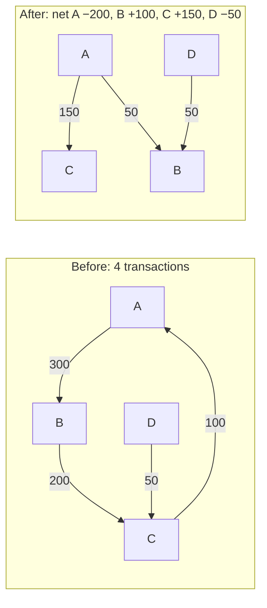

<!-- tab: LLD -->

## Requirements
1. Users and groups. Add an expense paid by one (or more) users, split among participants.
2. Split types: **equal**, **exact amounts**, **percentage**, **shares**.
3. Show balances: who owes whom, per user and per group.
4. **Settle up** records a payment between two users.
5. **Simplify debts** in a group to the minimum number of transactions — the interesting algorithm.

## Classes



**Patterns**: Strategy for split types, a Factory that maps `"EQUAL"` → `EqualSplit`, and the balance sheet as the single source of truth for who owes what.

## Money: use integers
Store amounts in **paise** (`int64_t`), never `double`. Equal split of ₹100 among 3 is 3333 + 3333 + 3334 paise: give the remainder to the first participants so the sum matches exactly.

## C++ code: splits and balances

```cpp
using Paise = long long;
struct Split { std::string user; Paise amount; };

struct SplitStrategy { virtual ~SplitStrategy() = default;
    virtual std::vector<Split> compute(Paise total, const std::vector<std::string>& users, const std::vector<double>& params) const = 0; };

struct EqualSplit : SplitStrategy {
    std::vector<Split> compute(Paise total, const std::vector<std::string>& u, const std::vector<double>&) const override {
        Paise base = total / (Paise)u.size(), rem = total % (Paise)u.size(); std::vector<Split> out;
        for (size_t i = 0; i < u.size(); ++i) out.push_back({u[i], base + ((Paise)i < rem ? 1 : 0)});
        return out;
    }
};
struct PercentSplit : SplitStrategy {
    std::vector<Split> compute(Paise total, const std::vector<std::string>& u, const std::vector<double>& pct) const override {
        double sum = 0; for (double p : pct) sum += p;
        if (std::abs(sum - 100.0) > 1e-6) throw std::invalid_argument("percentages must sum to 100");
        std::vector<Split> out; Paise used = 0;
        for (size_t i = 0; i < u.size(); ++i) { Paise a = (i + 1 == u.size()) ? total - used : (Paise)std::llround(total * pct[i] / 100.0); used += a; out.push_back({u[i], a}); }
        return out;
    }
};

class BalanceSheet {                         // net[u] > 0: u should receive; < 0: u owes
    std::unordered_map<std::string, Paise> net; std::mutex m;
public:
    void apply(const std::string& payer, Paise total, const std::vector<Split>& splits) {
        std::lock_guard<std::mutex> lk(m);
        net[payer] += total;
        for (auto& s : splits) net[s.user] -= s.amount;
    }
    void settle(const std::string& from, const std::string& to, Paise amt) { std::lock_guard<std::mutex> lk(m); net[from] += amt; net[to] -= amt; }
    std::unordered_map<std::string, Paise> snapshot() { std::lock_guard<std::mutex> lk(m); return net; }
};
```

## Simplify debts

Only each person's **net balance** matters. Repeatedly match the biggest creditor with the biggest debtor; each step settles at least one person, so there are at most N − 1 transactions.



```cpp
struct Txn { std::string from, to; Paise amount; };
std::vector<Txn> simplify(const std::unordered_map<std::string, Paise>& net) {
    using P = std::pair<Paise, std::string>;
    std::priority_queue<P> cred, debt;                       // both max-heaps by absolute amount
    for (auto& [u, v] : net) { if (v > 0) cred.push({v, u}); else if (v < 0) debt.push({-v, u}); }
    std::vector<Txn> out;
    while (!cred.empty() && !debt.empty()) {
        auto [c, cu] = cred.top(); cred.pop();
        auto [d, du] = debt.top(); debt.pop();
        Paise x = std::min(c, d); out.push_back({du, cu, x});
        if (c > x) cred.push({c - x, cu});
        if (d > x) debt.push({d - x, du});
    }
    return out;
}
```

> [!TRAP]
> Greedy gives at most N − 1 transactions but not always the true minimum. The exact minimum is NP-hard (it reduces to partitioning people into the most zero-sum subgroups); a DFS/bitmask solution works for small groups (LeetCode 465). Say both.

<!-- tab: Interview -->

### Q: Why store money as integers?
Floating point can't represent 0.1 exactly, so sums drift (0.1 + 0.2 ≠ 0.3). Integers in the smallest unit keep totals exact; handle remainders explicitly.

### Q: How do you validate an exact split?
Sum of parts must equal the total; every participant must be in the group; amounts non-negative. Reject otherwise.

### Q: How would you store balances in a real database?
An `expenses` table, a `splits` table, and either compute balances on read or maintain a `balances(group_id, user_id, net)` table updated in the same transaction as the expense insert. Use idempotency keys so a retried "add expense" doesn't double count.

### Q: Multiple payers for one expense?
Model `payments: vector<{user, amount}>` alongside splits; net change for each user = paid − owed.

```quiz
Q: Three people split ₹100 equally, in paise. A correct allocation is…
- 3333, 3333, 3333
* 3334, 3333, 3333
- 3333.33 each
- 3400, 3300, 3300
> The remainder of 1 paisa goes to one participant so the total is exact.

Q: With n people with non-zero net balance, greedy simplification needs at most…
- n²
- n
* n − 1 transactions
- log n
> Each transaction zeroes at least one person; the last one zeroes two.

Q: Choosing EQUAL vs PERCENT vs SHARES at runtime is…
- Observer
* Strategy
- Singleton
- Memento
> Interchangeable split algorithms behind one interface.
```
