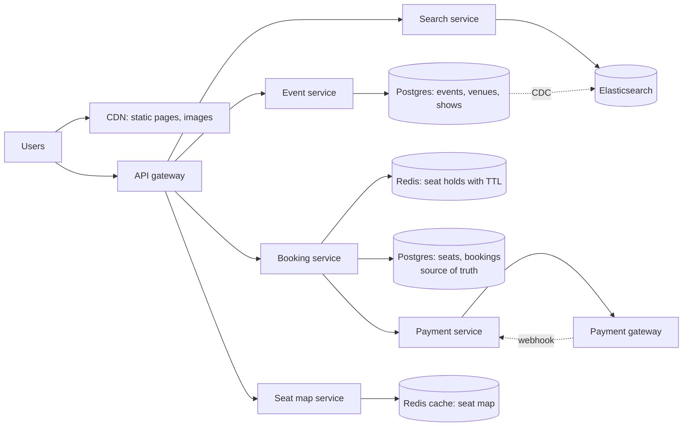
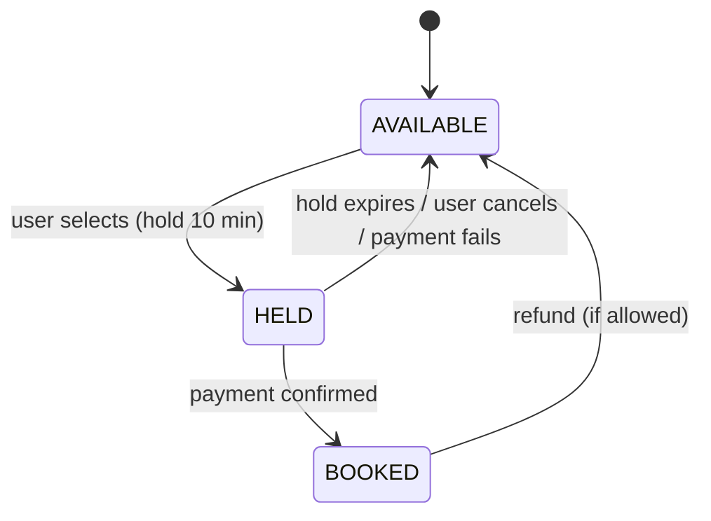
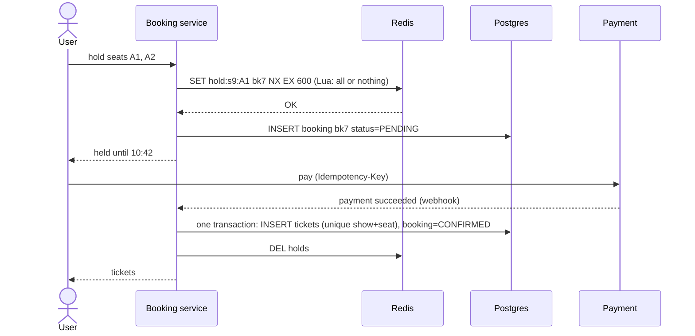
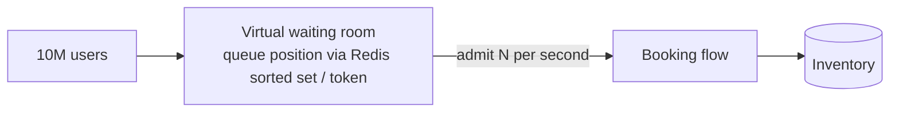
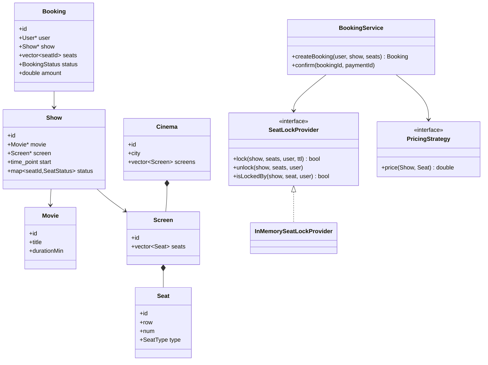

<!-- tab: HLD -->

## Requirements

**Functional**
1. Browse and search events/shows by city, date, name.
2. View the seat map with live availability.
3. Select seats, hold them for a few minutes, pay, get a ticket.

**Non-functional**
- **No double booking** — strong consistency for seat inventory.
- Browsing and search: high availability, low latency, staleness OK.
- Handle hot events: 10M users trying to buy 50K seats when sales open.
- Read-heavy: ~100:1 browse to book.

## Core entities
Event, Venue, Show (event at a venue and time), Seat (row, number, category, price), Booking, Ticket, User.

## API

```http
GET  /v1/events?city=delhi&q=coldplay&date=2027-01-26
GET  /v1/shows/{showId}/seats                 → seat map with status
POST /v1/bookings          { showId, seatIds[] }          → 201 { bookingId, holdExpiresAt }
POST /v1/bookings/{id}/pay  Idempotency-Key: …            → 200 { status: CONFIRMED, tickets[] }
```

## High-level design



## Deep dive: no double booking

Seat lifecycle:



Options for the **hold**:

| Approach | How | Notes |
|---|---|---|
| Pessimistic lock | `SELECT … FOR UPDATE` on seat rows during checkout | Holds DB locks for minutes: doesn't scale |
| Status column + conditional update | `UPDATE seats SET status='HELD', held_by=?, hold_until=now()+10min WHERE id IN (…) AND (status='AVAILABLE' OR hold_until < now())` and check affected rows = seats requested | Simple, correct, one transaction |
| Distributed lock in Redis | `SET seat:{showId}:{seatId} {bookingId} NX EX 600` per seat | Fast, TTL auto-releases; DB still confirms at payment |

My pick: Redis `SET NX EX` holds for speed (so the seat map can show "held" instantly and expiry is automatic), and at payment the booking service commits in Postgres with a **unique constraint on (show_id, seat_id)** in the tickets table. Two layers: Redis prevents most conflicts; the database guarantees none get through.



> [!TRAP]
> If the hold expires while payment is in flight, another user might grab the seat. Fix: extend the hold when payment starts, and if the DB insert hits the unique constraint after a successful charge, **auto-refund**. Say this; it's a classic follow-up.

## Deep dive: the hot event (10M users, 50K seats)



- **Virtual waiting room**: users get a queue token when sales open; admit a controlled rate into the booking flow; show their position. Protects the booking service and makes it fair.
- Seat map served from cache, updated via pub/sub when holds change; clients poll or get SSE updates.
- Rate-limit per user and bot detection (CAPTCHA, device fingerprint) at the gateway.

## Search
Events in Postgres, replicated to Elasticsearch through CDC (Debezium) for full-text and filters; cache popular queries; CDN for event pages.

<!-- tab: LLD -->

## BookMyShow machine-coding version



```cpp
enum class SeatStatus { Available, Booked };

class InMemorySeatLockProvider {
    struct Lock { std::string user; std::chrono::steady_clock::time_point until; };
    std::unordered_map<std::string, Lock> locks;    // key = showId + ":" + seatId
    std::mutex m; std::chrono::seconds ttl;
public:
    explicit InMemorySeatLockProvider(std::chrono::seconds t) : ttl(t) {}
    bool lock(const std::string& show, const std::vector<std::string>& seats, const std::string& user) {
        std::lock_guard<std::mutex> lk(m);
        auto now = std::chrono::steady_clock::now();
        for (auto& s : seats) {                      // all-or-nothing: check every seat first
            auto it = locks.find(show + ":" + s);
            if (it != locks.end() && it->second.until > now && it->second.user != user) return false;
        }
        for (auto& s : seats) locks[show + ":" + s] = {user, now + ttl};
        return true;
    }
    bool isLockedBy(const std::string& show, const std::string& seat, const std::string& user) {
        std::lock_guard<std::mutex> lk(m);
        auto it = locks.find(show + ":" + seat);
        return it != locks.end() && it->second.user == user && it->second.until > std::chrono::steady_clock::now();
    }
    void unlock(const std::string& show, const std::vector<std::string>& seats) { std::lock_guard<std::mutex> lk(m); for (auto& s : seats) locks.erase(show + ":" + s); }
};

struct Show { std::string id; std::unordered_map<std::string, SeatStatus> status; std::mutex m; };

class BookingService {
    InMemorySeatLockProvider& locks;
public:
    explicit BookingService(InMemorySeatLockProvider& l) : locks(l) {}
    bool hold(Show& show, const std::vector<std::string>& seats, const std::string& user) {
        { std::lock_guard<std::mutex> lk(show.m); for (auto& s : seats) if (show.status.at(s) == SeatStatus::Booked) return false; }
        return locks.lock(show.id, seats, user);
    }
    bool confirm(Show& show, const std::vector<std::string>& seats, const std::string& user) {   // after payment success
        std::lock_guard<std::mutex> lk(show.m);
        for (auto& s : seats) if (!locks.isLockedBy(show.id, s, user) || show.status.at(s) == SeatStatus::Booked) return false;   // hold expired → refund
        for (auto& s : seats) show.status[s] = SeatStatus::Booked;
        locks.unlock(show.id, seats);
        return true;
    }
};
```

<!-- tab: Interview -->

### Q: How do you guarantee no two people book the same seat?
Atomic claim at two levels: a short-lived hold with `SET NX EX` (or a conditional UPDATE) so only one user can be in checkout for a seat, and a unique constraint on `(show_id, seat_id)` in the tickets table at confirmation, which is the final guarantee.

### Q: Why not lock seat rows with SELECT FOR UPDATE during checkout?
Checkout takes minutes; holding row locks that long blocks other transactions and exhausts connections. Use a logical hold (status + expiry) instead of a physical DB lock.

### Q: Payment succeeded but the seat was taken meanwhile. Now what?
Detect it at confirm (unique constraint violation or expired hold), mark the booking FAILED and trigger an automatic refund; notify the user. Prevent it mostly by extending holds when payment starts.

### Q: Which parts are CP and which AP?
Seat inventory and bookings: CP (refuse rather than double-sell). Event listings, search, seat-map display: AP with caches and slight staleness.

```quiz
Q: The final guarantee against double booking should be…
- A Redis key with TTL alone
* A unique constraint on (show_id, seat_id) in the database
- Client-side checks
- A CDN rule
> Redis holds speed things up; the database constraint is authoritative.

Q: Why use a TTL on seat holds?
* So abandoned checkouts release seats automatically
- To make Redis faster
- Because payments need it
- To encrypt the seat
> No cleanup job needed for users who walk away.

Q: The best tool against 10M users hitting "buy" at once is…
- More database replicas
* A virtual waiting room that admits users at a controlled rate
- Longer holds
- Disabling search
> It protects the booking path and gives fair ordering.

Q: Selecting seats A1 and A2 must succeed or fail together. In Redis you'd use…
- Two separate SET calls
* A Lua script or MULTI with checks for all seats first
- EXPIRE only
- PUBLISH
> All-or-nothing holds avoid half-held selections.
```
