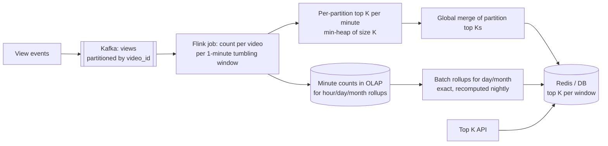
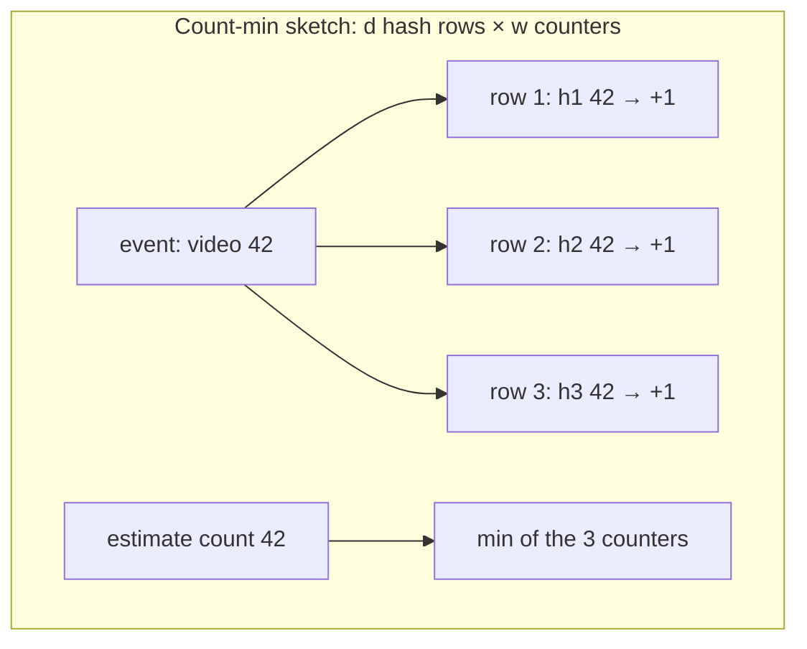

<!-- tab: HLD -->

## Requirements

**Functional**
1. Return the top K (K ≤ 1,000) most-viewed videos for windows: last hour, last day, last month, all time.
2. Leaderboard variant: top K players by score, and a player's own rank.

**Non-functional**
- Queries in tens of milliseconds.
- Results can be a minute stale.
- Scale: 1M view events/s (YouTube-scale), billions of distinct videos.
- Ask whether counts must be **exact** — it changes the design.

## The naive answer and why it fails
A database `GROUP BY video_id ORDER BY count DESC LIMIT K` over billions of rows per query is far too slow. Precompute.

## Architecture: streaming aggregation



**Why partition by video_id:** all events for a video go to the same counter, so each partition's counts are exact for its videos. Each partition keeps a min-heap of its local top K; the global top K is the top K of the merged partition lists (correct because a video lives in exactly one partition).

## Sliding windows
- **Last hour**: keep 60 one-minute buckets of counts; the hour total = sum of buckets; slide by dropping the oldest. Or a Flink sliding window (size 1 h, slide 1 min).
- **Last day / month**: roll up minute buckets into hours, hours into days (hierarchical aggregation); recompute exact values in batch.

## Exact vs approximate



- **Exact**: one counter per video. Memory grows with distinct videos, but partitioning makes it manageable.
- **Count-min sketch**: fixed memory (d × w counters); estimates never under-count, may over-count due to collisions. Pair it with a heap of size K for "heavy hitters". Great when memory is tight and approximate is acceptable.
- A **Lambda** design: fast approximate results from the stream, exact results from batch later.

## Leaderboard variant (game scores)

```text
ZADD   lb:season7 1850 player:shiva        O(log N)
ZREVRANGE lb:season7 0 9 WITHSCORES         top 10
ZREVRANK  lb:season7 player:shiva           my rank, O(log N)
ZINCRBY   lb:season7 25 player:shiva        add points
```

A Redis **sorted set** (skip list + hash) handles leaderboards of tens of millions per key. For bigger, shard by score range or by region and merge top lists.

<!-- tab: Interview -->

### Q: How do you merge top K across partitions correctly?
If partitioned by item ID, each item's full count lives in one partition, so the global top K is within the union of each partition's local top K; merge with a heap. If items are spread across partitions, you must aggregate counts per item first.

### Q: Why a min-heap of size K, not a max-heap?
The min-heap's root is the smallest of the current top K, so each new count is compared with it in O(1) and replaces it in O(log K). Total O(N log K).

### Q: When would you use count-min sketch?
When distinct keys are too many to count exactly in memory and small over-estimates are acceptable (trending hashtags, heavy hitters).

### Q: How do you serve "my rank" in a leaderboard of 50M?
Redis sorted set `ZREVRANK`, O(log N). For approximate ranks at huge scale, bucket scores into a histogram and count players above.

```quiz
Q: Finding the top K of N counts with a min-heap costs…
- O(N log N)
* O(N log K)
- O(K log N)
- O(N)
> Each of N items costs at most log K.

Q: Count-min sketch estimates can…
- Under-count
* Over-count but never under-count
- Be exact always
- Return negative values
> Collisions only add to counters; take the minimum across rows.

Q: Which Redis structure fits a leaderboard?
- List
- Set
* Sorted set
- HyperLogLog
> Ordered by score with O(log N) updates and rank queries.
```
