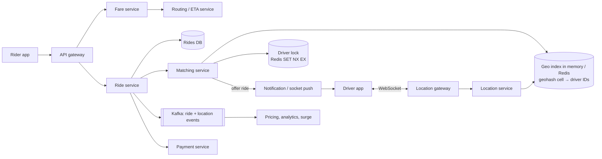
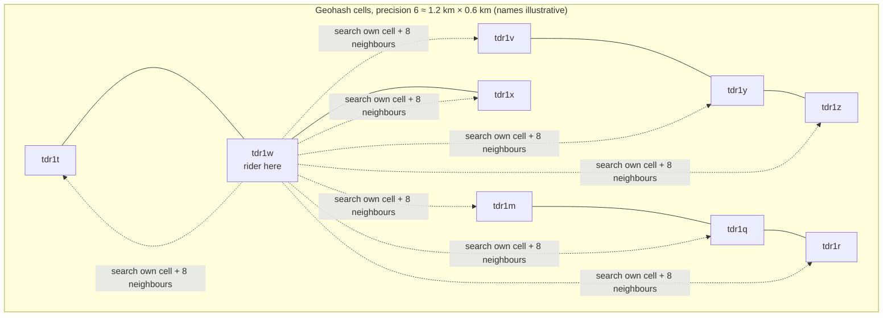
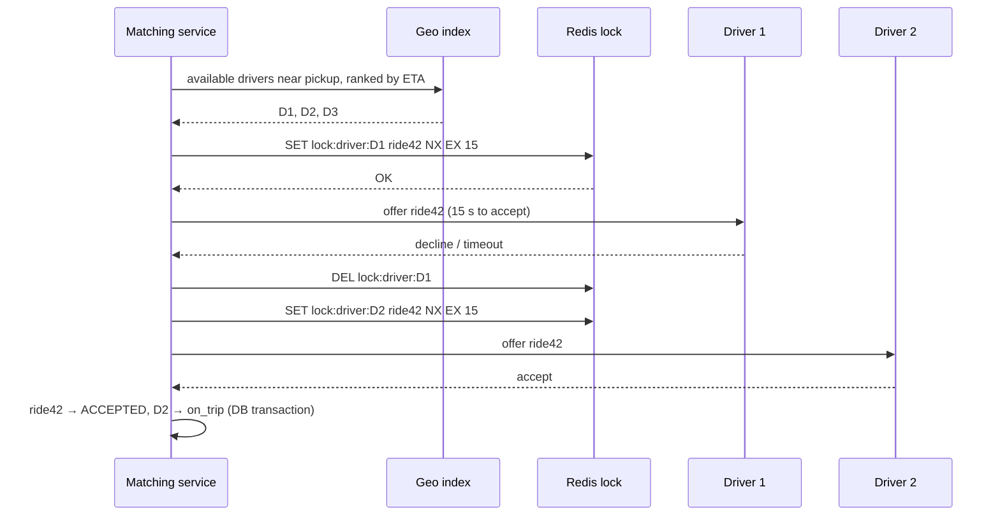
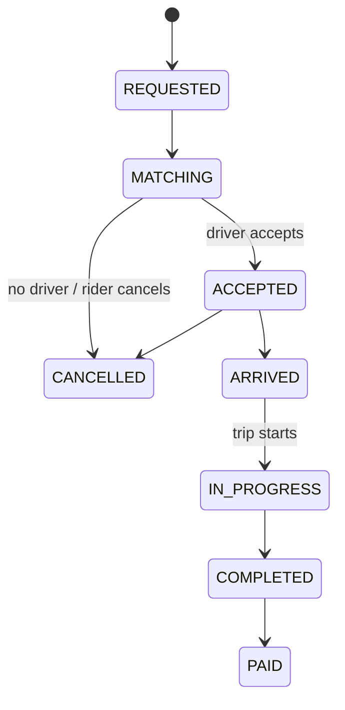

<!-- tab: HLD -->

## Requirements

**Functional**
1. Rider requests a ride from pickup to destination and sees a fare estimate.
2. The system matches the rider with a nearby available driver; the driver accepts or declines.
3. Both see each other's live location until the trip ends; payment at the end.

**Non-functional**
- Matching within a few seconds; **a driver is never assigned to two rides** (strong consistency for assignment).
- Location updates are huge in volume and may be slightly stale (availability over consistency).
- Scale: 10M drivers online at peak sending location every 4 s ≈ 2.5M location writes/s; 1M ride requests/hour at peak.

## Core entities
Rider, Driver (status: offline, available, on_trip), Location (lat, lng, ts), Ride (state machine), Fare.

## API

```http
POST /v1/fare-estimates     { pickup, dropoff }            → { estimateId, price, eta }
POST /v1/rides              { estimateId }                 → { rideId, status: REQUESTED }
POST /v1/drivers/location   { lat, lng }   (every 4 s; or over a persistent socket)
PATCH /v1/rides/{id}        { action: accept | decline | arrived | start | complete }
```

## High-level design



## Deep dive: finding nearby drivers

| Index | How | Pros | Cons |
|---|---|---|---|
| Geohash | Encode lat/lng into a string prefix; nearby points share prefixes; search the cell + 8 neighbours | Simple, works as a Redis/DB key | Cells are uneven near poles; edge effects need neighbour cells |
| Quadtree | Recursively split regions with too many points | Adapts to density (dense cities get small cells) | Rebuild cost with constantly moving points |
| H3 (Uber) | Hexagonal hierarchical grid | Uniform neighbour distances | Library dependency |
| Redis GEO | `GEOADD drivers lng lat id`, `GEOSEARCH … BYRADIUS 2 km` | Built-in, uses geohash under the hood | Single key per region must be sharded |



Location writes (2.5M/s) go to an **in-memory store** keyed by cell, sharded by region (city), with TTL so stale drivers disappear. Don't write every location ping to a disk database; sample a copy to Kafka for trip history and analytics.

## Deep dive: matching without double assignment



- Lock one driver at a time while the offer is pending, so two riders' matchers can't offer the same driver.
- The final assignment is a conditional update: `UPDATE drivers SET status='on_trip', ride_id=42 WHERE id='D2' AND status='available'`.
- Requests that wait too long are retried with a bigger radius; durable state in a queue so a crashed matcher doesn't lose rides.

## Ride state machine



## Other deep dives
- **Surge pricing**: stream demand (requests) and supply (available drivers) per cell per minute; multiplier = f(demand / supply).
- **ETA**: road graph + traffic (Dijkstra/A* with contraction hierarchies), not straight-line distance.
- **Sharding by city**: matching is local, so partition services and data by region; it also limits blast radius.

<!-- tab: Interview -->

### Q: Why not store every location update in the database?
2.5M writes/s of data that's obsolete four seconds later. Keep current positions in memory (Redis/in-process geo index) with TTL; send a sampled stream to Kafka for history.

### Q: Geohash or quadtree?
Geohash is simpler and fits key-value stores: prefix = cell; search the cell and its 8 neighbours. Quadtrees adapt to density but are costly to update with millions of moving points every few seconds. Uber built H3 (hexagons) for uniform neighbours.

### Q: How do you prevent assigning one driver to two riders?
Lock the driver (`SET NX EX`) while the offer is pending and make the final assignment a conditional update on driver status. Only one transaction can move a driver from available to on_trip.

### Q: The matching service crashes mid-offer. What happens?
The driver lock expires after its TTL; the ride request is still in the durable queue/DB in MATCHING state, so another matcher picks it up.

```quiz
Q: Geohash precision 6 cells are roughly…
- 5 km × 5 km
* 1.2 km × 0.6 km
- 40 m × 20 m
- 150 m × 150 m
> Each extra character shrinks the cell.

Q: When searching nearby drivers with geohash, you query…
- Only the rider's cell
* The rider's cell and its 8 neighbours
- The whole city
- A random sample
> Drivers just across a cell edge may be closest.

Q: Driver locations are best kept in…
* An in-memory geo index with TTL
- A relational table updated per ping
- Blob storage
- The CDN
> High write rate, short-lived data.

Q: Locking a driver with SET NX EX 15 guarantees…
- The ride is paid
* Only one pending offer per driver, auto-released after 15 s
- The driver accepts
- Exactly-once location updates
> The TTL avoids stuck locks if the matcher crashes.
```
