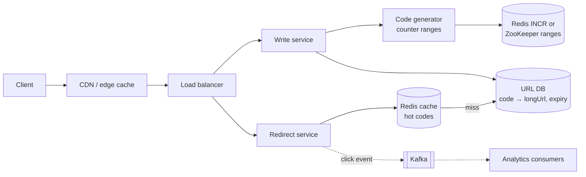
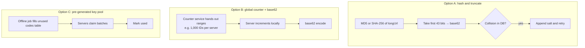
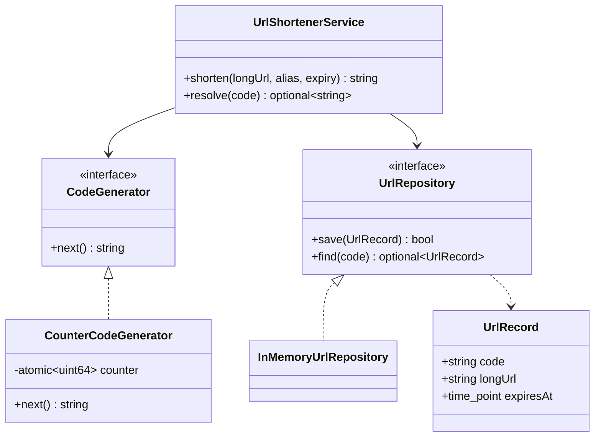

<!-- tab: HLD -->

## Requirements

**Functional**
1. Create a short URL from a long URL, with an optional custom alias and expiry.
2. Visiting the short URL redirects to the long URL.
3. Out of scope unless asked: user accounts, click analytics dashboards.

**Non-functional**
- Very read-heavy: about 100 redirects per create.
- Redirect latency p99 under 100 ms; redirects must be highly available.
- Short codes must be unique and should not be guessable in sequence (optional but good to raise).
- Scale target: 100M new links per month, 10B redirects per month.

## Estimation

```widget estimator dau=3300000 writes=1 reads=100 size=500 years=10 peak=5
```

That works out to about 40 creates/s and 4,000 redirects/s on average, ~20K/s at peak. Storage: 100M × 12 months × 10 years × 500 B ≈ 6 TB. One relational primary handles the writes; the redirect path needs a cache.

**Code length.** Base62 (`a–z A–Z 0–9`) with 7 characters gives 62⁷ ≈ 3.5 trillion codes, far more than the 12 billion we need over 10 years. 6 characters (56 billion) would also work.

## API

```http
POST /v1/urls
  { "longUrl": "https://…", "alias": "my-sale", "expiresAt": "2027-01-01T00:00:00Z" }
  201 { "shortUrl": "https://sho.rt/aZ3k9Qx" }

GET /{code}
  302 Location: https://…      (404 if unknown, 410 if expired)
```

> [!TIP]
> **301 vs 302.** 301 (permanent) lets browsers cache the redirect, cutting load but hiding clicks from you. 302 (temporary) sends every click through your servers, so analytics and expiry work. Say which you pick and why.

## High-level design



**Create**: validate the URL, get a unique code, insert `(code, long_url, user_id, created_at, expires_at)` with a unique constraint on `code`.

**Redirect**: check Redis, fall back to the database, write the result back into Redis, return 302. Optionally emit a click event to Kafka asynchronously; never block the redirect on analytics.

## Deep dive: generating unique codes



| Approach | Pros | Cons |
|---|---|---|
| Hash + truncate | Same URL gives the same code; stateless | Collisions need a DB check and retry |
| Counter + base62 | No collisions, tiny and fast | Sequential codes are guessable; counter is a coordination point |
| Pre-generated pool | Fast, no collisions | Extra storage and a job to maintain |

My pick: **counter with range allocation**. Each write server asks Redis (`INCRBY counter 1000`) or ZooKeeper for a block of 1,000 IDs and hands them out from memory. A crashed server only wastes its unused range. To avoid guessable codes, run the counter value through a reversible bijective scramble (for example multiply by a large odd constant mod 62⁷) before base62.

```cpp
std::string toBase62(uint64_t n) {
    static const char* A = "0123456789abcdefghijklmnopqrstuvwxyzABCDEFGHIJKLMNOPQRSTUVWXYZ";
    std::string s;
    do { s.push_back(A[n % 62]); n /= 62; } while (n);
    while (s.size() < 7) s.push_back('0');
    return std::string(s.rbegin(), s.rend());
}
```

**Custom aliases** go through the same unique constraint; a conflict returns 409.

## Deep dive: making redirects fast

- **Cache**: 20% of codes get ~80% of clicks. An LRU Redis cluster with ~a day's hot codes (tens of GB) gives >95% hit rate.
- **CDN / edge**: cache 302 responses at the edge for very popular links with a short TTL.
- **Database**: key-value access by `code` suits DynamoDB or Cassandra, or Postgres with an index; shard by `hash(code)` if one node isn't enough.
- **Expiry**: check `expires_at` on read; a background job deletes expired rows and their cache keys.

## Failures and trade-offs
- Cache down: requests fall through to DB replicas; keep replicas sized for that, and rate-limit.
- Counter service down: servers still have their current range; size ranges so a few minutes of outage is survivable.
- Abuse: rate-limit creates per user/IP, scan new URLs against a malware blocklist.

<!-- tab: LLD -->

## Classes for a single-process version



```cpp
struct UrlRecord { std::string code, longUrl; std::optional<std::chrono::system_clock::time_point> expiresAt; };

class InMemoryUrlRepository {
    std::unordered_map<std::string, UrlRecord> byCode; std::shared_mutex m;
public:
    bool saveIfAbsent(const UrlRecord& r) {                 // false if the code is taken
        std::unique_lock lk(m); return byCode.emplace(r.code, r).second;
    }
    std::optional<UrlRecord> find(const std::string& c) {
        std::shared_lock lk(m); auto it = byCode.find(c);
        return it == byCode.end() ? std::nullopt : std::optional<UrlRecord>(it->second);
    }
};

class UrlShortenerService {
    InMemoryUrlRepository& repo; std::atomic<uint64_t> counter{100000};
public:
    explicit UrlShortenerService(InMemoryUrlRepository& r) : repo(r) {}
    std::string shorten(const std::string& url, const std::string& alias = "") {
        if (url.rfind("http", 0) != 0) throw std::invalid_argument("bad url");
        if (!alias.empty()) { if (!repo.saveIfAbsent({alias, url, {}})) throw std::runtime_error("alias taken"); return alias; }
        for (;;) { auto code = toBase62(counter.fetch_add(1)); if (repo.saveIfAbsent({code, url, {}})) return code; }
    }
    std::optional<std::string> resolve(const std::string& code) {
        auto r = repo.find(code);
        if (!r || (r->expiresAt && *r->expiresAt < std::chrono::system_clock::now())) return std::nullopt;
        return r->longUrl;
    }
};
```

Concurrency: `atomic::fetch_add` gives each thread a unique number with no lock; the repository uses a `shared_mutex` so redirects (reads) don't block each other.

<!-- tab: Interview -->

### Q: Why not just use an auto-increment primary key as the code?
It works for one database but exposes your volume and lets anyone enumerate links. Across shards, auto-increment isn't globally unique without coordination. Use a range-allocated counter plus scrambling, or random codes with a uniqueness check.

### Q: How many characters do you need?
Total links over the lifetime, say 12 billion. 62⁶ ≈ 57 billion, so 6 is enough; 7 gives headroom (3.5 trillion).

### Q: Same long URL submitted twice: same short code?
Product decision. Same code saves space (store a `hash(longUrl) → code` index) but leaks that someone else shortened it and breaks per-user expiry. Most services return a new code per request.

### Q: How do you handle a viral link getting 1M clicks a minute?
It's a hot key: serve it from the CDN edge with a short TTL and replicate it in a local in-process cache on each redirect server. The DB never sees it.

### Q: Where do analytics go?
Off the hot path: the redirect service publishes a click event to Kafka; consumers aggregate counts by code, country and referrer into an OLAP store.

```quiz
Q: How many distinct 7-character base62 codes are there?
- 62 million
- 7 billion
* About 3.5 trillion
- About 78 billion
> 62⁷ = 3,521,614,606,208.

Q: Which HTTP status keeps every click flowing through your servers?
- 301
* 302
- 200
- 404
> Browsers may cache 301s and skip your server next time.

Q: Each write server reserves a block of 1,000 IDs. A server crashes after using 300. What happens?
- Duplicate codes are created
* 700 IDs are skipped forever, which is harmless
- The counter must be reset
- All servers stop
> Gaps are fine; uniqueness is what matters.

Q: Best primary access pattern for the URL table?
* Point lookup by code
- Range scan by created_at
- Full-text search on long_url
- Join with users
> Redirects are a single key lookup, ideal for a key-value store or a primary-key index.

Q: Where should click analytics be recorded?
- Synchronously in the redirect DB transaction
* Asynchronously via a queue after redirecting
- In the CDN only
- In the user's browser
> Analytics must never slow or break redirects.
```
