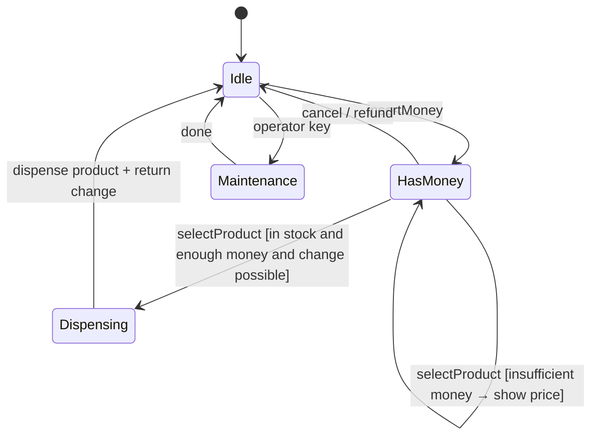
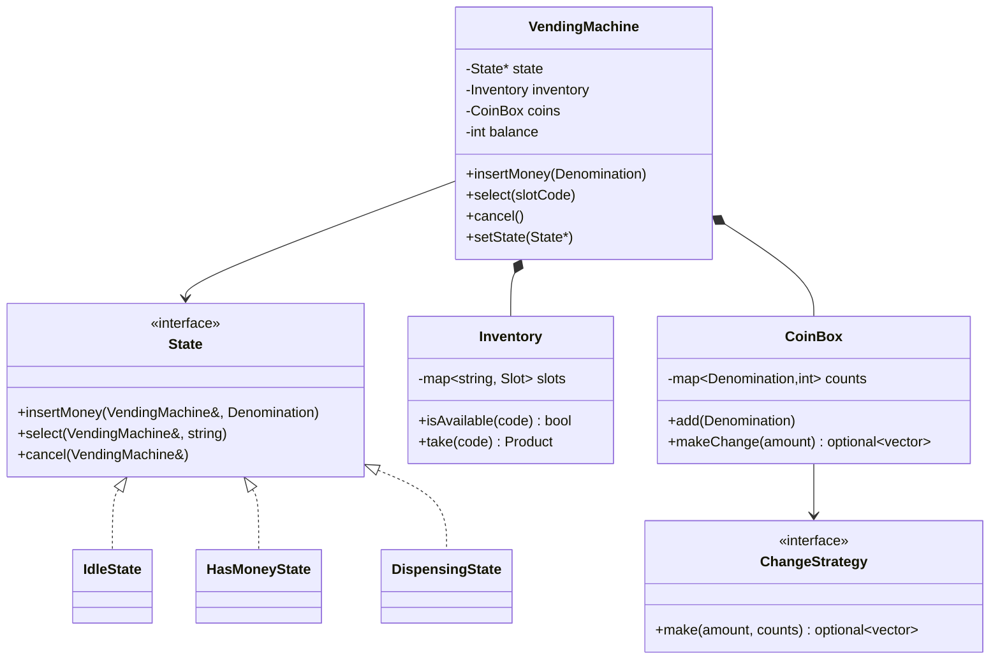

<!-- tab: LLD -->

## Requirements
1. The machine holds products in slots, each with a price and quantity.
2. A user inserts coins/notes, selects a product, receives the product and change.
3. The user can cancel and get a refund at any point before dispensing.
4. Reject selection if the product is sold out or money is insufficient; refuse the sale if exact change can't be made.
5. An operator can restock products and coins.

## States are the whole design



Without the State pattern, every method becomes `if (state == IDLE) … else if (state == HAS_MONEY) …`. With it, each state class handles only the events that make sense for it and decides the next state.

## Classes



## C++ code

```cpp
#include <map>
#include <memory>
#include <optional>
#include <stdexcept>
#include <string>
#include <vector>
#include <iostream>

enum Denomination { ONE = 1, TWO = 2, FIVE = 5, TEN = 10, TWENTY = 20, FIFTY = 50 };

struct Product { std::string name; int price; };
struct Slot { Product product; int qty; };

class CoinBox {
    std::map<int, int, std::greater<int>> counts;              // largest denomination first
public:
    void add(int d, int n = 1) { counts[d] += n; }
    // Greedy works for canonical coin systems like 1,2,5,10,20,50. Returns coins or nullopt.
    std::optional<std::vector<int>> makeChange(int amount) {
        auto trial = counts; std::vector<int> out;
        for (auto& [d, n] : trial) while (amount >= d && n > 0) { amount -= d; --n; out.push_back(d); }
        if (amount != 0) return std::nullopt;
        counts = trial; return out;                               // commit only on success
    }
};

class VendingMachine;
struct State {
    virtual ~State() = default;
    virtual void insertMoney(VendingMachine&, int) { std::cout << "Not accepting money now\n"; }
    virtual void select(VendingMachine&, const std::string&) { std::cout << "Insert money first\n"; }
    virtual void cancel(VendingMachine&) { std::cout << "Nothing to cancel\n"; }
};

class VendingMachine {
public:
    std::map<std::string, Slot> slots; CoinBox coins; int balance = 0;
    std::unique_ptr<State> idle, hasMoney; State* state;
    VendingMachine();
    void insertMoney(int d) { state->insertMoney(*this, d); }
    void select(const std::string& code) { state->select(*this, code); }
    void cancel() { state->cancel(*this); }
    void refund() { if (auto c = coins.makeChange(balance)) { std::cout << "Refunded " << balance << "\n"; } balance = 0; }
};

struct IdleState : State {
    void insertMoney(VendingMachine& m, int d) override { m.coins.add(d); m.balance += d; m.state = m.hasMoney.get(); }
};

struct HasMoneyState : State {
    void insertMoney(VendingMachine& m, int d) override { m.coins.add(d); m.balance += d; }
    void cancel(VendingMachine& m) override { m.refund(); m.state = m.idle.get(); }
    void select(VendingMachine& m, const std::string& code) override {
        auto it = m.slots.find(code);
        if (it == m.slots.end() || it->second.qty == 0) { std::cout << "Sold out\n"; return; }
        int price = it->second.product.price;
        if (m.balance < price) { std::cout << "Price " << price << ", inserted " << m.balance << "\n"; return; }
        auto change = m.coins.makeChange(m.balance - price);
        if (!change) { std::cout << "Exact change only\n"; return; }      // stay in HasMoney; user can cancel
        it->second.qty--;                                                // "Dispensing" step, kept inline for brevity
        std::cout << "Dispensed " << it->second.product.name << ", change " << m.balance - price << "\n";
        m.balance = 0; m.state = m.idle.get();
    }
};

VendingMachine::VendingMachine() : idle(std::make_unique<IdleState>()), hasMoney(std::make_unique<HasMoneyState>()), state(idle.get()) {}

int main() {
    VendingMachine vm;
    vm.slots["A1"] = {{"Coke", 40}, 3};
    vm.coins.add(TEN, 5); vm.coins.add(FIVE, 5); vm.coins.add(ONE, 10);
    vm.insertMoney(FIFTY); vm.select("A1");          // Dispensed Coke, change 10
}
```

> [!TIP]
> Greedy change-making is optimal only for "canonical" coin systems (like 1, 2, 5, 10). For arbitrary denominations, use the bounded-coin DP. Saying this earns points.

### Concurrency
A physical machine serves one user at a time; a single mutex around each public method is enough. For a remote-controlled fleet, each machine is an actor that processes commands from a queue in order.

<!-- tab: Interview -->

### Q: Why the State pattern here?
Behaviour depends on what has happened so far: inserting money is valid in Idle and HasMoney, selecting only in HasMoney. State classes keep each state's rules together and make adding a state (Maintenance, OutOfService) a new class rather than edits across every method.

### Q: What if the machine can't make change?
Check change before dispensing. If impossible, show "exact change only" and stay in HasMoney so the user can add exact money or cancel. Never take money without delivering either the product or a refund.

### Q: Where's the transaction boundary?
Product decrement, coin commit and balance reset happen together. In the code, `makeChange` works on a copy and commits only on success.

### Q: How would you support card payments?
A `PaymentMethod` strategy (Cash, Card, UPI). Card adds an "Authorizing" state that waits for the bank's callback with a timeout.

```quiz
Q: Which pattern best removes "if (state == …)" chains from the vending machine?
- Strategy
* State
- Command
- Observer
> Each state object handles events and chooses the next state.

Q: Greedy change-making is guaranteed optimal for…
- Any set of denominations
* Canonical systems like 1, 2, 5, 10, 20, 50
- Only powers of two
- Never
> For {1, 3, 4} and amount 6, greedy gives 4+1+1 but 3+3 is better.

Q: A user selects an item but exact change is impossible. Correct behaviour?
- Dispense and keep the extra
- Refund automatically and reset
* Stay in HasMoney, show exact-change-only, allow cancel
- Crash
> The user decides: add exact money or cancel.
```
