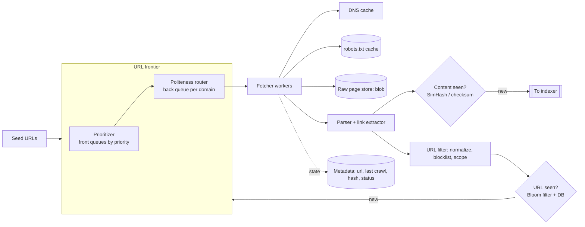

<!-- tab: HLD -->

## Requirements

**Functional**
1. Start from seed URLs, fetch pages, extract links, and crawl them, storing page content for a search indexer.
2. Respect `robots.txt` and crawl politely (limited rate per domain).
3. Don't crawl the same URL or near-identical content repeatedly; recrawl pages periodically.

**Non-functional**
- Scale: 1 billion pages per month (≈ 400 pages/s; plan for 1,000+/s).
- Fault tolerant: a crashed worker must not lose its URLs.
- Extensible to new content types.

## Estimation
1B pages × ~100 KB = 100 TB/month of raw HTML (compress ~4×). URL frontier: billions of URLs × ~100 bytes ≈ hundreds of GB, so it lives on disk-backed queues, not only in memory.

## Architecture



## Deep dive: the frontier and politeness

- **Front queues** by priority (PageRank, freshness, domain importance).
- **Back queues**: one per domain (or host); a worker takes a URL from a domain's queue only when that domain's **next allowed time** has passed (min-heap keyed by next-allowed time). This guarantees at most one request every few seconds per host.
- Durable: Kafka topics partitioned by `hash(domain)` work well: one partition's consumer owns a set of domains and can enforce per-domain delay locally.

## Deep dive: duplicates
- **URL dedup**: normalize (lowercase host, remove fragments, sort query params), then check a **Bloom filter** (false positives skip a few new URLs; no false negatives), backed by a URL table for certainty when needed.
- **Content dedup**: exact duplicate = same hash (MD5/SHA of content); near duplicate = **SimHash** fingerprints with small Hamming distance.

## Deep dive: traps and failures
- **Spider traps** (infinite calendars, session IDs in URLs): cap URL length and depth per domain, detect repeating path patterns.
- **Timeouts and retries** with backoff; mark dead hosts and skip them for a while.
- **Worker crash**: messages are acked only after the page is stored; unacked URLs return to the queue.
- **DNS** is a bottleneck: cache it locally per worker.

## Recrawl
Track change frequency per page; recrawl pages that change often (news) more frequently. Use `If-Modified-Since` / ETags to skip unchanged pages.

<!-- tab: LLD angle -->

## Multi-threaded crawler (LeetCode 1242 style)

```cpp
// Crawl all URLs under the start URL's hostname using N threads.
class Crawler {
    std::unordered_set<std::string> seen; std::queue<std::string> q; std::mutex m; std::condition_variable cv; int active = 0;
    static std::string host(const std::string& u) { auto s = u.find("//") + 2; return u.substr(0, u.find('/', s)); }
public:
    std::vector<std::string> crawl(const std::string& start, std::function<std::vector<std::string>(const std::string&)> getUrls, int threads = 8) {
        const std::string h = host(start);
        seen.insert(start); q.push(start);
        auto worker = [&] {
            for (;;) {
                std::string url;
                {
                    std::unique_lock<std::mutex> lk(m);
                    cv.wait(lk, [&] { return !q.empty() || active == 0; });
                    if (q.empty()) return;                    // nothing queued and nobody working: done
                    url = q.front(); q.pop(); ++active;
                }
                auto next = getUrls(url);                     // network I/O outside the lock
                {
                    std::lock_guard<std::mutex> lk(m);
                    for (auto& n : next) if (host(n) == h && seen.insert(n).second) q.push(n);
                    --active;
                }
                cv.notify_all();
            }
        };
        std::vector<std::thread> ts; for (int i = 0; i < threads; ++i) ts.emplace_back(worker);
        for (auto& t : ts) t.join();
        return {seen.begin(), seen.end()};
    }
};
```

The termination condition is the subtle part: stop when the queue is empty **and** no worker is still fetching (it might add more URLs).

<!-- tab: Interview -->

### Q: How do you crawl politely?
Respect robots.txt (cached per host), one connection per host with a delay between requests, back queues per domain gated by a next-allowed-time heap, and back off on errors or slow responses.

### Q: Why a Bloom filter for seen URLs?
Billions of URLs won't fit in a hash set in memory; a Bloom filter uses ~10 bits per URL for a 1% false-positive rate and never says "not seen" for a seen URL. A false positive just skips one new URL.

### Q: BFS or DFS?
BFS with priorities: it finds important pages near seeds first and avoids getting lost deep in one site. DFS dives into traps.

### Q: How do you detect near-duplicate pages?
SimHash: hash weighted features into a 64-bit fingerprint where similar documents have fingerprints differing in few bits; compare Hamming distance.

```quiz
Q: A Bloom filter can return…
* False positives but never false negatives
- False negatives but never false positives
- Both
- Neither
> If it says "not present", the item was definitely never added.

Q: Per-domain back queues exist to enforce…
- Ordering of links
* Politeness: limited request rate per host
- Deduplication
- Compression
> One fetch per host at a time with a delay.

Q: The multi-threaded crawler should stop when…
- The queue is empty
* The queue is empty and no worker is still processing
- Any thread finishes
- After a fixed time
> An active worker may still add URLs.
```
