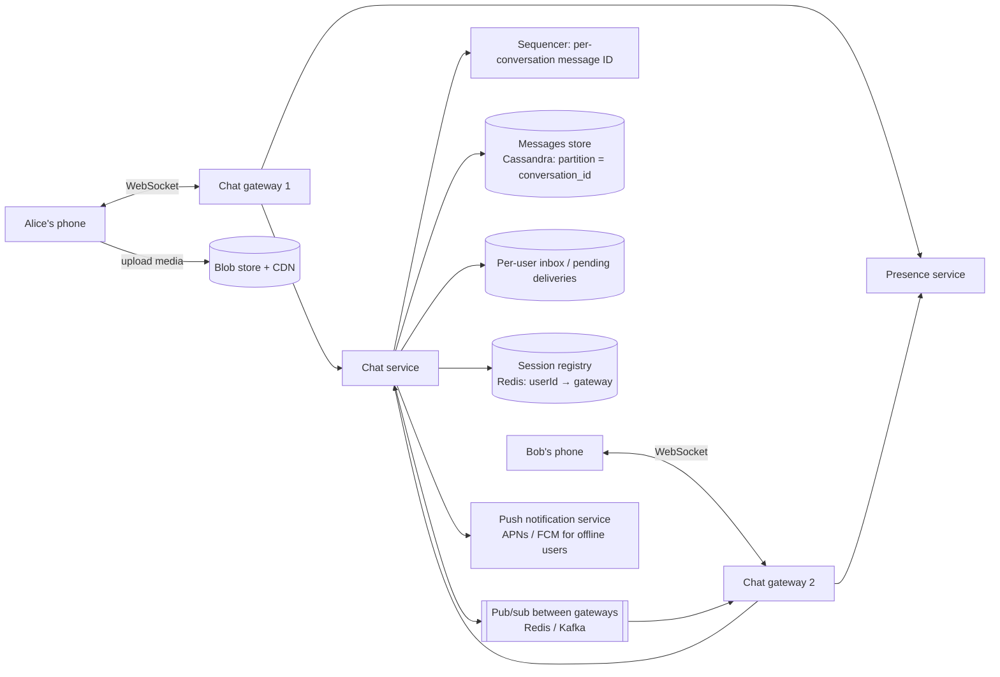
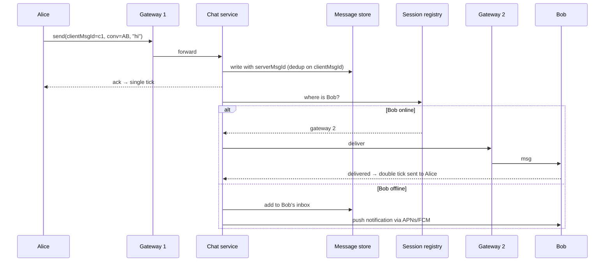
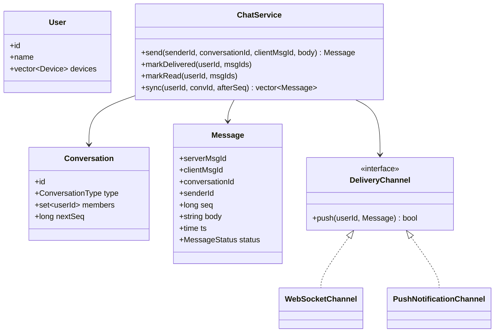

<!-- tab: HLD -->

## Requirements

**Functional**
1. One-to-one and group chats (groups up to ~1,000 members).
2. Send text and media; receive messages in real time when online.
3. Messages sent while the recipient is offline are delivered when they reconnect.
4. Delivery and read receipts (✓, ✓✓, blue ✓✓); online/last-seen presence.
5. Multiple devices per user — mention as an extension.

**Non-functional**
- Delivery latency under 500 ms when both are online.
- **Guaranteed delivery**, no loss, no visible duplicates; **ordered within a conversation**.
- Scale: 1B users, 100B messages/day, ~200M concurrent connections.
- Messages stored on the server only until delivered (WhatsApp's model), or stored permanently (Messenger's) — ask.

## Estimation
100B/day ≈ 1.2M messages/s average, ~3M/s peak. At ~100 bytes each that's ~10 TB/day if stored. 200M concurrent WebSockets at ~50K–100K connections per gateway server ≈ 2,000–4,000 chat gateway servers.

## API (over a persistent connection)

```text
client → server   send   { clientMsgId, conversationId, body, media? }
server → client   ack    { clientMsgId, serverMsgId, ts }                 (single tick)
server → client   msg    { serverMsgId, conversationId, from, body, ts }
client → server   delivered / read  { serverMsgIds[] }                   (double tick / blue)
```

## High-level design



### Send flow



## Deep dives

### Connections
WebSockets keep a bidirectional connection open; gateways are stateful (they hold sockets), so the **session registry** (Redis: `user → gateway`, with TTL refreshed by heartbeats) tells the chat service where to route. Gateways talk through pub/sub or direct RPC. Long polling is the fallback for restrictive networks.

### Ordering
Order matters per conversation, not globally. The server assigns a **monotonic sequence number per conversation** (a counter in the conversation's partition). Clients sort by it and detect gaps ("I have 41 and 43, fetch 42").

### Delivery guarantees and dedup
At-least-once delivery from server to client with client acks; retries can duplicate, so clients dedup by `serverMsgId`. On the send side, the client's `clientMsgId` (UUID) makes the server's write idempotent when the client retries after a network drop.

### Offline users
Undelivered messages go to the user's inbox (a queue per user). On reconnect the client sends its last-seen sequence per conversation and pulls everything after it. Delete from the server after delivery if following WhatsApp's model.

### Groups
Small groups: **fan-out on write** — the chat service looks up members and delivers a copy to each member's gateway or inbox. For very large groups or channels, store once and let members pull (fan-out on read). Group membership is cached.

### Storage
Cassandra / HBase: partition key `conversation_id`, clustering key `seq` descending: fetching the latest 50 messages is one partition read. Huge write throughput, horizontal scaling.

### Presence
Heartbeats every ~30 s update `last_seen` in Redis. Publish presence changes only to users who currently have the chat open (subscribe on screen open) — broadcasting to every contact doesn't scale.

### Media
Client uploads to blob storage through a presigned URL, sends a message containing the media ID; recipients download through the CDN. End-to-end encryption (Signal protocol) means the server stores only ciphertext.

### Failures
- Gateway dies: clients reconnect (with backoff) to another gateway; registry updates; they resync from their last sequence.
- Chat service retries delivery; messages are durable in the store before ack, so nothing acknowledged is lost.

<!-- tab: LLD angle -->

## If asked for classes (chat app core)



Message status is a small state machine: `SENT → DELIVERED → READ`, and per recipient in groups.

<!-- tab: Interview -->

### Q: Why WebSockets instead of HTTP polling?
Messages must arrive in real time and the server must push. Polling wastes requests and adds latency; long polling works but holds a request per client and reconnects constantly. WebSockets give one full-duplex connection with small frames.

### Q: How do you route a message to the right server?
A session registry maps each online user to the gateway holding their socket. The chat service looks it up and forwards through pub/sub or RPC. If there's no entry, the user is offline: store in their inbox and send a push notification.

### Q: How do you guarantee ordering?
Per-conversation sequence numbers assigned by the server. Clients render by sequence and request missing ones. Global ordering isn't needed and would be a bottleneck.

### Q: How do read receipts work in a group of 200?
Each member's client sends read acks; the server aggregates per message. Show blue ticks to the sender only when all have read, and batch these updates heavily.

### Q: How would you design last seen?
Heartbeat updates a Redis key with TTL; when the TTL lapses, the user is offline and `last_seen` is the last heartbeat time. Only push presence to users who are viewing that chat.

```quiz
Q: The message store is Cassandra. Best partition key?
- message_id
* conversation_id (clustered by sequence)
- sender_id
- timestamp
> Fetching recent messages of one chat becomes a single-partition read.

Q: A client resends a message after a timeout. How do you avoid storing it twice?
* Dedup on the client-generated message ID
- Use TCP
- Ask the user
- Rely on the CDN
> The clientMsgId makes the send idempotent.

Q: Where is "which server is Bob connected to?" stored?
- In the message store
* In a session registry such as Redis with TTL
- In DNS
- In the CDN
> Updated on connect and heartbeats.

Q: Ordering should be guaranteed…
- globally across all chats
* within each conversation
- per gateway server
- not at all
> Per-conversation sequence numbers are enough and scale.
```
