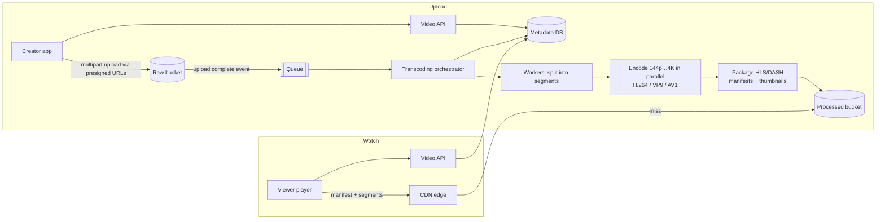
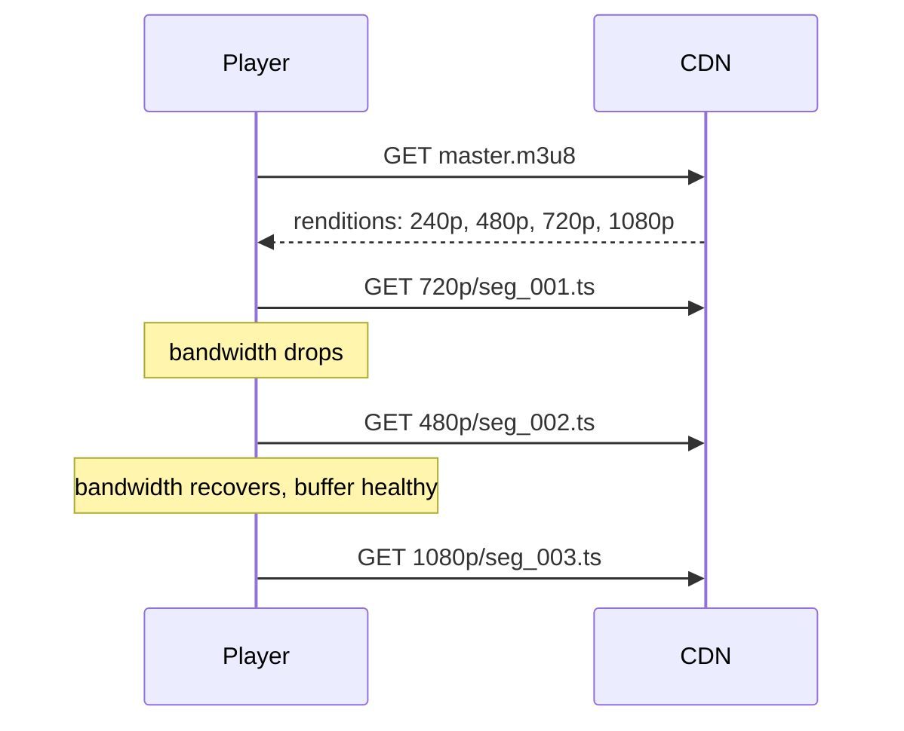

<!-- tab: HLD -->

## Requirements

**Functional**
1. Upload videos (up to several GB).
2. Watch videos with smooth playback on any device and network.
3. Search, view counts, likes (mention, don't design deeply unless asked).

**Non-functional**
- Uploads are resumable; processing can take minutes.
- Playback starts in under 2 s and adapts to bandwidth; very high availability for viewing.
- Scale: 1B DAU, 500 hours of video uploaded per minute, ~5 videos watched per user per day.
- Eventual consistency is fine for counts and metadata.

## Estimation
- Uploads: 500 h/min × 60 × 24 ≈ 720K hours/day. At ~1 GB/hour raw and ~3× after multiple renditions ≈ 2 PB/day of new storage.
- Views: 5B/day ≈ 60K starts/s. At 5 Mbps average for 10 minutes, egress is enormous: **the CDN is the system**.

## API

```http
POST /v1/videos              { title, description }  → { videoId, uploadUrls[] (presigned, per part) }
PUT  {presigned part URL}    (client uploads chunks directly to object storage)
POST /v1/videos/{id}/complete
GET  /v1/videos/{id}         → metadata + manifest URL (HLS/DASH)
```

## High-level design



## Deep dive: upload and processing
- **Multipart, resumable upload**: the client splits the file into ~10 MB parts, uploads each to a presigned URL, retries failed parts, then calls complete. App servers never touch the bytes.
- **Transcoding DAG**: split the video into short chunks (a few seconds each), encode each chunk into every resolution and codec **in parallel** on many workers, then stitch. A DAG scheduler tracks tasks; failed tasks are retried individually.
- Status in metadata: `UPLOADING → PROCESSING → READY` (or `FAILED`); the creator gets notified.
- Also generated: thumbnails, captions (speech-to-text), content moderation checks.

## Deep dive: adaptive bitrate streaming



The video is stored as 2–10 second segments per rendition plus a manifest (HLS `.m3u8` or DASH `.mpd`). The **player** measures throughput and buffer level and picks the rendition for each next segment. Plain HTTP GETs make segments easy to cache on CDNs.

## Deep dive: CDN and cost
- Popular videos are pushed to edge caches; the long tail is pulled on demand from regional caches and origin.
- Most views go to a small fraction of videos, so edge hit rates are high. Big platforms place caches inside ISPs (Netflix Open Connect, Google Global Cache).
- Store rarely watched renditions in colder, cheaper storage tiers.

## Other parts
- **Metadata**: MySQL sharded by video ID (YouTube used Vitess), cached heavily.
- **View counts**: increment in a stream (Kafka) and aggregate; exact real-time counts aren't required.
- **Search**: Elasticsearch over titles, descriptions, captions.
- **Recommendations**: offline ML pipelines; out of scope unless asked.

<!-- tab: Interview -->

### Q: Why transcode into many resolutions?
Devices and networks differ. Adaptive bitrate needs the same video at several bitrates so the player can switch per segment without stalling.

### Q: Why split videos into segments?
Parallel encoding (faster processing), cacheable small objects on CDNs, resumable playback and seeking, and switching quality between segments.

### Q: How do you make huge uploads reliable?
Multipart upload to object storage with presigned URLs; each part retried independently; the server assembles parts on complete. The client stores progress so it can resume after the app restarts.

### Q: Where does most of the cost go?
Egress bandwidth. Hence CDNs, ISP-embedded caches, efficient codecs (VP9/AV1 save 30–50% over H.264), and serving lower bitrates on mobile.

```quiz
Q: In HLS, the player chooses the quality of each next segment based on…
* Measured throughput and buffer level
- The server's CPU load
- The user's account type
- Random selection
> Adaptive bitrate logic runs in the client.

Q: Why encode chunks of a video in parallel?
- Smaller files
* Much faster processing on many workers
- Better audio
- Required by HLS
> Splitting turns one long job into many short ones.

Q: Upload bytes should flow…
- Through API servers into the database
* Directly from the client to object storage via presigned URLs
- Over WebSockets to workers
- Through the CDN to the database
> Keeps app servers out of the heavy data path.
```
