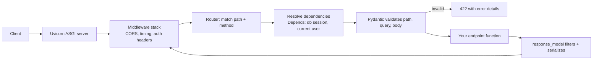
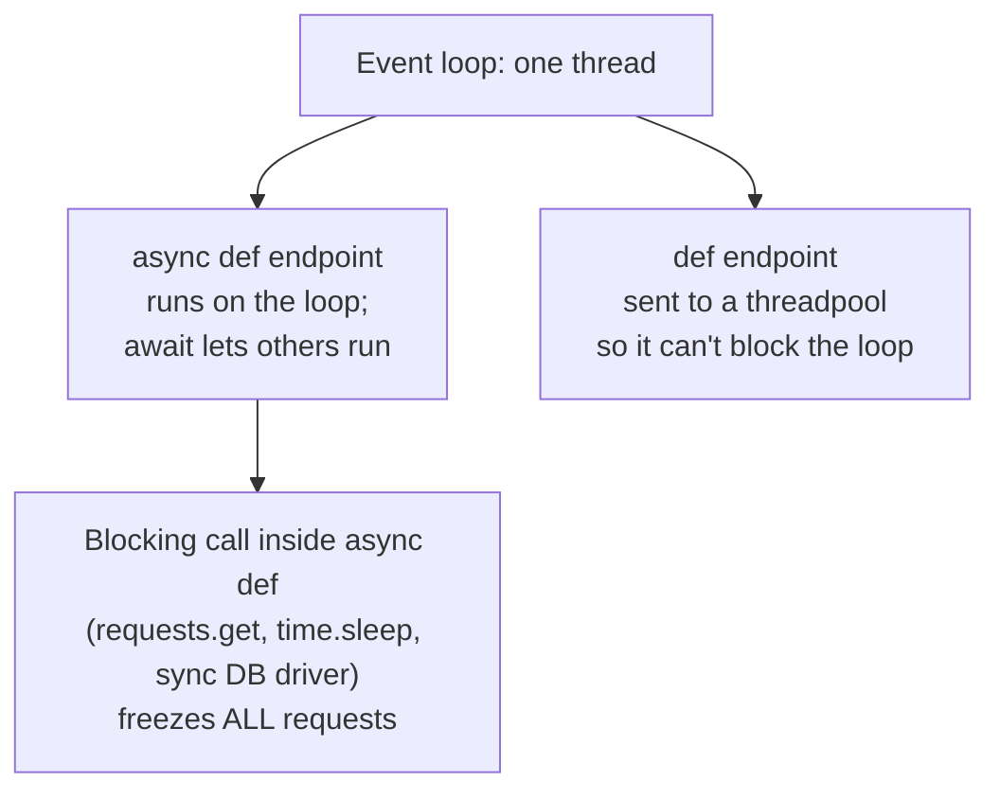

<!-- tab: Core ideas -->

## What FastAPI is
A Python web framework on **Starlette** (ASGI web toolkit) and **Pydantic** (validation via type hints). Type hints drive request parsing, validation, serialization and the auto-generated **OpenAPI docs** at `/docs` (Swagger UI) and `/redoc`. Served by an ASGI server such as **Uvicorn**.

## Request lifecycle



## A complete CRUD example

```python
from fastapi import FastAPI, Depends, HTTPException, status, Query
from pydantic import BaseModel, Field, EmailStr
from sqlalchemy.orm import Session

app = FastAPI(title="Notes API")

class NoteIn(BaseModel):
    title: str = Field(min_length=1, max_length=120)
    body: str = ""

class NoteOut(NoteIn):
    id: int
    model_config = {"from_attributes": True}     # read from ORM objects (Pydantic v2)

def get_db():
    db = SessionLocal()
    try:
        yield db                                   # dependency with teardown
    finally:
        db.close()

@app.post("/notes", response_model=NoteOut, status_code=status.HTTP_201_CREATED)
def create_note(note: NoteIn, db: Session = Depends(get_db)):
    obj = Note(**note.model_dump()); db.add(obj); db.commit(); db.refresh(obj)
    return obj

@app.get("/notes/{note_id}", response_model=NoteOut)
def read_note(note_id: int, db: Session = Depends(get_db)):          # path param, validated as int
    obj = db.get(Note, note_id)
    if not obj:
        raise HTTPException(status_code=404, detail="Note not found")
    return obj

@app.get("/notes", response_model=list[NoteOut])
def list_notes(skip: int = 0, limit: int = Query(20, le=100), db: Session = Depends(get_db)):   # query params
    return db.query(Note).offset(skip).limit(limit).all()
```

Parameter sources: in the path template → **path**; simple type not in path → **query**; Pydantic model → **JSON body**; `Header()`, `Cookie()`, `Form()`, `File()/UploadFile` for the rest.

`response_model` filters output (e.g., never return `hashed_password`) and documents it.

## Dependency injection

`Depends` declares something the endpoint needs; FastAPI resolves the graph per request, caches each dependency once per request, and runs `yield` teardown afterwards. Used for DB sessions, auth, pagination, settings. Override in tests with `app.dependency_overrides[get_db] = fake_db`.

```python
oauth2 = OAuth2PasswordBearer(tokenUrl="token")

def current_user(token: str = Depends(oauth2), db: Session = Depends(get_db)) -> User:
    try:
        payload = jwt.decode(token, SECRET, algorithms=["HS256"])
    except JWTError:
        raise HTTPException(401, "Invalid token", headers={"WWW-Authenticate": "Bearer"})
    user = db.get(User, int(payload["sub"]))
    if not user: raise HTTPException(401, "User not found")
    return user

@app.get("/me", response_model=UserOut)
def me(user: User = Depends(current_user)):
    return user
```

<!-- tab: Async & production -->

## async def vs def



- Use `async def` with async libraries (`httpx.AsyncClient`, `asyncpg`, SQLAlchemy async, `aioredis`) and `await` them.
- Use plain `def` for blocking libraries; FastAPI runs it in a threadpool.
- CPU-heavy work doesn't belong in either — offload to a worker (Celery, RQ, Arq) or a process pool.

> [!TRAP]
> `async def` + `time.sleep(5)` or `requests.get(...)` blocks the event loop: every other request waits. This is the most common FastAPI bug.

**Concurrency vs parallelism**: async gives concurrency on one thread while waiting on I/O; parallelism needs multiple processes (`uvicorn --workers 4` or gunicorn with uvicorn workers) because of the GIL.

## Background tasks
`BackgroundTasks` runs a function after the response is sent (send an email). It runs in the same process — not durable; use Celery/Kafka for anything that must not be lost or takes long.

## Middleware, CORS, lifespan

```python
from contextlib import asynccontextmanager
from fastapi.middleware.cors import CORSMiddleware

@asynccontextmanager
async def lifespan(app: FastAPI):
    app.state.redis = await create_redis()       # startup
    yield
    await app.state.redis.close()                # shutdown

app = FastAPI(lifespan=lifespan)
app.add_middleware(CORSMiddleware, allow_origins=["https://myapp.com"], allow_methods=["*"], allow_headers=["*"])

@app.middleware("http")
async def timing(request, call_next):
    start = time.perf_counter()
    response = await call_next(request)
    response.headers["X-Process-Time"] = f"{time.perf_counter() - start:.4f}"
    return response
```

## Project structure

```text
app/
  main.py            # create app, include routers, middleware
  api/routes/        # APIRouter per resource: users.py, notes.py
  schemas/           # Pydantic models (in/out)
  models/            # SQLAlchemy ORM models
  services/          # business logic (no HTTP here)
  db.py              # engine, SessionLocal, get_db
  core/config.py     # settings via pydantic-settings (.env)
tests/               # pytest + TestClient / httpx.AsyncClient
alembic/             # migrations
```

## Testing

```python
from fastapi.testclient import TestClient
client = TestClient(app)

def test_create_note():
    r = client.post("/notes", json={"title": "hi"})
    assert r.status_code == 201 and r.json()["title"] == "hi"

def test_validation():
    assert client.post("/notes", json={"title": ""}).status_code == 422
```

## Production checklist
Uvicorn/Gunicorn with multiple workers behind nginx or a load balancer; connection pooling; Alembic migrations; pydantic-settings for config; structured logging; rate limiting (slowapi or gateway); health endpoint; pagination; idempotency keys on POSTs that create payments/orders; Docker image.

## FastAPI vs Flask vs Django

| | FastAPI | Flask | Django |
|---|---|---|---|
| Interface | ASGI (async native) | WSGI | WSGI + ASGI |
| Validation/docs | Built in (Pydantic, OpenAPI) | Extensions | DRF serializers |
| Batteries | Minimal | Minimal | ORM, admin, auth |
| Best for | APIs, ML serving, I/O-heavy services | Small apps | Full web apps with admin |

<!-- tab: Interview Q&A -->

### Q: Why is FastAPI fast?
It's ASGI on Starlette with an async event loop, so I/O-bound endpoints handle many concurrent requests on one worker; Pydantic v2's core is in Rust. "Fast" also means fast to develop: validation and docs come from type hints.

### Q: What happens if you call a blocking function inside async def?
It blocks the event loop thread, so all concurrent requests on that worker stall. Use the async version, run it with `run_in_threadpool`, or declare the endpoint with plain `def`.

### Q: How does dependency injection work in FastAPI?
Parameters with `Depends(fn)` are resolved before the endpoint runs; dependencies can depend on others, results are cached per request, and generator dependencies run teardown after the response. Tests swap them with `dependency_overrides`.

### Q: How do you implement authentication?
OAuth2 password flow: `/token` verifies the password (bcrypt hash) and returns a signed JWT with `sub` and `exp`; protected routes depend on `current_user`, which decodes and validates the token. Use HTTPS, short expiry and refresh tokens.

### Q: What status code does FastAPI return for invalid input?
422 Unprocessable Entity with details of which field failed. Customize with an exception handler for `RequestValidationError`.

### Q: Path vs query vs body parameters?
Path: part of the URL template `/items/{id}`. Query: other simple-typed parameters `?skip=0`. Body: Pydantic model parameters, parsed from JSON.

<!-- tab: MCQs -->

```quiz
Q: FastAPI is built on top of…
- Flask and Marshmallow
* Starlette and Pydantic
- Django and DRF
- Tornado and attrs
> Starlette for web, Pydantic for data.

Q: The default status code for a failed request validation is…
- 400
* 422
- 404
- 500
> Unprocessable Entity.

Q: A plain def endpoint in FastAPI runs…
- On the event loop
* In a threadpool
- In a separate process
- Only at startup
> So blocking code doesn't freeze the loop.

Q: Which server typically runs FastAPI?
- Gunicorn sync workers only
* Uvicorn (ASGI)
- Apache mod_wsgi
- Tomcat
> Gunicorn can manage Uvicorn workers.

Q: response_model is used to…
* Validate, filter and document the response
- Define the database table
- Set CORS headers
- Run background jobs
> Hides fields not in the model.

Q: A parameter of a Pydantic model type is read from…
- Query string
- Path
* Request body (JSON)
- Headers
> Simple types become query parameters.

Q: Where should a heavy CPU task (video encoding) run?
- Inside async def
- In BackgroundTasks
* In a separate worker (Celery/RQ) or process pool
- In middleware
> Keep request workers free.

Q: Auto-generated interactive docs are at…
- /swagger.json only
* /docs
- /admin
- /api
> /redoc too; schema at /openapi.json.

Q: Dependencies declared with yield are useful for…
* Setup and teardown, like opening and closing a DB session
- Streaming responses
- Faster routing
- WebSockets only
> Code after yield runs after the response.

Q: To override a dependency in tests you use…
- monkeypatch only
* app.dependency_overrides
- environment variables
- a new FastAPI instance per test always
> Swap get_db for a test session.
```
