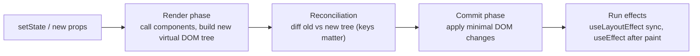
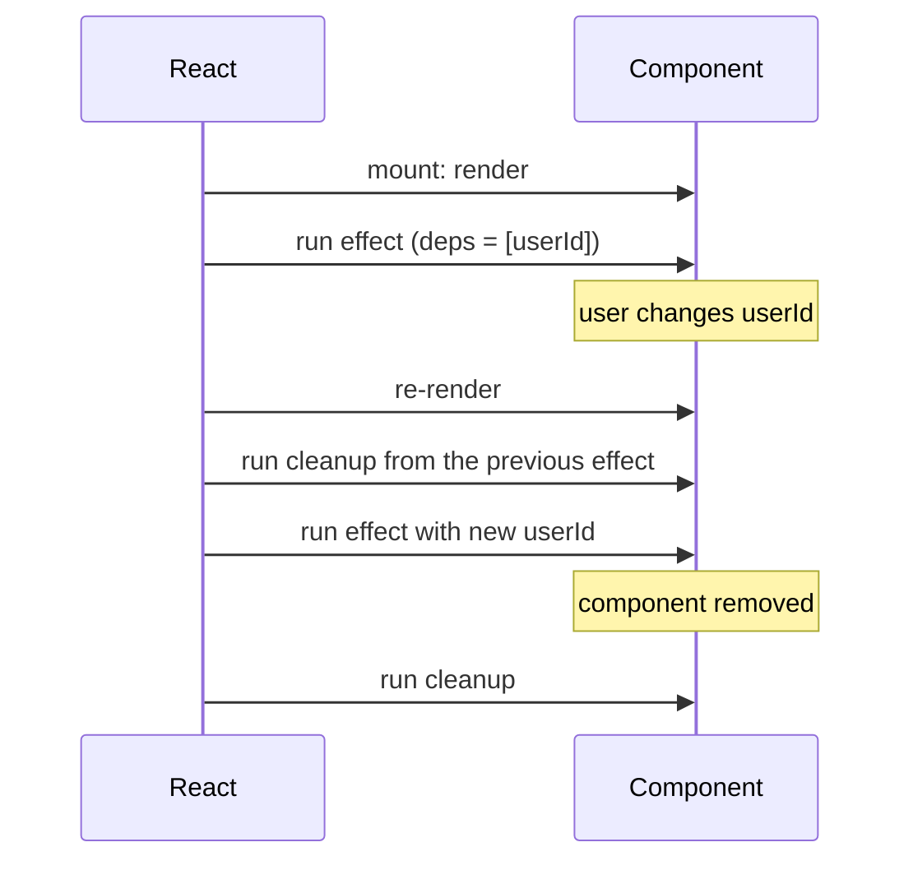

<!-- tab: Core ideas -->

## How React renders



- **Components** are functions of props and state that return a description of UI (JSX → `React.createElement` calls).
- **Virtual DOM + reconciliation**: React compares trees; different element types → rebuild the subtree; same type → update props; lists are matched by **key**.
- **Fiber** (React 16+): rendering is split into units of work that can be paused and prioritized (concurrent rendering, `startTransition`).
- A component re-renders when its **state** changes, its **parent re-renders**, or a **context** it uses changes. Props changing is a consequence of the parent re-rendering.
- Render must be **pure**: no side effects; React 18 Strict Mode calls components and effects twice in development to catch impurity.

## Props vs state

| Props | State |
|---|---|
| Passed from parent; read-only | Owned by the component; changed with a setter |
| Changing requires the parent to re-render | `setState` schedules a re-render |

**Lifting state up**: move shared state to the nearest common parent. **One-way data flow**: data goes down via props; events go up via callbacks.

## Keys

```jsx
{todos.map(t => <TodoItem key={t.id} todo={t} />)}
```

> [!TRAP]
> Using the array index as key breaks when items are inserted, removed or reordered: React reuses the wrong component instance, so input text and local state appear on the wrong row.

## Controlled vs uncontrolled inputs

```jsx
function Login() {
  const [email, setEmail] = useState("");                // controlled: React state is the source of truth
  const passwordRef = useRef(null);                      // uncontrolled: DOM holds the value
  const submit = e => { e.preventDefault(); login(email, passwordRef.current.value); };
  return (
    <form onSubmit={submit}>
      <input value={email} onChange={e => setEmail(e.target.value)} />
      <input type="password" ref={passwordRef} />
      <button>Sign in</button>
    </form>
  );
}
```

<!-- tab: Hooks -->

## The hooks you must know

| Hook | Use |
|---|---|
| `useState` | Local state; setter can take a function `setN(n => n + 1)` for updates based on previous state |
| `useEffect` | Side effects after paint: fetching, subscriptions, timers; return a cleanup |
| `useLayoutEffect` | Runs before paint; measure DOM synchronously |
| `useRef` | Mutable value that persists without re-rendering; DOM refs |
| `useMemo` | Cache an expensive computed value between renders |
| `useCallback` | Cache a function identity (for memoized children or effect deps) |
| `useContext` | Read a context value without prop drilling |
| `useReducer` | State with complex transitions (`dispatch(action)`) |

**Rules of hooks**: call them only at the top level of a component or custom hook (not in loops, conditions or nested functions), because React identifies hooks by call order.

## useEffect lifecycle



```jsx
function Profile({ userId }) {
  const [user, setUser] = useState(null);
  useEffect(() => {
    const ctrl = new AbortController();               // cancel stale requests (race conditions)
    fetch(`/api/users/${userId}`, { signal: ctrl.signal })
      .then(r => r.json()).then(setUser).catch(() => {});
    return () => ctrl.abort();                         // cleanup on change/unmount
  }, [userId]);                                        // re-run only when userId changes
  if (!user) return <Spinner />;
  return <h1>{user.name}</h1>;
}
```

Dependency array: none → every render; `[]` → once after mount; `[a, b]` → when a or b changes (compared with `Object.is`).

> [!TRAP]
> **Stale closure**: an effect or callback captures the state from the render it was created in. `setInterval(() => setCount(count + 1), 1000)` with `[]` deps keeps adding to 0 — use `setCount(c => c + 1)`.

## Custom hooks

```jsx
function useDebounce(value, delay = 300) {
  const [v, setV] = useState(value);
  useEffect(() => { const t = setTimeout(() => setV(value), delay); return () => clearTimeout(t); }, [value, delay]);
  return v;
}
```

<!-- tab: Performance & architecture -->

## Avoiding unnecessary renders
- `React.memo(Component)` skips re-render if props are shallow-equal.
- Pass stable props: `useCallback` for handlers, `useMemo` for objects/arrays, otherwise memo is useless (new reference every render).
- Keep state as low as possible; split contexts (every consumer re-renders when a context value changes).
- **Virtualize** long lists (react-window); **code split** with `React.lazy` + `Suspense`; debounce input-driven work.
- Measure first with the React DevTools Profiler.

## State management

| Need | Tool |
|---|---|
| Local UI state | `useState` / `useReducer` |
| Shared across a subtree | Context (low-frequency updates: theme, auth) |
| Global app state, frequent updates | Redux Toolkit, Zustand |
| **Server state** (cache, refetch, loading/error) | TanStack Query (React Query), SWR |

## Rendering strategies

| | CSR | SSR | SSG | ISR |
|---|---|---|---|---|
| HTML built | In the browser | Per request on server | At build time | At build, regenerated periodically |
| First paint / SEO | Slow / weak | Fast / good | Fastest / good | Fast / good |
| Example | Vite SPA | Next.js `getServerSideProps` / server components | Docs, blogs | Product pages |

**Hydration**: attaching event handlers to server-rendered HTML. **React Server Components**: components that run only on the server and send no JS.

## Error boundaries
Class components with `componentDidCatch` / `getDerivedStateFromError` catch render errors in their subtree and show a fallback. They don't catch errors in event handlers or async code.

## Class lifecycle → hooks mapping
`componentDidMount` → `useEffect(…, [])`; `componentDidUpdate` → `useEffect(…, [deps])`; `componentWillUnmount` → effect cleanup; `shouldComponentUpdate` → `React.memo`.

<!-- tab: Interview Q&A -->

### Q: What is the virtual DOM and why is it useful?
An in-memory tree describing the UI. React diffs the new tree against the old one and applies only the needed DOM updates, batching them. The win is a declarative programming model with acceptable performance, not that the DOM is "slow".

### Q: Why are keys needed in lists?
So reconciliation can match items between renders. Stable unique keys let React move, insert and delete correctly; index keys cause state to attach to the wrong item when the list changes.

### Q: useMemo vs useCallback?
`useMemo(() => compute(a), [a])` caches a value; `useCallback(fn, [deps])` caches a function (same as `useMemo(() => fn, deps)`). Both only help when reference stability matters or the computation is expensive.

### Q: Why doesn't state update immediately after setState?
Updates are scheduled and batched (automatic batching in React 18); the new value is visible on the next render. Use the functional updater when the new state depends on the old.

### Q: How do you fetch data correctly in useEffect?
Dependency array with the inputs, cleanup that aborts or ignores stale responses, loading and error states. In real apps prefer React Query or framework loaders.

### Q: What causes a component to re-render?
Its state changes, its parent re-renders, or a context it consumes changes. Not prop changes on their own.

### Q: Context vs Redux?
Context is a dependency-injection mechanism: every consumer re-renders when the value changes, fine for rarely changing data. Redux/Zustand provide a store with selective subscriptions, middleware and devtools for frequently changing global state.

<!-- tab: MCQs -->

```quiz
Q: Hooks must be called…
- Inside loops for each item
* At the top level of components or custom hooks
- Only in class components
- Inside conditions to save work
> React relies on call order.

Q: useEffect with an empty dependency array runs…
- On every render
* Once after the first render (mount)
- Before the first render
- Never
> Its cleanup runs on unmount.

Q: Which hook persists a mutable value without causing re-renders?
- useState
- useMemo
* useRef
- useContext
> Changing ref.current doesn't re-render.

Q: Using array index as key is problematic when…
* Items are reordered, inserted or deleted
- The list is static
- Items have no IDs and never change
- Rendering on the server
> State attaches to the wrong item.

Q: React.memo prevents re-render when…
- State changes
* Props are shallowly equal to the previous props
- Context changes
- The parent unmounts
> Pass stable references for it to work.

Q: Which is best suited for caching server data with refetching?
- useState
- Context
* TanStack Query
- useRef
> Server state has different needs from UI state.

Q: Error boundaries catch errors in…
* Rendering of their child tree
- Event handlers
- setTimeout callbacks
- Server code
> Use try/catch for handlers and async code.

Q: setCount(count + 1) called three times in one handler (count = 0) results in…
* 1
- 3
- 0
- An error
> All three read the same count; use setCount(c => c + 1) for 3.

Q: Data flows in React…
* From parent to child via props (one-way)
- From child to parent via props
- Two-way by default
- Through the DOM
> Children notify parents through callbacks.

Q: Hydration is…
- Fetching data on mount
* Attaching event listeners to server-rendered HTML
- Re-rendering on state change
- Code splitting
> Makes SSR markup interactive.
```
